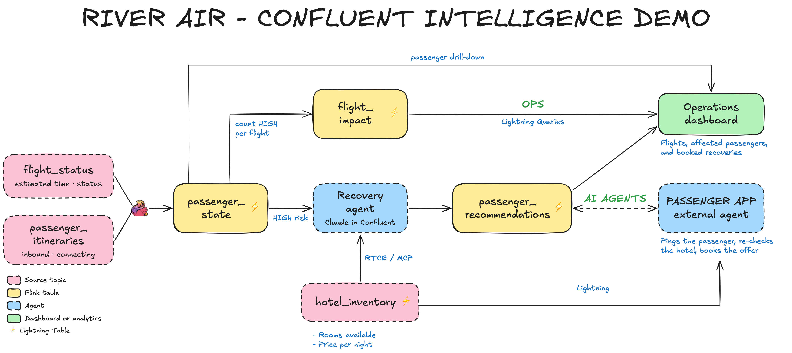

# Streamhouse Quickstart

*Your business, always current.*

A **Streamhouse** is a data architecture that continuously captures, processes, governs, and serves the current state of the business to applications, AI agents, and analytics, so they all work from the same fresh, trusted source of truth. It sits alongside your warehouse or lakehouse, not in place of it.

- **Always current:** data updates as business events happen, not on a batch schedule.
- **Mission critical:** built to production service levels, because the business depends on it.
- **Decentralized:** the same trusted context, in whatever shape each consumer needs, wherever it's needed.

Build one on Confluent Cloud in either of these hands-on labs:

<table>
<tr>
<th width="25%">Lab</th>
<th width="75%">Description</th>
</tr>
<tr>
<td><a href="./docs/flight-disruptions/workshop.md"><strong>Agentic Airline Operations</strong></a></td>
<td>Rebook passengers in real time when a delay breaks their connections. A streaming agent recovers three delayed flights (RA417, RA183, and RA185) while hotel rooms sell out. <a href="https://www.youtube.com/watch?v=4pzIwuhAG2s">Watch the demo video</a>.<br><br></td>
</tr>
<tr>
<td><a href="./docs/agentic-pit-decisions/walkthrough.md"><strong>F1 Agentic Pit Decisions</strong></a></td>
<td>Call every F1 pit stop with anomaly detection and a streaming agent.<br><br></td>
</tr>
</table>

## Prerequisites

1. A [Confluent Cloud](https://cnfl.io/learnwithcflt) account with a payment method, so deploy can create your cluster. Add one under **[Billing & payment](https://confluent.cloud/settings/billing/payment)** → **Payment details and contacts** → **Add credit card / bank account**. Free credit is used first. Don't create a cluster: deploy does.
2. [Git](https://git-scm.com), [uv](https://github.com/astral-sh/uv), [Terraform](https://github.com/hashicorp/terraform), and the [Confluent CLI](https://docs.confluent.io/confluent-cli/current/overview.html).

    <details>
    <summary>for Mac</summary>

    No Homebrew yet? Install it from [brew.sh](https://brew.sh) first.

    ```bash
    brew install git uv
    brew tap hashicorp/tap
    brew install hashicorp/tap/terraform
    brew install --cask confluent-cli
    ```

    </details>

    <details>
    <summary>for Windows</summary>

    1. Open **PowerShell**: Start menu → type **PowerShell** → **Windows PowerShell**.
    2. Install the tools. If winget asks you to accept its terms, enter `Y`.

        ```powershell
        winget install --id Git.Git -e --scope user --source winget
        winget install --id astral-sh.uv -e --source winget
        winget install --id Hashicorp.Terraform -e --source winget
        winget install --id ConfluentInc.Confluent-CLI -e --source winget
        ```

    3. Close PowerShell and open a new window.
    4. When you clone the repo later, do it in your user folder (where PowerShell opens), not OneDrive or Documents. Long paths break the install.

    **Problems?**

    - **`winget` is not recognized:** install [App Installer](https://apps.microsoft.com/detail/9NBLGGH4NNS1) from the Microsoft Store, then open a new PowerShell window.
    - **winget is blocked on your laptop:** install [Git](https://git-scm.com/downloads/win), [uv](https://docs.astral.sh/uv/getting-started/installation/), [Terraform](https://developer.hashicorp.com/terraform/install), and the [Confluent CLI](https://docs.confluent.io/confluent-cli/current/install.html) from their download pages. Unzip Terraform and the Confluent CLI into one folder, add it to your `Path` (Start menu → **Edit environment variables for your account**), then open a new PowerShell window.
    - **Windows on Arm** (Surface Pro X, Copilot+ PCs): after you `cd quickstart-streamhouse`, run `uv venv --python cpython-3.12-windows-x86_64-none` once.

    </details>

## Quick start

```shell
git clone https://github.com/confluentinc/quickstart-streamhouse.git
cd quickstart-streamhouse
```

**Only if you signed up to Confluent Cloud with SSO:** sign in to the Confluent CLI first.

```shell
confluent login
```

Deploy, and pick a lab (or both) when it asks:

```shell
uv run deploy
```

Then continue in your lab's guide after its deploy step: [Agentic Airline Operations](./docs/flight-disruptions/workshop.md#deploy-to-confluent-cloud) (step 4) or [F1 Agentic Pit Decisions](./docs/agentic-pit-decisions/walkthrough.md#1-enhance-the-data-with-built-in-ml-functions-and-start-the-race) (Section 1).

> [!TIP]
>
> **Presenting a demo?** Run `uv run deploy --with-labs` to get everything prebuilt.

## Always-on demo

Operators can run the full demo around the clock on AWS (Lambda and ECS) for colleagues to explore: see the [always-on guide](./docs/flight-disruptions/always-on.md).

## Clean up

Tear everything down. Enter `y` to confirm:

```shell
uv run destroy
```

<details>
<summary>Remove only one lab</summary>

These keep the environment and the other lab.

| To remove | Run |
|---|---|
| Only Agentic Airline Operations | `uv run destroy --lab flight-disruptions` |
| Only Agentic Pit Decisions | `uv run destroy --lab agentic-pit-decisions` |

</details>
