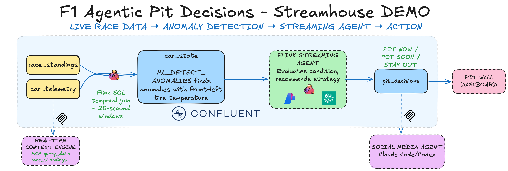

# Streamhouse Quickstart

*Your business, always current.*

A **Streamhouse** is a data architecture that continuously captures, processes, governs, and serves the current state of the business to applications, AI agents, and analytics, so they all work from the same fresh, trusted source of truth. It sits alongside your warehouse or lakehouse, not in place of it.

- **Always current:** data updates as business events happen, not on a batch schedule.
- **Mission critical:** built to production service levels, because the business depends on it.
- **Decentralized:** the same trusted context, in whatever shape each consumer needs, wherever it's needed.

Build one on Confluent Cloud in either of these hands-on labs:

<table>
<tr>
<th width="25%">Lab</th>
<th width="75%">Description</th>
</tr>
<tr>
<td><a href="./docs/flight-disruptions/workshop.md"><strong>Agentic Airline Operations</strong></a></td>
<td>Rebook passengers in real time when a delay breaks their connections. A streaming agent recovers three delayed flights (RA417, RA183, and RA185) while hotel rooms sell out. <a href="https://www.youtube.com/watch?v=4pzIwuhAG2s">Watch the demo video</a>.<br><br></td>
</tr>
<tr>
<td><a href="./docs/agentic-pit-decisions/walkthrough.md"><strong>F1 Agentic Pit Decisions</strong></a></td>
<td>Call every F1 pit stop with anomaly detection and a streaming agent.<br><br></td>
</tr>
</table>

## Prerequisites

1. A [Confluent Cloud](https://cnfl.io/learnwithcflt) account with a payment method, so Terraform can create your cluster. Add one under **[Billing & payment](https://confluent.cloud/settings/billing/payment)** → **Payment details and contacts** → **Add credit card / bank account**. Free credit is used first.
2. [Git](https://git-scm.com), [uv](https://github.com/astral-sh/uv), [Terraform](https://github.com/hashicorp/terraform), and the [Confluent CLI](https://docs.confluent.io/confluent-cli/current/overview.html).

    <details>
    <summary>for Mac</summary>

    No Homebrew yet? Install it from [brew.sh](https://brew.sh) first.

    ```bash
    brew install git uv
    brew tap hashicorp/tap
    brew install hashicorp/tap/terraform
    brew install --cask confluent-cli
    ```

    </details>

    <details>
    <summary>for Windows</summary>

    Open PowerShell (Start menu → type **PowerShell** → **Windows PowerShell**) and run these. If winget asks you to accept its terms, enter `Y`. None of them needs administrator rights.

    ```powershell
    winget install --id Git.Git -e --scope user --source winget
    winget install --id astral-sh.uv -e --source winget
    winget install --id Hashicorp.Terraform -e --source winget
    winget install --id ConfluentInc.Confluent-CLI -e --source winget
    ```

    Then **close PowerShell and open a new window**, so it finds the new tools. Skip any you already have; `git --version`, `uv --version`, `terraform -version`, and `confluent version` each print a version once installed.

    **`winget` is not recognized?** Install [App Installer](https://apps.microsoft.com/detail/9NBLGGH4NNS1) from the Microsoft Store, then open a new PowerShell window and run the commands above.

    **winget or the Store blocked on your work laptop?** Install each tool from its download page instead: [Git](https://git-scm.com/downloads/win), [uv](https://docs.astral.sh/uv/getting-started/installation/), [Terraform](https://developer.hashicorp.com/terraform/install), and the [Confluent CLI](https://docs.confluent.io/confluent-cli/current/install.html). Terraform and the Confluent CLI come as a zip: unzip each to a folder you keep, add that folder to your user `Path` (Start menu → **Edit environment variables for your account**; no administrator rights needed), then open a new PowerShell window.

    **Clone into a short folder**, such as your user folder (PowerShell opens there), rather than deep inside OneDrive or Documents: Windows limits file paths to 260 characters unless an administrator turns long paths on, and the labs' Python packages nest about 120 characters deep.

    **Windows on Arm** (Surface Pro X, Copilot+ PCs): after `cd quickstart-streamhouse` below, run `uv venv --python cpython-3.12-windows-x86_64-none` once. Some of the labs' Python packages have no Arm build yet, and Windows runs the x64 one for you.

    </details>

3. *Optional, only for `uv run setup-mcp`* (the local Confluent MCP server for your coding agent; neither lab needs it): [Node.js 24 LTS](https://nodejs.org/en/download). On Mac, `brew install node@24`. On Windows, `winget install --id OpenJS.NodeJS.24 -e --source winget`, which asks for administrator approval, then open a new PowerShell window. Not `OpenJS.NodeJS.LTS`: that is Node 26, which the MCP server's Kafka client has no prebuilt build for yet.

## Quick start

```shell
git clone https://github.com/confluentinc/quickstart-streamhouse.git
cd quickstart-streamhouse
```

**SSO users only:** sign in to the Confluent CLI.

> [!TIP]
>
> **Signed up with an email and password?** Skip this step. Deploy logs you in to the CLI with them.

Deploy can't log in with single sign-on (SSO), so SSO users sign in to the Confluent CLI first. Enter your email when it asks, then finish signing in in the browser window it opens:

```shell
confluent login
```

Deploy, and pick a lab (or both) when it asks:

```shell
uv run deploy
```

Then follow its guide: [Agentic Airline Operations](./docs/flight-disruptions/workshop.md) or [F1 Agentic Pit Decisions](./docs/agentic-pit-decisions/walkthrough.md).

> [!TIP]
>
> **Presenting a demo?** Run `uv run deploy --with-labs` to get everything prebuilt.

## Always-on demo

Operators can run the full demo around the clock on AWS (Lambda and ECS) for colleagues to explore: see the [always-on guide](./docs/flight-disruptions/always-on.md).

## Clean up

Tear down everything deploy created (the environment, cluster, Flink pool, and both labs) and answer `y`:

```shell
uv run destroy
```

<details>
<summary>Remove only one lab</summary>

These keep the environment and the other lab.

| To remove | Run |
|---|---|
| Only Flight Disruptions | `uv run destroy --lab flight-disruptions` |
| Only Agentic Pit Decisions | `uv run destroy --lab agentic-pit-decisions` |

</details>
