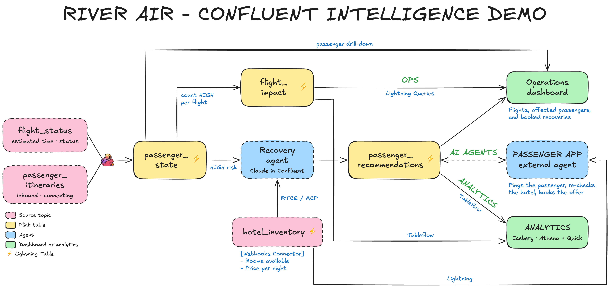
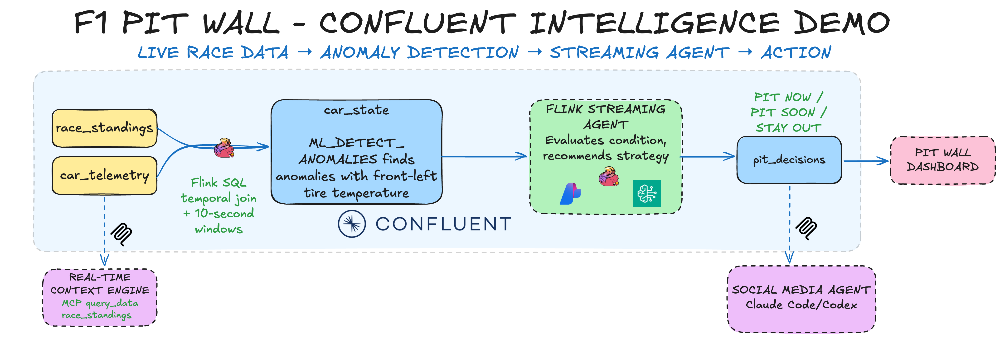

# Streamhouse Quickstart

Two hands-on labs on Confluent Cloud:

<table>
<tr>
<th width="25%">Lab</th>
<th width="75%">Description</th>
</tr>
<tr>
<td><a href="./docs/walkthrough.md"><strong>Flight Disruptions</strong></a></td>
<td>Rebook passengers in real time when a delay breaks their connections.<br><br></td>
</tr>
<tr>
<td><a href="./docs/agentic-pit-decisions/walkthrough.md"><strong>Agentic Pit Decisions</strong></a></td>
<td>Call every F1 pit stop with anomaly detection and a streaming agent.<br><br></td>
</tr>
</table>

## Quick start

You need a [Confluent Cloud](https://www.confluent.io/get-started/) account, [uv](https://github.com/astral-sh/uv), [Terraform](https://github.com/hashicorp/terraform), and the [Confluent CLI](https://docs.confluent.io/confluent-cli/current/overview.html).

```bash
git clone https://github.com/confluentinc/quickstart-streamhouse.git
cd quickstart-streamhouse
uv run deploy
```

Pick a lab, then follow its walkthrough. Clean up with `uv run destroy`.
