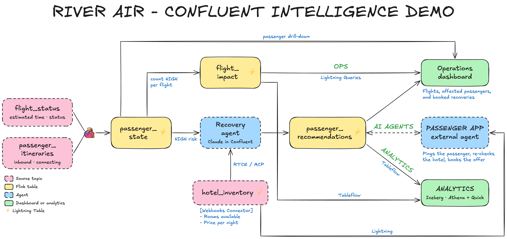
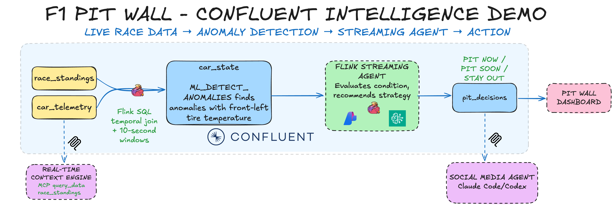

# Streamhouse Quickstart

Two hands-on labs on Confluent Cloud, deployed by one command into one shared environment:

| Lab | What you build | Start here |
|---|---|---|
| **Flight Disruptions** | River Air's flight recovery: Flink connection risk, a recovery agent, Lightning Tables, RTCE, and Tableflow to Iceberg | [Walkthrough](./docs/walkthrough.md) or the [workshop guide](./docs/workshop.md) |
| **Agentic Pit Decisions** | River Racing's pit wall: ML anomaly detection on live F1 telemetry and a streaming agent that calls every pit stop | [Walkthrough](./docs/agentic-pit-decisions/walkthrough.md) |

```bash
uv run deploy
```

Deploy asks which lab to deploy: Flight Disruptions, Agentic Pit Decisions, or both. Both labs run their agents on Claude hosted in Confluent, so neither needs AWS credentials for inference. `uv run deploy --lab agentic-pit-decisions` skips the question.

## Flight Disruptions



River Air runs 180 flights a day through SFO. When flight RA417 from Chicago slips by nearly two hours, 150 of its passengers miss their connections. Flink recomputes every connection as flight updates arrive, maintains `passenger_state` and `flight_impact`, and each at-risk passenger gets two rebooking offers, with a hotel when the wait is overnight. Thirty days of history answer the closing questions in Athena: how many flights were delayed, how many passengers were impacted, what it cost, and how long recovery takes. The [data model](./docs/data-model.md) defines every feed and field.

- **an operations app** through [Lightning Tables](https://docs.confluent.io/cloud/current/lightning/overview.html)
- **AI agents** through the [Real-Time Context Engine](https://docs.confluent.io/cloud/current/ai/real-time-context-engine/overview.html) (MCP)
- **open analytics** through [Tableflow](https://docs.confluent.io/cloud/current/topics/tableflow/overview.html) to Iceberg in S3 with AWS Glue and Athena

### Workshop

Attending the hands-on workshop? Follow the **[self-service workshop guide](./docs/workshop.md)**. In about 60 minutes in your own Confluent Cloud account, you build the Flink tables and the recovery agent yourself and turn on Lightning Tables and RTCE by hand. It covers the live operations and recovery scenes; Tableflow and the Webhooks connector aren't part of it yet.

### Quickstart

Prerequisites: `uv`, `terraform`, the Confluent CLI, and a Confluent Cloud account. The full setup is in the [walkthrough](./docs/walkthrough.md#prerequisites).

```bash
uv run deploy
```

Choose **Flight Disruptions** (or **Both**). Deploy asks for your Confluent Cloud login and API key, provisions everything, publishes 30 days of history and today's flights, starts a 90-minute live stream in the background, enables Lightning Tables and RTCE, and offers to start the app at http://127.0.0.1:8000. Later, `uv run airport-app` restarts the app and `uv run airport-datagen` restarts the scene.

Resource names get a random suffix so workshop deployments can share an org. For a recording, add `TF_VAR_deployment_name=RIVER-AIR-PROD` to `credentials.env` before deploying to get fixed names: `RIVER-AIR-PROD-ENV`, `RIVER-AIR-PROD-CLUSTER`, and so on. Service account names must be unique across the org, so a second fixed deployment needs its own `TF_VAR_deployment_name`. It can still show `RIVER-AIR-PROD` on screen with `TF_VAR_environment_name=RIVER-AIR-PROD`, which renames only the environment, cluster, and compute pool.

Deploy finishes by applying topic tag colors: green for `DATA_PRODUCT`, pink for `PII`, gray for `RAW_DATA`, and blue for `PARTNER_DATA`. Terraform owns the definitions and topic assignments in [tags.tf](./terraform/airline-demo/tags.tf); the Catalog API sets colors because the provider has no color attribute. Run `uv run setup-topic-tags` to restore the configured colors after a manual Terraform update.

`uv run destroy` tears everything down. Replaying the data, running single scenes, troubleshooting, and reset are in the [walkthrough](./docs/walkthrough.md).

### The app

`uv run airport-app` serves the FastAPI app:

- **Operations:** today's 180 flights with delay and passengers at risk, the biggest delays, and a drill-down into each flight's passengers.
- **Passenger:** two offers, live hotel options in place of the biggest delays, a select action, a replacement hotel offer when the chosen room has sold out, and booking.

The browser polls every 2.5 seconds. Lightning credentials stay server-side. A recovery agent (Claude hosted in Confluent, reading RTCE/MCP) writes the live day's offers for RA417; the generator writes every other flight's. Hotel changes publish directly to Kafka because no Webhooks source connector is deployed yet.

## Agentic Pit Decisions



Car #88 streams telemetry from Silverstone while a race simulator runs on your machine. Flink joins it with live race standings in 20-second windows and flags a front-left tire anomaly with `ML_DETECT_ANOMALIES`. A streaming agent reads every lap through `AI_RUN_AGENT` and calls `STAY OUT`, `PIT SOON`, or `PIT NOW`. RTCE, powered by Lightning Tables, then exposes the live race to any MCP client.

```bash
uv run deploy --lab agentic-pit-decisions
uv run f1-race       # terminal 1: the race feed
uv run f1-pitwall    # terminal 2: the Pit Wall at http://localhost:8001
```

You write the Flink SQL yourself by following the [walkthrough](./docs/agentic-pit-decisions/walkthrough.md). `uv run f1-reset` erases the race so you can run the lab again, and `uv run destroy --lab agentic-pit-decisions` removes only this lab.

## Repository layout

| Path | What's there |
|---|---|
| [`scripts/`](./scripts/) | Deploy/destroy, RTCE setup, the generator (`airport_datagen.py`), and the app (`airport_app.py`) |
| [`scripts/pit_decisions/`](./scripts/pit_decisions/) | The race simulator, the Pit Wall, `f1-sql`, and `f1-reset` |
| [`terraform/core/`](./terraform/core/) | Environment, Kafka cluster, Flink compute pool, service accounts, keys |
| [`terraform/airline-demo/`](./terraform/airline-demo/) | The Flight Disruptions pipeline. The Flink SQL in [`sql/`](./terraform/airline-demo/sql/) is the source of truth |
| [`terraform/agentic-pit-decisions/`](./terraform/agentic-pit-decisions/) | The Agentic Pit Decisions source tables and hosted model |
| [`tests/`](./tests/) | `uv run pytest` |
| [`docs/`](./docs/) | Walkthroughs, workshop guide, data model, and architecture diagrams |

Contributors and AI coding agents should read [AGENTS.md](./AGENTS.md).

All data is synthetic. Never commit `credentials.env`.

Licensed under Apache 2.0. See [LICENSE](./LICENSE) and [CHANGELOG.md](./CHANGELOG.md).
