# Agentic Pit Decisions walkthrough

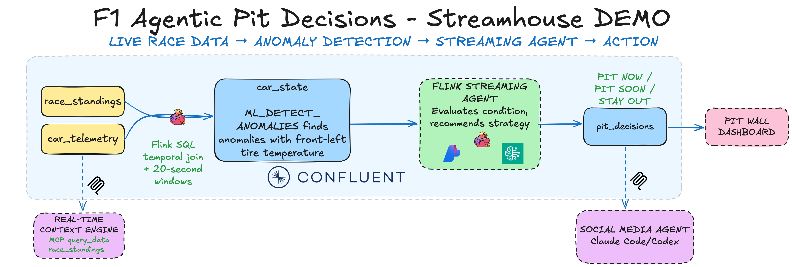

In this ~45-minute lab, River Racing's car #88 streams live telemetry from Silverstone. Flink uses `ML_DETECT_ANOMALIES` to flag a front-left tire anomaly, and a streaming agent running on Confluent-hosted Claude recommends `STAY OUT`, `PIT SOON`, or `PIT NOW` on every lap. You'll provision your own Confluent Cloud environment with `uv run deploy` and run the race simulator locally.

Along the way, you build a small **Streamhouse**: an architecture that continuously captures, processes, and serves the current state of the business. Here the business is a race, and the agent's every call is only as good as how current its view of the car is.

## 0. Prerequisites

> [!TIP]
>
> **Provided a workstation by the workshop host?** Skip this section — it's already set up for you. Continue to [Set up Confluent Cloud](#set-up-confluent-cloud).

<details>
<summary><strong>Prerequisites for your own machine</strong> (click to expand)</summary>

<details>
<summary>for Mac</summary>

No Homebrew yet? Install it from [brew.sh](https://brew.sh) first.

```bash
brew install git uv
brew tap hashicorp/tap
brew install hashicorp/tap/terraform
brew install --cask confluent-cli
```

</details>

<details>
<summary>for Windows</summary>

In PowerShell:

```powershell
winget install --id Git.Git -e
winget install --id astral-sh.uv -e
winget install --id Hashicorp.Terraform -e
```

Download the latest `confluent_*_windows_amd64.zip` from the [Confluent CLI releases](https://github.com/confluentinc/cli/releases/latest), unzip it, and add the folder that contains `confluent.exe` to your `PATH`.

Close and reopen the terminal so every tool is on your `PATH`.

</details>

Check that each tool prints a version:

```bash
git --version
uv --version
terraform -version
confluent version
```

</details>

## Set up Confluent Cloud

#### Step 1 — Create your Confluent Cloud account

1. Go to the **[Confluent Cloud sign-up page](https://cnfl.io/learnwithcflt)**.
2. Enter your **name**, **work email**, **company**, and a **password**, then accept the terms
   and click **Start Free**.
3. On first sign-in, an **onboarding wizard** asks a few questions, then offers to create your
   first cluster.

> [!WARNING]
> **Do NOT create a cluster.** Skip the **Add cluster** / **Create cluster** step — Terraform
> creates its own environment *and* cluster for you. Click the Confluent logo (top-left) to
> exit the wizard.

#### Step 2 — Add a payment method (credit card)

A payment method is required for Terraform to create a **Standard** cluster. Free
credit is used first, so you typically won't be charged during the workshop.

> [!TIP]
> All new sign-ups get **$400 in free credit** to use within the first 30 days — deploying this
> workshop will not get you charged.

1. Go directly to **[Billing & payment](https://confluent.cloud/settings/billing/payment)**.
2. Open the **Payment details and contacts** tab.
3. Click **Add credit card / bank account**, enter your **card details**, then **Save**.

   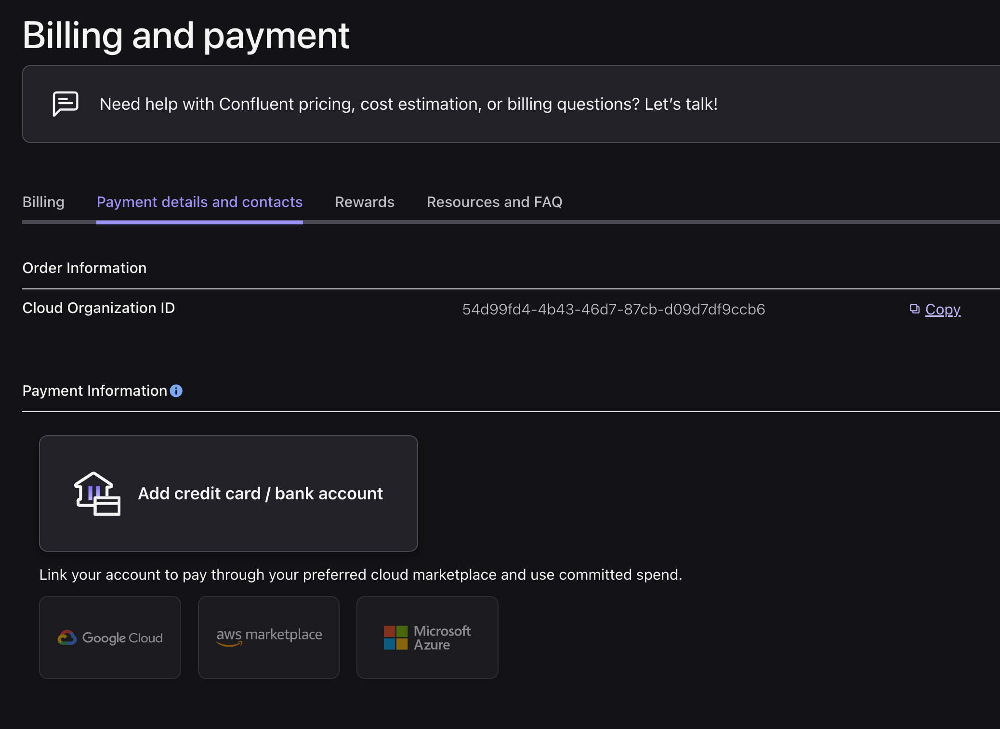

## Deploy to Confluent Cloud

1. Clone the repo and go into it:

    ```bash
    git clone https://github.com/confluentinc/quickstart-streamhouse.git
    cd quickstart-streamhouse
    ```

2. **Only if you signed up to Confluent Cloud with SSO:** sign in to the Confluent CLI first. Skip this if you signed up with email and password.

    ```bash
    confluent login
    ```

3. Deploy your environment:

    ```bash
    uv run deploy
    ```

    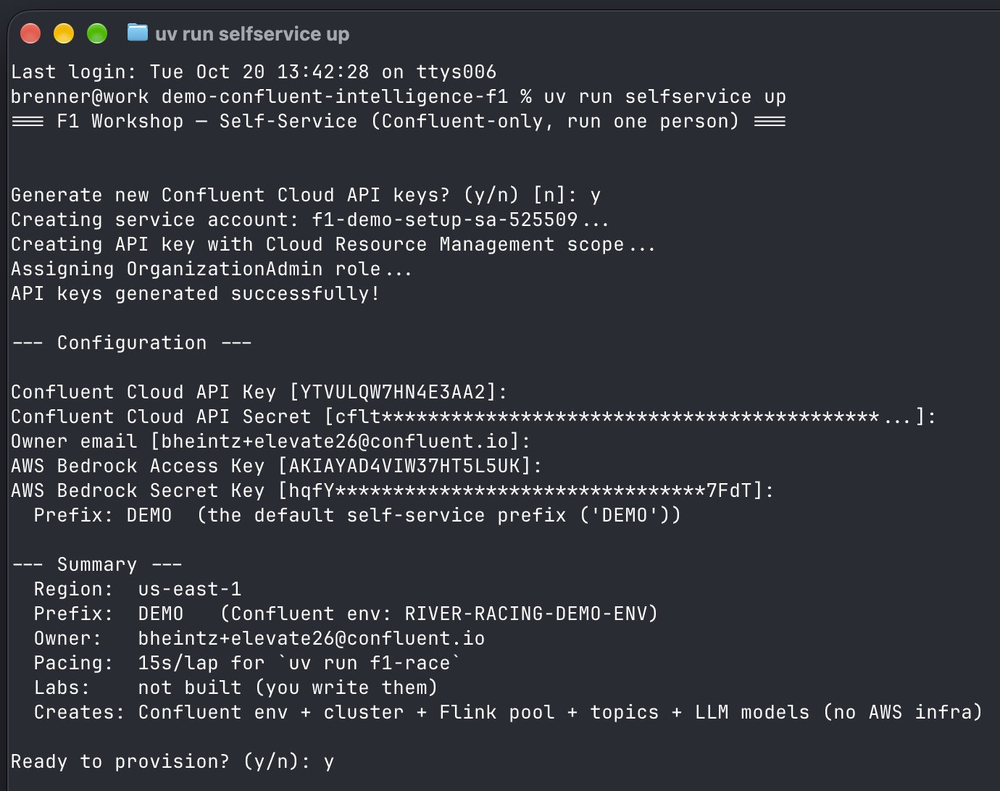

    Deploy asks for the following, in this order:

    | Prompt | Answer |
    |---|---|
    | `Which lab do you want to deploy?` | Enter `2` for **Agentic Pit Decisions**. Deploy builds the lab's starting point, and you build the rest in this walkthrough. |
    | `Email (Enter to skip)` and `Password` | The **email and password you used to sign up**. Deploy checks them with a real login and saves them to `credentials.env`, so later commands log in automatically. **Signed in with SSO in step 2?** Press **Enter** to skip. |
    | `Generate new Confluent Cloud API keys? (y/N)` | Enter `y`. Deploy creates the key and uses it, so it doesn't ask for a key or secret. |
    | `Ready to deploy? (y/n)` | Enter `y`. |

    When it finishes, deploy prints your **catalog** and **database** names, which you need in Section 1.

## 1. Enhance the data with built-in ML functions and start the race

The provisioning step sets up source tables for car telemetry, live race standings, and historical race results. Next, we will create a `car_state` table that joins telemetry with race standings over 20-second tumbling windows and uses Confluent's built-in `ML_DETECT_ANOMALIES` function to flag abnormal front-left tire temperatures. Flink processes each window as the telemetry arrives, not after the race in a batch job.

1. Open the Flink SQL workspace:

    1. Go to the [Flink UI](https://confluent.cloud/go/flink) and select the **environment** deploy created (`streamhouse-…-env`).

        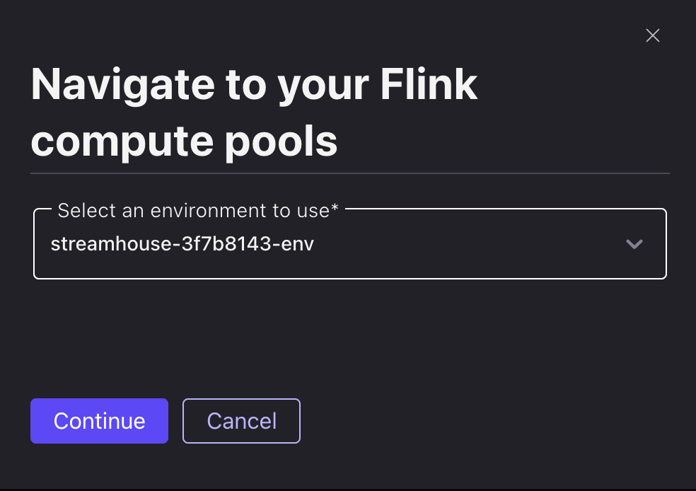

    2. Open a **SQL workspace**.

        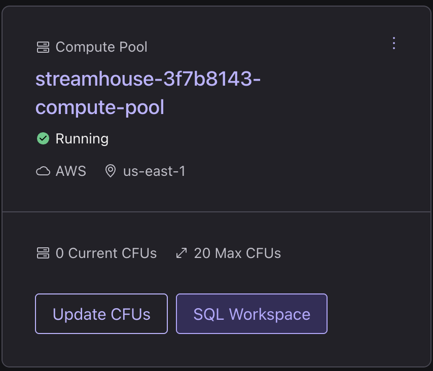

    3. Set the **Catalog** to your environment and the **Database** to your cluster: the names printed at the end of `uv run deploy` (`streamhouse-…-env` and `streamhouse-…-cluster`).

        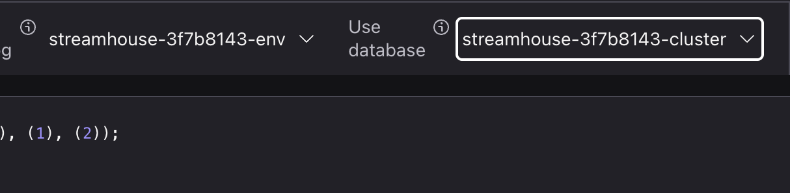

    <details>
    <summary>Optional: Explore the pre-deployed source tables and models</summary>

    ```sql
    SHOW TABLES;
    ```

    | Table | Source | Format |
    |-------|--------|--------|
    | `car_telemetry` | Race simulator — car #88 sensors, every 2s | Avro |
    | `race_standings` | Race simulator — all 22 cars, keyed by `car_number` (upsert) | Avro |
    | `driver_race_history` | 198 historical race rows seeded during setup | JSON |

    ```sql
    SELECT COUNT(*) FROM driver_race_history;
    ```

    ```sql
    SHOW MODELS;        -- llm_textgen_model, Claude hosted in Confluent
    ```

    </details>

2. Paste this statement into one SQL cell and run it. Wait for it to show **Running**.

    ```sql
    CREATE TABLE `car_state` WITH ('changelog.mode' = 'append', 'kafka.consumer.isolation-level' = 'read-uncommitted') AS
    WITH enriched AS (
      SELECT
        t.car_number, t.event_time, t.lap,
        t.tire_temp_fl_c, t.tire_temp_fr_c, t.tire_temp_rl_c, t.tire_temp_rr_c,
        t.tire_pressure_fl_psi, t.tire_pressure_fr_psi, t.tire_pressure_rl_psi, t.tire_pressure_rr_psi,
        t.engine_temp_c, t.brake_temp_fl_c, t.brake_temp_fr_c, t.battery_charge_pct, t.fuel_remaining_kg,
        r.`position`, r.gap_to_ahead_sec, r.gap_to_leader_sec, r.pit_stops, r.tire_compound, r.tire_age_laps
      FROM `car_telemetry` t
      JOIN `race_standings` /*+ OPTIONS('scan.startup.mode'='earliest-offset') */ FOR SYSTEM_TIME AS OF t.event_time AS r ON t.car_number = r.car_number
    ),
    windowed AS (
      SELECT
        window_start, window_end, window_time, car_number, MAX(lap) AS lap,
        AVG(tire_temp_fl_c) AS tire_temp_fl_c, AVG(tire_temp_fr_c) AS tire_temp_fr_c,
        AVG(tire_temp_rl_c) AS tire_temp_rl_c, AVG(tire_temp_rr_c) AS tire_temp_rr_c,
        AVG(tire_pressure_fl_psi) AS tire_pressure_fl_psi, AVG(tire_pressure_fr_psi) AS tire_pressure_fr_psi,
        AVG(tire_pressure_rl_psi) AS tire_pressure_rl_psi, AVG(tire_pressure_rr_psi) AS tire_pressure_rr_psi,
        AVG(engine_temp_c) AS engine_temp_c, AVG(brake_temp_fl_c) AS brake_temp_fl_c, AVG(brake_temp_fr_c) AS brake_temp_fr_c,
        AVG(battery_charge_pct) AS battery_charge_pct, AVG(fuel_remaining_kg) AS fuel_remaining_kg,
        MAX(`position`) AS `position`, MAX(gap_to_ahead_sec) AS gap_to_ahead_sec, MAX(gap_to_leader_sec) AS gap_to_leader_sec,
        MAX(pit_stops) AS pit_stops, MAX(tire_compound) AS tire_compound, MAX(tire_age_laps) AS tire_age_laps
      FROM TABLE(TUMBLE(TABLE enriched, DESCRIPTOR(event_time), INTERVAL '20' SECOND))
      GROUP BY window_start, window_end, window_time, car_number
    ),
    anomaly AS (
      SELECT *,
        ML_DETECT_ANOMALIES(tire_temp_fl_c, window_time,
          JSON_OBJECT('minTrainingSize' VALUE 12, 'maxTrainingSize' VALUE 50, 'confidencePercentage' VALUE 99.99, 'enableStl' VALUE FALSE))
          OVER (PARTITION BY car_number ORDER BY window_time RANGE BETWEEN UNBOUNDED PRECEDING AND CURRENT ROW) AS anomaly_tire_temp_fl_result
      FROM windowed
    )
    SELECT
      car_number, lap,
      tire_temp_fl_c, tire_temp_fr_c, tire_temp_rl_c, tire_temp_rr_c,
      tire_pressure_fl_psi, tire_pressure_fr_psi, tire_pressure_rl_psi, tire_pressure_rr_psi,
      engine_temp_c, brake_temp_fl_c, brake_temp_fr_c, battery_charge_pct, fuel_remaining_kg,
      CASE
        WHEN anomaly_tire_temp_fl_result.is_anomaly AND anomaly_tire_temp_fl_result.actual_value > anomaly_tire_temp_fl_result.upper_bound THEN true
        ELSE false
      END AS anomaly_tire_temp_fl,
      `position`, gap_to_ahead_sec, gap_to_leader_sec, pit_stops, tire_compound, tire_age_laps
    FROM anomaly
    WHERE lap > 0;
    ```

> [!NOTE]
>
> This is a continuous statement — keep this cell **RUNNING** for the whole workshop.

3. Start the race in your local terminal:

    ```bash
    uv run f1-race
    ```

> [!WARNING]
>
> **Leave `f1-race` running for the rest of the lab.** If you stop it, the car stops sending telemetry.

4. Open the Pit Wall dashboard. In a **second terminal**, run:

    ```bash
    uv run f1-pitwall
    ```

    The dashboard at http://localhost:8001 shows the Silverstone track map, the live leaderboard, and car #88's tire and fuel gauges. The **Anomaly Detection** panel unlocks as `car_state` emits rows, and the **AI Pit Strategist** panel unlocks once you create `pit_decisions` in Section 3.

    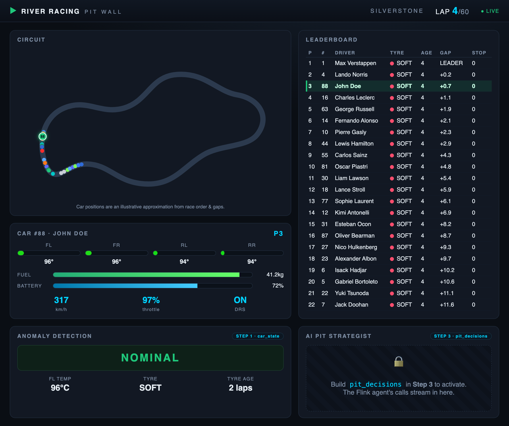

> [!NOTE]
>
> **Leave this running too**, so you can watch the dashboard in Section 4.

5. Back in the Flink SQL workspace, verify the stream in a new SQL cell:

    ```sql
    SELECT car_number, lap, `position`, tire_compound, tire_age_laps, anomaly_tire_temp_fl, tire_temp_fl_c
    FROM `car_state`;
    ```

    `car_state` emits one row per 20-second window. After 12 windows (~4 minutes), it has enough history to detect temperature anomalies on the front-left tire. At lap 24, the tire spikes to ~145°C and `anomaly_tire_temp_fl` becomes `true`.

## 2. Create the agent to provide pit decision guidance

With `car_state` streaming, we can create `pit_strategy_agent` to evaluate car condition and race context on every lap and recommend `STAY OUT`, `PIT SOON`, or `PIT NOW`.

1. Paste and run the `CREATE AGENT` statement in your SQL Workspace:

    ```sql
    CREATE AGENT `pit_strategy_agent`
    USING MODEL `llm_textgen_model`
    USING PROMPT 'OUTPUT FORMAT — respond with exactly these 7 labeled lines in this order. Plain text only, no markdown or bold.

    Suggestion: [PIT NOW | PIT SOON | STAY OUT]
    Condition Summary: [one sentence describing current car condition]
    Race Context: [one sentence on race situation]
    Recommended Compound: [SOFT | MEDIUM | HARD | N/A if STAY OUT]
    Recommended Stint Laps: [integer expected laps on new tires | N/A if STAY OUT]
    Recommended Reason: [one sentence explaining compound choice | N/A if STAY OUT]
    Reasoning: [2-4 sentences full explanation of your decision]

    Correct STAY OUT example:
    Suggestion: STAY OUT
    Condition Summary: Front-left tire temperature is nominal at 107C with 18 laps of age on SOFT compound.
    Race Context: Currently P3. Leader is 8.2s ahead.
    Recommended Compound: N/A
    Recommended Stint Laps: N/A
    Recommended Reason: N/A
    Reasoning: No anomaly has been detected, so tire temps and pressures are within normal operating windows for this stage of the stint. Track position P3 is strong and pitting now would surrender 4-6 seconds.

    Correct PIT NOW example:
    Suggestion: PIT NOW
    Condition Summary: Front-left tire temperature anomaly at 145C, 20C above expected upper bound — failure risk imminent.
    Race Context: Currently P8 with 36 laps remaining.
    Recommended Compound: MEDIUM
    Recommended Stint Laps: 36
    Recommended Reason: Mediums will carry John to the flag across the remaining 36 laps and give him the pace to recover positions lost during the stop.
    Reasoning: The FL anomaly flag indicates the SOFT has gone past its operating limit with blowout risk. Pitting now onto mediums avoids tire failure. Based on historical data, John averages +2.75 positions on SOFT-MEDIUM — this is his strongest strategy.

    ---

    You are the AI pit wall strategist for River Racing at the 2026 British Grand Prix (Silverstone, 60 laps). Driver: John Doe, Car #88.

    DECISION FRAMEWORK — weigh these in priority order:
    1. Anomaly signal: anomaly_tire_temp_fl comes from a trained statistical anomaly detector (ML_DETECT_ANOMALIES) that evaluates tire_temp_fl_c against expected bounds. PIT NOW is reserved for this signal being true — treat it as validated evidence of a real tire problem requiring an immediate stop. When it is false, a raw temperature reading that merely looks high is still within expected bounds for the stint. Nothing else in this input — not tire age, not race context, not competitor behavior — should produce PIT NOW; those inform PIT SOON or STAY OUT instead.
    2. Pit history: a car that has already pitted this race should usually stay out and run its current tires to the end, absent a new anomaly.
    3. Tire age and compound: a SOFT tire past ~20 laps enters its strategic pit window. Call PIT SOON (never PIT NOW) throughout this window when no anomaly is flagged.
    4. Otherwise: default to STAY OUT.

    STRICT OUTPUT VALUES — the Suggestion line must be the exact literal string PIT NOW, PIT SOON, or STAY OUT with no extra text. For STAY OUT, write N/A for Recommended Compound, Recommended Stint Laps, and Recommended Reason.

    TIRE STRATEGY at Silverstone (60-lap race):
    - SOFT: Optimal laps 1-19; degrades in laps 20-22 (PIT SOON window), no failure risk unless the anomaly sensor fires.
    - MEDIUM: Best for a 30-40 lap second stint after SOFT (clean 1-stop).
    - HARD: Durable but slow; only for 40+ lap stints.
    - John Doe historical best: SOFT -> MEDIUM 1-stop averages +2.75 positions over 4 prior races.'
    WITH ('max_iterations' = '10');
    ```

2. Confirm that the agent is registered:

    ```sql
    SHOW AGENTS;
    ```

## 3. Create the pit decisions table

Next we create the `pit_decisions` table, which invokes `pit_strategy_agent` on every row of `car_state` using [`AI_RUN_AGENT`](https://docs.confluent.io/cloud/current/flink/reference/functions/model-inference-functions.html#ai-run-agent) and parses the structured fields. Because it reads `car_state` from `earliest-offset`, it also processes laps that have already arrived.

1. Create the `pit_decisions` table in your SQL Workspace:

    ```sql
    CREATE TABLE `pit_decisions` WITH ('changelog.mode' = 'append', 'kafka.consumer.isolation-level' = 'read-uncommitted') AS
    SELECT
      cs.car_number, cs.lap, cs.`position`,
      cs.tire_compound AS tire_compound_current, cs.tire_age_laps, cs.anomaly_tire_temp_fl,
      TRIM(REGEXP_EXTRACT(CAST(response AS STRING), '\*{0,2}Suggestion:\*{0,2}\s*([^\n]+)', 1)) AS suggestion,
      TRIM(REGEXP_EXTRACT(CAST(response AS STRING), '\*{0,2}Condition Summary:\*{0,2}\s*([^\n]+)', 1)) AS condition_summary,
      TRIM(REGEXP_EXTRACT(CAST(response AS STRING), '\*{0,2}Race Context:\*{0,2}\s*([^\n]+)', 1)) AS race_context,
      NULLIF(TRIM(REGEXP_EXTRACT(CAST(response AS STRING), '\*{0,2}Recommended Compound:\*{0,2}\s*([^\n]+)', 1)), 'N/A') AS recommended_tire_compound,
      CAST(NULLIF(TRIM(REGEXP_EXTRACT(CAST(response AS STRING), '\*{0,2}Recommended Stint Laps:\*{0,2}\s*([^\n]+)', 1)), 'N/A') AS INT) AS recommended_stint_laps,
      NULLIF(TRIM(REGEXP_EXTRACT(CAST(response AS STRING), '\*{0,2}Recommended Reason:\*{0,2}\s*([^\n]+)', 1)), 'N/A') AS recommended_reason,
      TRIM(REGEXP_EXTRACT(CAST(response AS STRING), '\*{0,2}Reasoning:\*{0,2}\s*([\s\S]+?)$', 1)) AS reasoning,
      CAST(response AS STRING) AS raw_response
    FROM `car_state` /*+ OPTIONS('scan.startup.mode'='earliest-offset') */ cs,
    LATERAL TABLE(AI_RUN_AGENT(
      `pit_strategy_agent`,
      CONCAT(
        'CAR STATE — Lap ', CAST(cs.lap AS STRING), ' of 60 | Silverstone British Grand Prix\n',
        'Driver: John Doe (#', CAST(cs.car_number AS STRING), ') | Current Position: P', CAST(cs.`position` AS STRING), '\n',
        '\nTIRE DATA:\n',
        '  Compound: ', cs.tire_compound, ' | Age: ', CAST(cs.tire_age_laps AS STRING), ' laps\n',
        '  FL Temp: ', CAST(ROUND(cs.tire_temp_fl_c, 1) AS STRING), 'C  FR: ', CAST(ROUND(cs.tire_temp_fr_c, 1) AS STRING), 'C  RL: ', CAST(ROUND(cs.tire_temp_rl_c, 1) AS STRING), 'C  RR: ', CAST(ROUND(cs.tire_temp_rr_c, 1) AS STRING), 'C\n',
        '  FL Pressure: ', CAST(ROUND(cs.tire_pressure_fl_psi, 1) AS STRING), 'psi  FR: ', CAST(ROUND(cs.tire_pressure_fr_psi, 1) AS STRING), 'psi  RL: ', CAST(ROUND(cs.tire_pressure_rl_psi, 1) AS STRING), 'psi  RR: ', CAST(ROUND(cs.tire_pressure_rr_psi, 1) AS STRING), 'psi\n',
        '  FL Tire Anomaly Detected: ', CAST(cs.anomaly_tire_temp_fl AS STRING), '\n',
        '\nCAR SYSTEMS:\n',
        '  Engine Temp: ', CAST(ROUND(cs.engine_temp_c, 1) AS STRING), 'C  Brake FL: ', CAST(ROUND(cs.brake_temp_fl_c, 1) AS STRING), 'C  Brake FR: ', CAST(ROUND(cs.brake_temp_fr_c, 1) AS STRING), 'C\n',
        '  Battery: ', CAST(ROUND(cs.battery_charge_pct, 1) AS STRING), '%  Fuel Remaining: ', CAST(ROUND(cs.fuel_remaining_kg, 1) AS STRING), 'kg\n',
        '\nRACE CONTEXT:\n',
        '  Gap to Leader: ', CAST(ROUND(cs.gap_to_leader_sec, 2) AS STRING), 's  Gap to Car Ahead: ', CAST(ROUND(cs.gap_to_ahead_sec, 2) AS STRING), 's\n',
        '  Pit Stops Taken: ', CAST(cs.pit_stops AS STRING), '\n',
        '  Laps Remaining: ', CAST(60 - cs.lap AS STRING)
      ),
      MAP['debug', 'true']
    ));
    ```

> [!NOTE]
>
> This is a continuous statement — keep this cell **RUNNING** for the whole workshop.

## 4. Review the results

1. Query `pit_decisions` in your SQL Workspace to see the streaming recommendations:

    ```sql
    SELECT lap, `position`, suggestion, condition_summary, reasoning
    FROM `pit_decisions`;
    ```

    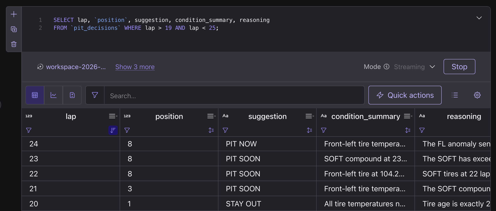

2. Filter for the tire temperature anomaly to inspect the lap 24 pit call:

    ```sql
    SELECT lap, `position`, tire_compound_current, tire_age_laps, anomaly_tire_temp_fl,
           suggestion, recommended_tire_compound, recommended_stint_laps, reasoning
    FROM `pit_decisions`
    WHERE anomaly_tire_temp_fl = true;
    ```

    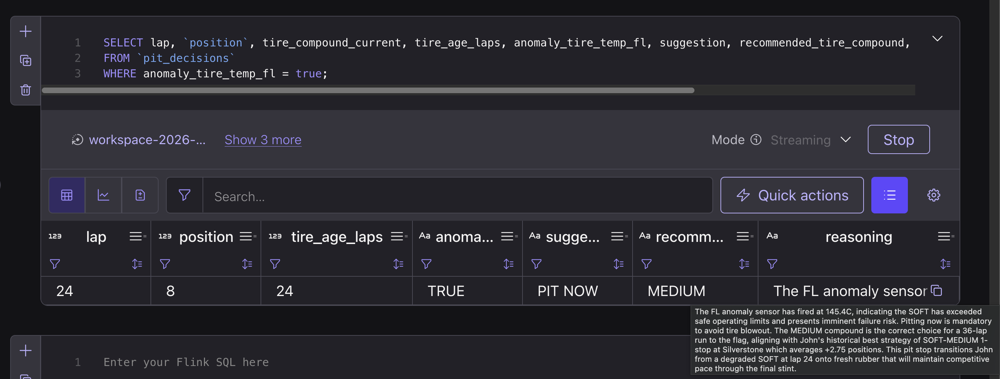

> [!NOTE]
>
> | Lap | Position | Suggestion | What's happening |
> |---|---|---|---|
> | 1–18 | P3 → P1 | `STAY OUT` | Competitive, nominal tire temps |
> | ~19–23 | P1 → P8 | `PIT SOON` | Aging SOFTs enter the strategic pit window |
> | **24** | **P8** | **`PIT NOW`** | **Front-left anomaly (~145°C) triggers an immediate stop** |
> | 25–60 | P14 → P1–P2 | `STAY OUT` | Recovery stint to the flag on fresh MEDIUMs |
>
> `PIT SOON` can start anywhere from about lap 19 to 23. The exact laps vary by run.
>
> The `PIT NOW` call lands on lap 24, the same lap the anomaly appears. An agent reading data even a few laps old would call the stop too late.
>
> As `car_state` and `pit_decisions` produce rows, the Pit Wall dashboard unlocks its **Anomaly Detection** and **AI Pit Strategist** panels:

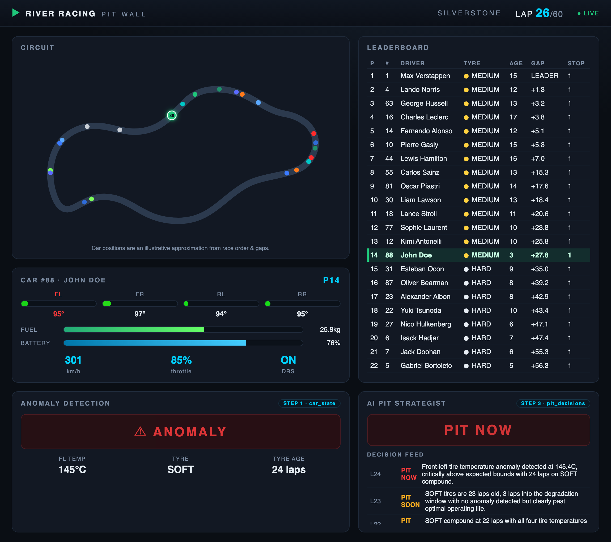

## 5. Enable Lightning Tables on the race topics

Real-Time Context Engine (RTCE), powered by Lightning Tables, exposes a Kafka topic as an MCP tool, so any MCP-compatible AI agent can query the live stream. Other agents get the same live data the pit strategy agent uses, without another copy or pipeline.

Because RTCE reads from Lightning Tables, a topic is available to agents once its **Lightning Table** is enabled. Enable it in the Console for all three race topics: `car_telemetry`, `car_state`, and `pit_decisions`.

1. Open **[Topics](https://confluent.cloud/go/topics)**, select your **environment** (`streamhouse-…-env`) and **cluster** (`streamhouse-…-cluster`), find the **Lightning Tables** column, and click **+ Enable** for `car_telemetry`:

    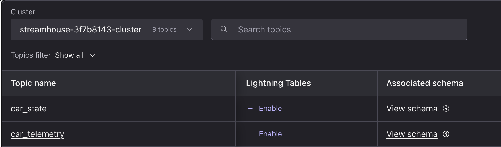

    In the dialog, click **Enable**:

    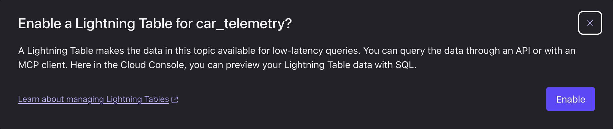

    The dialog shows its progress while it sets up the table:

    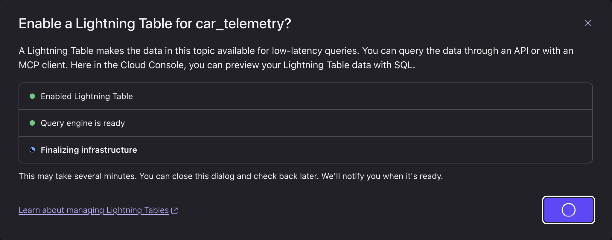

> [!NOTE]
>
> It may take a couple of minutes to enable each Lightning Table.

When it's ready, the dialog shows **Lightning Table is enabled**. Click **Done**:

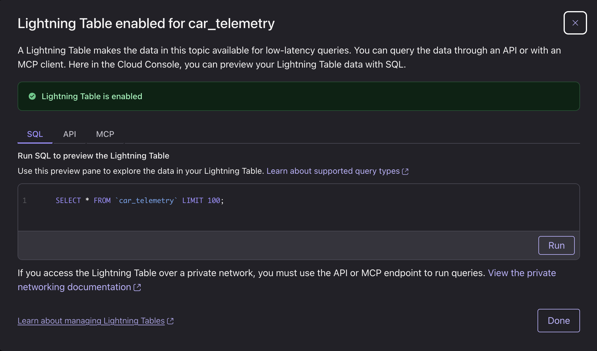

2. Repeat for `car_state` and `pit_decisions`.

## 6. (Optional) Ask your coding agent about the race with Real-Time Context Engine

> [!NOTE]
>
> Run this in a **new terminal**. Keep `f1-race` and `f1-pitwall` running in their own terminals.

1. In a **new terminal**, point your coding agent at RTCE in one command:

    ```bash
    uv run setup-rtce
    ```

    This registers RTCE as the `confluent-streamhouse-rtce` MCP server in Claude Code (or prints a config snippet for Codex CLI) using the Global API key from your credential card. If you also deployed Flight Disruptions, this one MCP server handles topics for both labs. Restart your coding agent, then ask questions in plain English:

    ```text
    What topics do I have access to in the Real-Time Context Engine?
    ```

    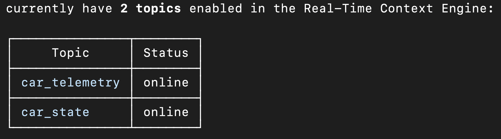

    ```text
    How has the engine temperature been trending over the last few laps?
    ```

    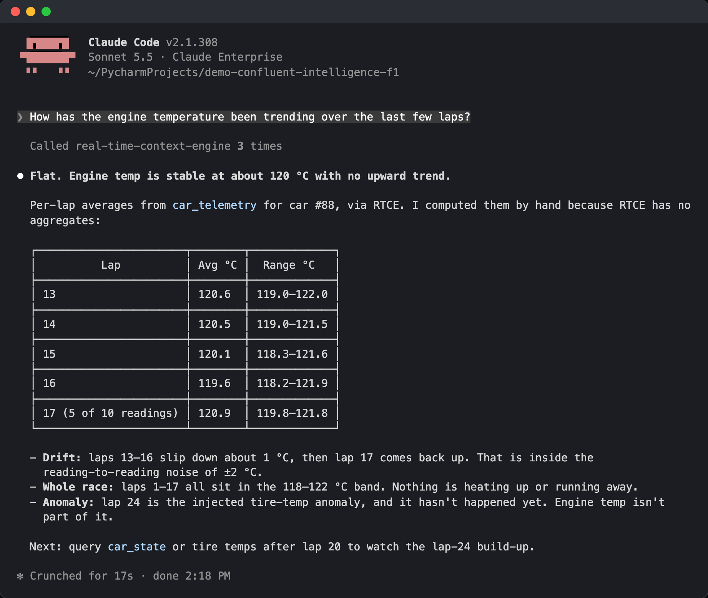

    ```text
    What's the front-left tire temperature on car 88 right now?
    ```

    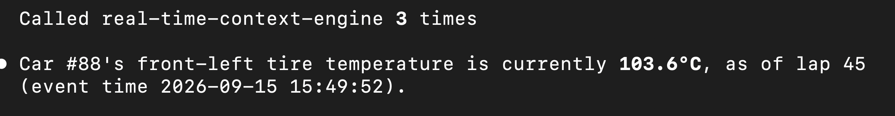

    ```text
    At what lap in the race does the engine temperature peak?
    ```

    ```text
    What is the front right tire temperature at lap 30?
    ```

## 🧩 Challenge #1 — Analyze race data with Lightning Queries

RTCE runs on Lightning Tables, so you can also query the same real-time data directly with Lightning Queries over low-latency REST. It reads the Lightning Tables you enabled in Section 5.

From the repo directory, print a ready-to-run query:

```bash
uv run setup-rtce --lightning car_telemetry
```

Copy the printed `curl` command into your terminal and run it. It returns the last 10 telemetry rows by lap; edit the SQL in `query` to filter for car 88 or select other columns. 

**Your challenge:** edit the `curl` command's `query` to find out what tire compound the agent recommended on lap 24, and why.

<details>
<summary>Hint</summary>

```sql
SELECT lap, <column>, <column> FROM pit_decisions WHERE lap = 24 LIMIT 1
```

Fill in the first `<column>` with the recommended tire compound, and the second with the agent's reasoning for that call.

</details>

## 🧩 (Optional) Challenge #2 — Social Media Agent (Claude + Real-Time Context Engine)

Take on the role of River Racing's social media team. Using live race data from RTCE, have your AI agent draft an engaging social media post:

1. Enable RTCE on the `car_state` and `pit_decisions` topics in the Confluent Cloud Console (the same way you enabled `car_telemetry` above).
2. Create a persona prompt for your agent to help it develop an engaging social media post. 
3. Have your agent draft a post using real time data from your MCP connection. 

Feel free to use one of the following prompts to draft your next post: 
- "We just made a big move — write a post celebrating it."
- "The pit wall just made a call. Draft a post about our strategy."
- "Write a 3-tweet recap thread of John's race so far."

**Success looks like:** Claude calls `queryData` against `car_state` and `pit_decisions` (you'll see the tool calls in the transcript) and returns a drafted post citing the real lap number, position, and strategy call from your live feed — not invented numbers. If it says the feed is quiet, the race may not be running yet, or RTCE isn't enabled on one of the two topics.

## Run the lab again or tear it down

Stop `f1-race` with Ctrl-C when you finish. To clear the race data and rerun the lab from a clean slate, run `f1-reset`. It stops and drops only this lab's statements and tables, leaving any Flight Disruptions resources in the same environment untouched:

```bash
uv run f1-reset
```

After reset, recreate `car_state`, wait for it to show **Running**, then start `uv run f1-race` again (or run `uv run f1-reset --with-labs` to rebuild `car_state`, `pit_strategy_agent`, and `pit_decisions` automatically before starting `uv run f1-race`).

To tear down everything, including the environment and cluster, run:

```bash
uv run destroy
```

<details>
<summary>Remove only this lab</summary>

This keeps the shared environment, cluster, and Flink pool, and Flight Disruptions if you deployed it:

```bash
uv run destroy --lab agentic-pit-decisions
```

</details>

## Troubleshooting

<details>
<summary>Common issues and fixes</summary>

- **`car_state` is empty at first.** `car_state` emits one row per 20-second window, and `f1-race` aligns lap 1 to the next 20-second wall-clock boundary before starting. Make sure `car_state` is **Running** before starting `uv run f1-race`.
- **No anomaly around lap 24.** `ML_DETECT_ANOMALIES` needs 12 windows of context (`minTrainingSize = 12`) before lap 24. If `car_state` was started mid-race after lap 12, reset and start `car_state` before `uv run f1-race`.
- **Agent fields are null but `raw_response` has text.** Inspect `SELECT lap, suggestion, raw_response FROM pit_decisions LIMIT 5;`. If `raw_response` is empty across the board, check that your org can use Confluent-hosted models: `DESCRIBE MODEL llm_textgen_model;` should show `'provider' = 'confluent'`.
- **`No Agentic Pit Decisions credential card`.** Re-run `uv run deploy --lab agentic-pit-decisions` to rewrite `tmp/agentic-pit-decisions-card.env`, or pass `--creds <path>`.

</details>

---

**← Back to Overview**: [Main README](../../README.md)
