# River Air Agentic Airline Operations Workshop

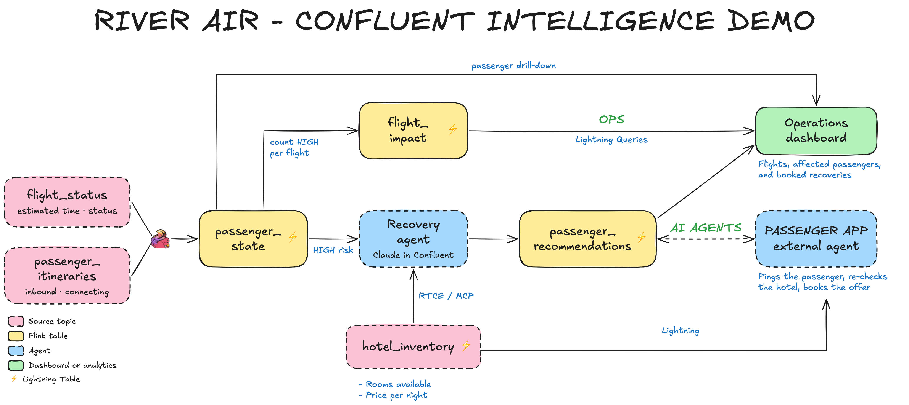

River Air runs 180 flights a day through its SFO hub, and like every airline, its data is spread across systems that weren't built to work together. Passenger itineraries come from ticketing. Flight status and gate times come from the airports' operational systems. Hotel rooms come from a partner.

That leaves River Air with two challenges:

1. **One live view of every flight.** A simple question like *"How many flights are delayed right now?"* turns into a data integration project.
2. **Recovering passengers when a flight is disrupted.** Flight RA417 from Chicago is about to run almost two hours late, and 150 of its passengers will miss their connections. Each one needs a new flight, and some need a hotel, before the rooms sell out.

In this workshop, you deploy a **Streamhouse** on Confluent Cloud: an architecture that keeps the current state of the business ready for apps and agents. It tackles both challenges. You compute every passenger's connection risk with Flink and serve it through Lightning Tables to a live operations dashboard. Then you build a streaming agent that reads live flights and hotel rooms through the Real-Time Context Engine (RTCE) and offers every stranded passenger a new flight and, when needed, a hotel.

**Watch the demo**

<a href="https://www.youtube.com/watch?v=4pzIwuhAG2s">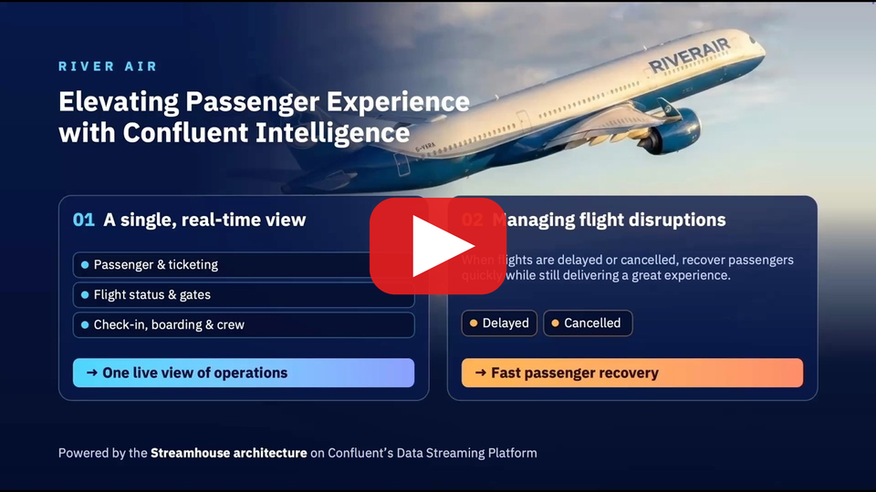</a>

> [!NOTE]
>
> **This workshop takes about 60 minutes to complete.**

| Part | Minutes | What you do |
|---|---|---|
| [Set up Confluent Cloud](#set-up-confluent-cloud) | 5 | Create your account and add a payment method |
| [Prerequisites](#prerequisites) | 5 | Install the tools (skip on a host-provided workstation) |
| [Deploy to Confluent Cloud](#deploy-to-confluent-cloud) | 10 | Clone the repo, deploy your environment, and start the data |
| [Lab 1](#lab-1--explore-the-live-feeds) | 5 | Explore the live feeds |
| [Lab 2](#lab-2--compute-connection-risk-with-flink) | 10 | Compute every passenger's connection risk with Flink |
| [Lab 3](#lab-3--power-a-live-operations-dashboard-with-lightning-tables) | 10 | Turn on Lightning Tables, then open the operations dashboard |
| [Lab 4](#lab-4--build-the-recovery-agent) | 10 | Build the recovery agent |
| [Lab 5](#lab-5--recover-a-passenger) | 5 | Watch hotel rooms change live, then rebook a passenger |
| [Challenge](#-optional-challenge--ask-your-coding-agent-about-the-live-operation) | optional | Ask Claude Code or Codex about the live operation over MCP |
| [Clean up](#clean-up) | 5 | Tear everything down |
| [Skipped a step?](#skipped-a-step) | — | Run `uv run workshop-status` to find the missing step |

## Set up Confluent Cloud

#### Step 1 — Create your Confluent Cloud account

1. Go to the **[Confluent Cloud sign-up page](https://cnfl.io/learnwithcflt)**.
2. Enter your **name**, **work email**, **company**, and a **password**, then accept the terms
   and click **Start Free**.
3. On first sign-in, an **onboarding wizard** asks a few questions, then offers to create your
   first cluster.

> [!WARNING]
> **Don't create a cluster.** Deploy creates one for you. Click the Confluent logo (top-left) to exit the wizard.

#### Step 2 — Add a payment method (credit card)

Deploy needs a payment method to create your cluster. New sign-ups get **$400 in free credit**, so the workshop won't charge your card.

1. Go directly to **[Billing & payment](https://confluent.cloud/settings/billing/payment)**.
2. Open the **Payment details and contacts** tab.
3. Click **Add credit card / bank account**, enter your **card details**, then **Save**.

   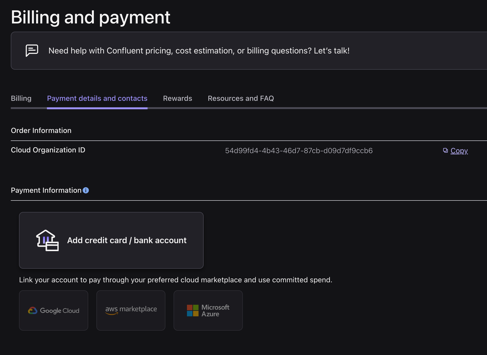

## Prerequisites

> [!TIP]
>
> **Using a host-provided workstation?** Skip to [Deploy to Confluent Cloud](#deploy-to-confluent-cloud).

<details>
<summary>for Mac</summary>

No Homebrew yet? Install it from [brew.sh](https://brew.sh) first.

```bash
brew install git uv
brew tap hashicorp/tap
brew install hashicorp/tap/terraform
brew install --cask confluent-cli
```

</details>

<details>
<summary>for Windows</summary>

1. Open **PowerShell**: Start menu → type **PowerShell** → **Windows PowerShell**.
2. Install the tools. If winget asks you to accept its terms, enter `Y`.

    ```powershell
    winget install --id Git.Git -e --scope user --source winget
    winget install --id astral-sh.uv -e --source winget
    winget install --id Hashicorp.Terraform -e --source winget
    winget install --id ConfluentInc.Confluent-CLI -e --source winget
    ```

3. Close PowerShell and open a new window.
4. When you clone the repo later, do it in your user folder (where PowerShell opens), not OneDrive or Documents. Long paths break the install.

**Problems?**

- **`winget` is not recognized:** install [App Installer](https://apps.microsoft.com/detail/9NBLGGH4NNS1) from the Microsoft Store, then open a new PowerShell window.
- **winget is blocked on your laptop:** install [Git](https://git-scm.com/downloads/win), [uv](https://docs.astral.sh/uv/getting-started/installation/), [Terraform](https://developer.hashicorp.com/terraform/install), and the [Confluent CLI](https://docs.confluent.io/confluent-cli/current/install.html) from their download pages. Unzip Terraform and the Confluent CLI into one folder, add it to your `Path` (Start menu → **Edit environment variables for your account**), then open a new PowerShell window.
- **Windows on Arm** (Surface Pro X, Copilot+ PCs): after you `cd quickstart-streamhouse`, run `uv venv --python cpython-3.12-windows-x86_64-none` once.

</details>

Check that each tool prints a version:

```bash
git --version
uv --version
terraform -version
confluent version
```

## Deploy to Confluent Cloud

1. Clone the repo and go into it:

    ```bash
    git clone https://github.com/confluentinc/quickstart-streamhouse.git
    cd quickstart-streamhouse
    ```

2. **Only if you signed up to Confluent Cloud with SSO:** sign in to the Confluent CLI first. Skip this if you signed up with email and password.

    ```bash
    confluent login
    ```

3. Deploy your environment:

    ```bash
    uv run deploy
    ```

    Deploy asks for the following, in this order:

    | Prompt | Answer |
    |---|---|
    | `Which lab do you want to deploy?` | Enter `1` for **Agentic Airline Operations**. |
    | `Email (Enter to skip)` and `Password` | Your Confluent Cloud email and password. Only asked if you aren't signed in. |
    | `Deploy into an existing environment? Paste its ID (env-xxxxx), or press Enter to create a new one:` | Press **Enter** for a new environment.<br>Or paste an environment ID to deploy into it. |
    | `Ready to deploy … ? (y/n)` | Enter `y`. |

    When it finishes, deploy prints your environment and cluster names, which you need in Lab 2.

> [!NOTE]
>
> Deploy takes about 10 minutes.

4. Start the datagen in a **new terminal** in the `quickstart-streamhouse` folder:

    ```bash
    uv run airport-datagen --skip-history
    ```

    It publishes today's 180 flights, about 13,000 passenger itineraries, tomorrow's schedule, and three hotels, then streams live updates for 90 minutes.

> [!WARNING]
>
> **Leave it running for the rest of the lab.** If it stops, run `uv run airport-datagen --resume`.

## Lab 1 — Explore the live feeds

River Air's data comes from different systems: itineraries from ticketing, flight status from the airports' operational databases, and hotel rooms from a partner. Let's look at them as they arrive.

1. Open **[Topics](https://confluent.cloud/go/topics)** and select your **environment** and **cluster** (`streamhouse-…-cluster`). You see the five topics deploy created: `flight_status`, `passenger_itineraries`, `hotel_inventory`, `flight_telemetry`, and `passenger_recommendations`.

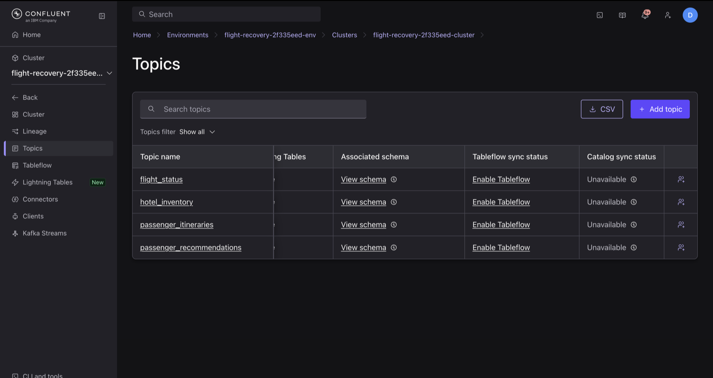

2. Click a topic name, then select **Messages** to view incoming keys and values in real time.

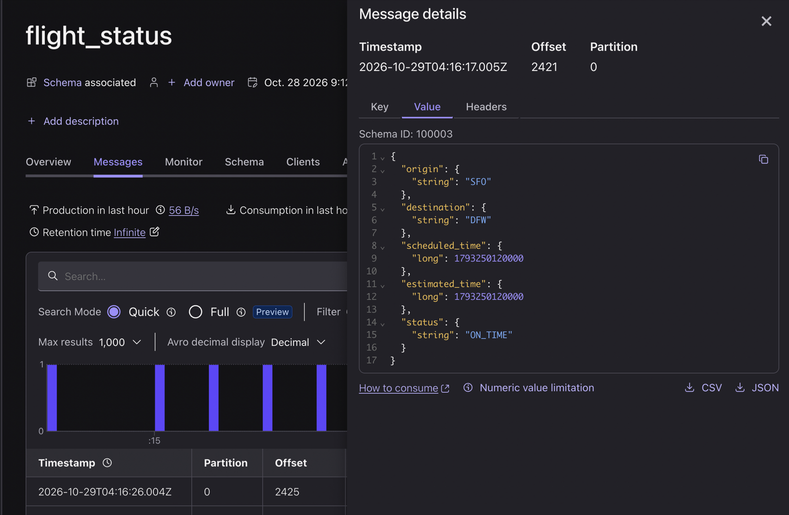

## Lab 2 — Compute connection risk with Flink

Use Flink to join each itinerary with the live status of both flights. Connection risk updates as soon as a flight's delay changes.

1. Open the Flink SQL workspace:

    1. Go to the [Flink UI](https://confluent.cloud/go/flink) and select your **environment**.

        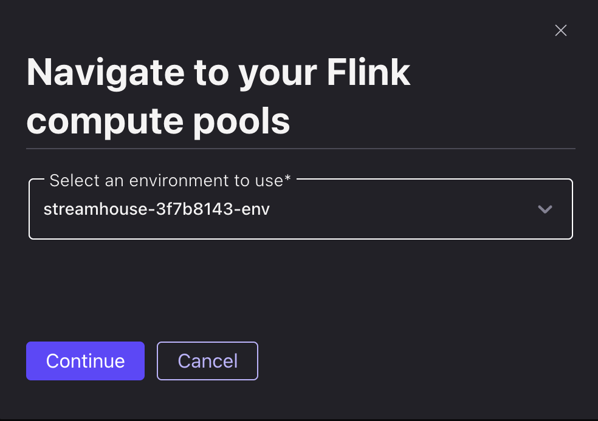

    2. Open a **SQL workspace**.

        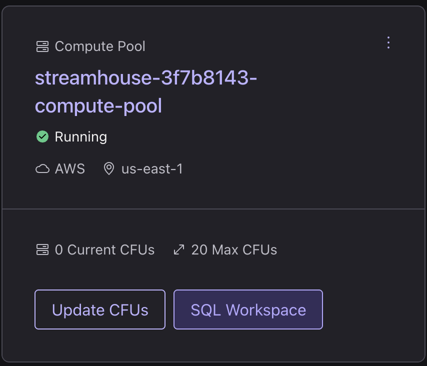

    3. Set **Catalog** to your environment and **Database** to your cluster: the names `uv run deploy` printed.

        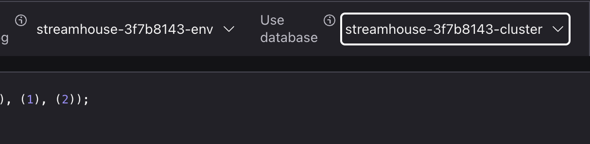

2. Check the source tables:

    ```sql
    SHOW TABLES;
    ```

    | Table | What it holds |
    |---|---|
    | `flight_status` | One row per flight: route, scheduled and estimated time, status |
    | `passenger_itineraries` | One row per passenger: inbound flight and seat, connecting flight and seat (null when the trip ends at SFO) |
    | `hotel_inventory` | Each hotel's rooms left and nightly rate, one row per update |
    | `flight_telemetry` | One row per airborne flight: position, altitude, speeds, and heading, refreshed every 5 seconds. Only the live flight map uses it |
    | `passenger_recommendations` | Rebooking offers. The generator writes offers for most flights; in Lab 4 you build the agent for RA417 and two later delayed flights, RA183 and RA185 |

    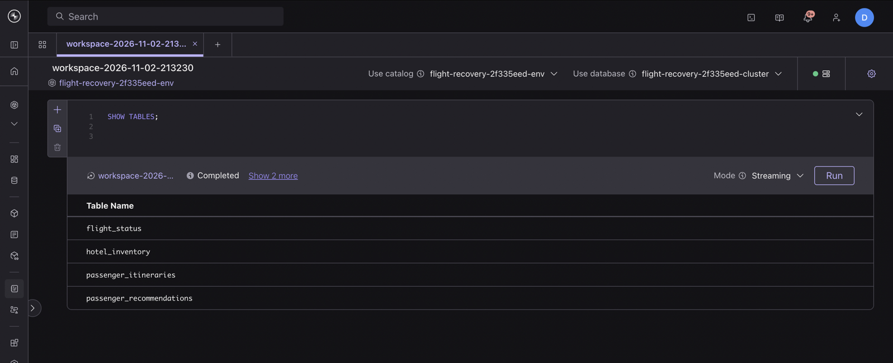

3. Create `passenger_state`, which keeps every passenger's connection current and flags it `HIGH` risk when a delay leaves less than 45 minutes to make it. Run this:

    ```sql
    CREATE OR ALTER MATERIALIZED TABLE passenger_state (
      `key` STRING NOT NULL,
      inbound_flight_id STRING,
      inbound_seat STRING,
      connecting_flight_id STRING,
      connecting_seat STRING,
      final_destination STRING,
      connection_minutes INT,
      risk STRING,
      inbound_estimated_arrival TIMESTAMP(3),
      PRIMARY KEY (`key`) NOT ENFORCED
    ) DISTRIBUTED BY (`key`) INTO 1 BUCKETS
    WITH (
      'changelog.mode' = 'upsert',
      'key.format' = 'raw',
      'kafka.cleanup-policy' = 'compact',
      'value.format' = 'avro-registry'
    )
    START_MODE = FROM_BEGINNING
    AS SELECT
      p.`key`,
      p.inbound_flight_id,
      p.inbound_seat,
      p.connecting_flight_id,
      p.connecting_seat,
      COALESCE(onward.destination, inbound.destination) AS final_destination,
      TIMESTAMPDIFF(MINUTE, inbound.estimated_arrival, onward.estimated_departure) AS connection_minutes,
      CASE
        WHEN p.connecting_flight_id IS NULL THEN 'NO_CONNECTION'
        WHEN TIMESTAMPDIFF(MINUTE, inbound.estimated_arrival, onward.estimated_departure) < 45 THEN 'HIGH'
        ELSE 'OK'
      END AS risk,
      inbound.estimated_arrival AS inbound_estimated_arrival
    FROM passenger_itineraries p
    JOIN flight_status inbound ON p.inbound_flight_id = inbound.`key`
    LEFT JOIN flight_status onward ON p.connecting_flight_id = onward.`key`;
    ```

    It joins each itinerary to its inbound flight and, when there is one, its connecting flight.

    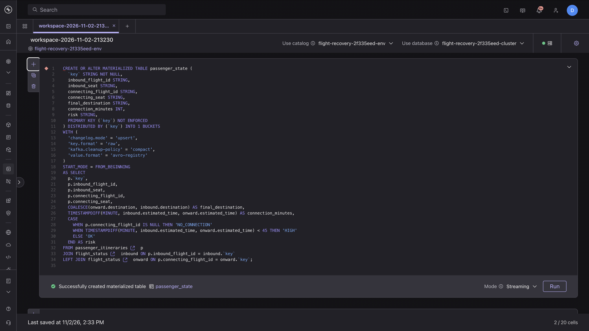

> [!NOTE]
> **Why a materialized table?**
>
> A materialized table is a single object that combines the schema and the continuous query that populates it. Flink creates a backing Kafka topic, registers the schema, and runs the query continuously, so passenger risk updates as flights change.
>
> Because schema and query live together, you can **evolve** them in place: `CREATE OR ALTER MATERIALIZED TABLE` lets you change the query or add a column and Flink migrates the table for you, without dropping the table or resetting downstream consumers.
>
> *Reference*: [Materialized Tables in Confluent Cloud for Apache Flink](https://docs.confluent.io/cloud/current/flink/concepts/materialized-tables.html)

4. In a new cell, create `flight_impact`, which keeps each flight's delay and counts its HIGH-risk passengers:

    ```sql
    CREATE OR ALTER MATERIALIZED TABLE flight_impact (
      `key` STRING NOT NULL,
      origin STRING,
      destination STRING,
      scheduled_departure TIMESTAMP(3),
      scheduled_arrival TIMESTAMP(3),
      status STRING,
      delay_minutes INT,
      affected_passengers INT,
      PRIMARY KEY (`key`) NOT ENFORCED
    ) DISTRIBUTED BY (`key`) INTO 1 BUCKETS
    WITH (
      'changelog.mode' = 'upsert',
      'key.format' = 'raw',
      'kafka.cleanup-policy' = 'compact',
      'value.format' = 'avro-registry'
    )
    START_MODE = FROM_BEGINNING
    AS SELECT
      f.`key`,
      f.origin,
      f.destination,
      f.scheduled_departure,
      f.scheduled_arrival,
      f.status,
      TIMESTAMPDIFF(MINUTE, f.scheduled_arrival, f.estimated_arrival) AS delay_minutes,
      COALESCE(impact.affected_passengers, 0) AS affected_passengers
    FROM flight_status f
    LEFT JOIN (
      SELECT inbound_flight_id, CAST(COUNT(*) FILTER (WHERE risk = 'HIGH') AS INT) AS affected_passengers
      FROM passenger_state /*+ OPTIONS('kafka.consumer.isolation-level' = 'read-uncommitted') */
      GROUP BY inbound_flight_id
    ) impact ON f.`key` = impact.inbound_flight_id;
    ```

    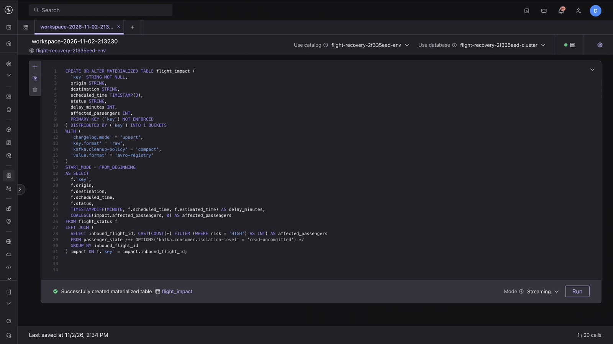

5. Watch RA417's passengers in a new cell:

    ```sql
    SELECT `key`, inbound_seat, final_destination, connection_minutes, risk
    FROM passenger_state
    WHERE inbound_flight_id LIKE 'RA417-%';
    ```

    RA417 may still be on time. As its delay grows, passengers change from `OK` to `HIGH`.

    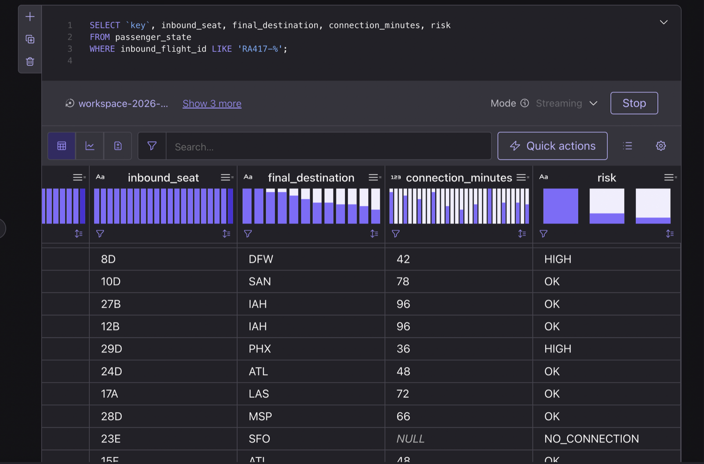

6. Check the flight itself:

    ```sql
    SELECT `key`, status, delay_minutes, affected_passengers
    FROM flight_impact
    WHERE `key` LIKE 'RA417-%';
    ```

    You see today's RA417 and tomorrow's. As today's delay grows, `affected_passengers` increases.

    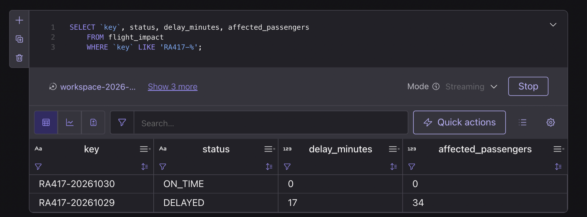

> [!NOTE]
>
> When you're done with a `SELECT`, click **Stop** in its cell to free up your compute pool.

## Lab 3 — Power a live operations dashboard with Lightning Tables

Lightning Tables make each topic queryable with low latency. Your operations dashboard and the Lab 4 recovery agent both read this live state.

1. Open your cluster's **[Topics](https://confluent.cloud/go/topics)** page. In the **Lightning Tables** column, click **+ Enable**, then **Enable**. Click **Done** when it says **Lightning Table is enabled** (a couple of minutes). Do this for `flight_status`, `flight_impact`, `hotel_inventory`, `passenger_itineraries`, `passenger_recommendations`, `passenger_state`, and `flight_telemetry`.

    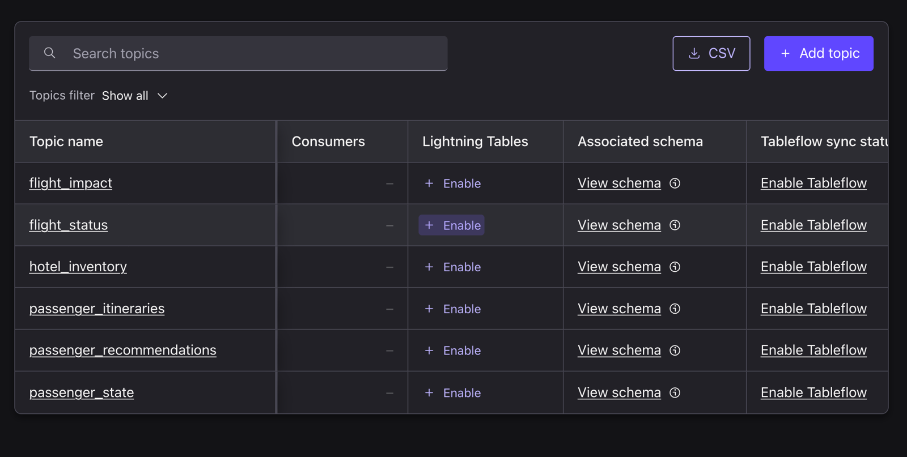

    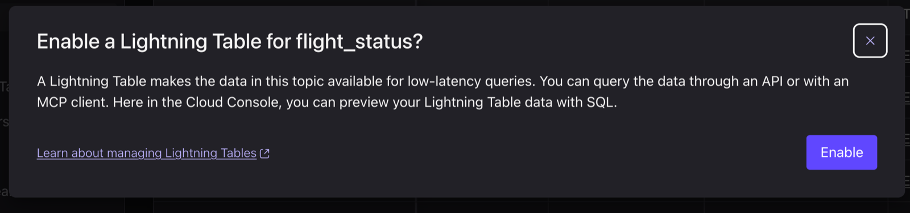

2. Wait until all seven show **Active**.

    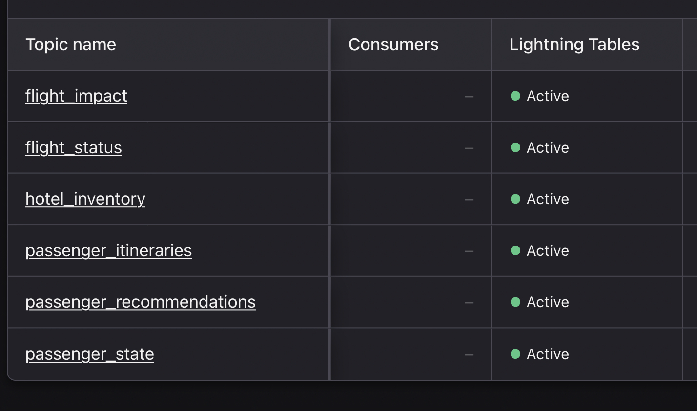

3. Look at the hotel room updates:

    1. On the Topics page, click **Preview** on the `hotel_inventory` row.
    2. No rows? Run this query in the preview:

        ```sql
        SELECT * FROM `hotel_inventory` LIMIT 100;
        ```

    Each row is one update to a hotel's rooms. `as_of` is when it happened.

    Run the same check in a **new terminal** in the `quickstart-streamhouse` folder:

    ```bash
    uv run setup-rtce --lightning hotel_inventory --run
    ```

    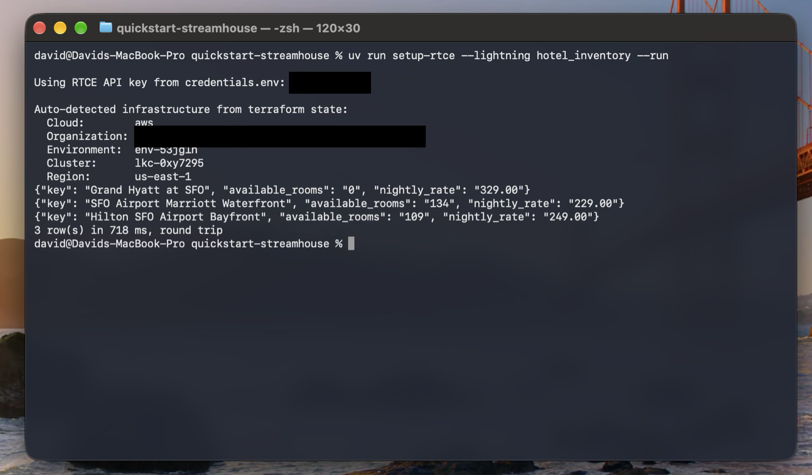

4. Back in your terminal, start the dashboard app:

    ```bash
    uv run airport-app
    ```

    Open [http://127.0.0.1:8000](http://127.0.0.1:8000) in your browser.

    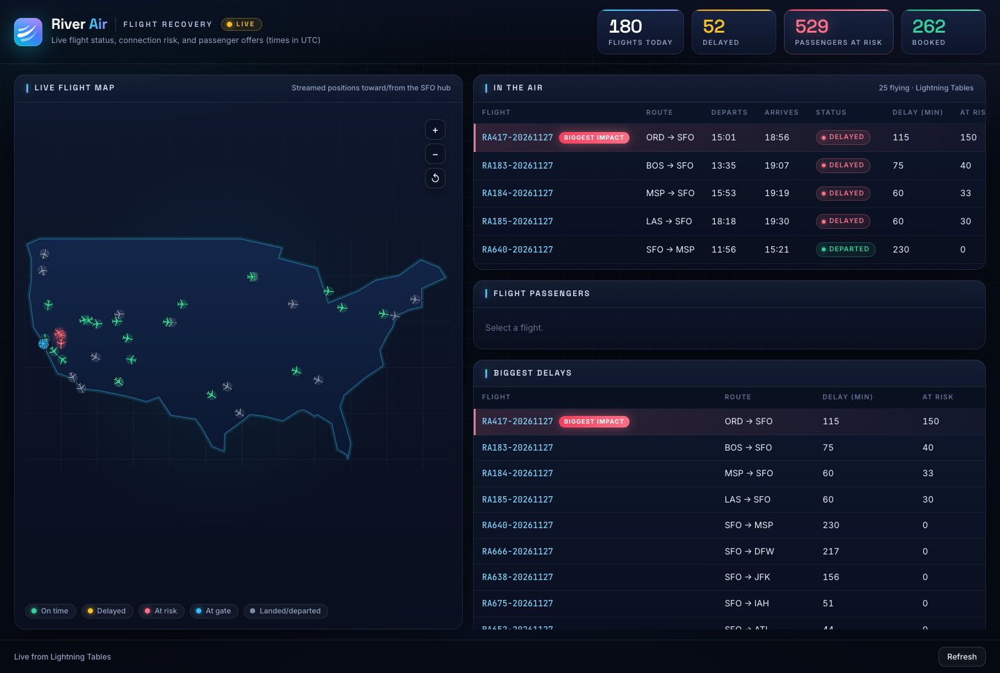

> [!WARNING]
>
> **Leave it running for the rest of the lab.**

5. Check **In the air** and **Biggest delays**, then select **RA417** (it may be on time initially; if you don't see it, find it in **Day view**). Hover a seat on the seat map to view that passenger's itinerary, and watch the live map telemetry update as the flight moves. The generator publishes telemetry every five seconds. If the map says **Waiting for telemetry**, check that `flight_telemetry` is **Active** on the Topics page.

    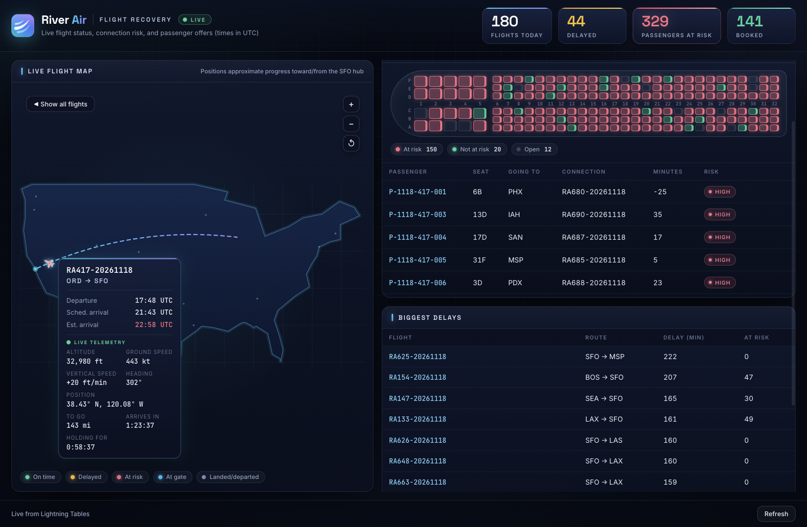

## Lab 4 — Build the recovery agent

Next you will build a Flink SQL recovery agent that checks live flights and hotel inventory through RTCE and writes rebooking offers for disrupted passengers.

1. Create the Flink connection to RTCE in a **new terminal** in the `quickstart-streamhouse` folder:

    ```bash
    uv run setup-rtce --agent-connection
    ```

2. Back in your Flink SQL workspace, create `passenger_state_changes` in a new cell. Use a new cell for each SQL block in this lab.

    ```sql
    CREATE OR ALTER MATERIALIZED TABLE passenger_state_changes (
      `key` STRING NOT NULL,
      inbound_flight_id STRING,
      connecting_flight_id STRING,
      final_destination STRING,
      risk STRING,
      inbound_estimated_arrival TIMESTAMP(3)
    ) DISTRIBUTED BY (`key`) INTO 4 BUCKETS
    WITH (
      'changelog.mode' = 'append',
      'key.format' = 'raw',
      'value.format' = 'avro-registry'
    )
    START_MODE = FROM_BEGINNING
    AS SELECT
      `key`,
      inbound_flight_id,
      connecting_flight_id,
      final_destination,
      risk,
      inbound_estimated_arrival
    FROM TO_CHANGELOG(
      input      => TABLE passenger_state PARTITION BY `key`,
      op_mapping => MAP['INSERT, UPDATE_AFTER', 'UPSERT']
    );
    ```

3. Create `impacted_passengers`: one append-only row per newly `HIGH`-risk passenger. Keep the UTC `SET` line in the cell.

    ```sql
    SET 'sql.local-time-zone' = 'UTC';
    CREATE OR ALTER MATERIALIZED TABLE impacted_passengers (
      `key` STRING NOT NULL,
      inbound_flight_id STRING,
      connecting_flight_id STRING,
      final_destination STRING,
      impacted_at TIMESTAMP(3)
    ) DISTRIBUTED BY (`key`) INTO 4 BUCKETS
    WITH (
      'changelog.mode' = 'append',
      'key.format' = 'raw',
      'value.format' = 'avro-registry'
    )
    START_MODE = FROM_BEGINNING
    AS WITH first_high AS (
      SELECT
        `key`,
        inbound_flight_id,
        connecting_flight_id,
        final_destination,
        CAST(MIN($rowtime) AS TIMESTAMP(3)) AS impacted_at
      FROM passenger_state_changes
      WHERE risk = 'HIGH'
        AND SPLIT_INDEX(inbound_flight_id, '-', 0) IN ('RA417', 'RA183', 'RA185')
        AND CAST($rowtime AS TIMESTAMP(3)) < inbound_estimated_arrival
      GROUP BY `key`, inbound_flight_id, connecting_flight_id, final_destination
    )
    SELECT `key`, inbound_flight_id, connecting_flight_id, final_destination, impacted_at
    FROM TO_CHANGELOG(
      input      => TABLE first_high PARTITION BY `key`,
      op_mapping => MAP['INSERT', 'FIRST_HIGH']
    );
    ```

4. Run `CREATE TOOL` to give Flink live access to RTCE.

    ```sql
    CREATE TOOL IF NOT EXISTS hotel_inventory_live_context
    USING CONNECTION `rtce-connection`
    WITH (
      'type' = 'mcp',
      'allowed_tools' = 'getMetadata,queryData',
      'request_timeout' = '30'
    );
    ```

5. Run `CREATE AGENT` to define the recovery agent and its booking rules.

    ```sql
    CREATE AGENT IF NOT EXISTS passenger_recovery_agent
    USING MODEL passenger_recovery_model
    USING PROMPT 'You are the River Air recovery agent. The passengers on the inbound flight in the task
    will miss their connections to the final destination, and they all get the same two offers.
    Use the queryData tool (arguments: topic_name, query, max_result_rows) to run the three queries in the task.
    The queries already use the right column names, so run them as given without calling getMetadata first.

    1. inbound_query returns the inbound flight. Its estimated_arrival is when the passenger lands at SFO.
    2. departures_query returns flights from SFO to the final destination. Offer the first two flights whose
       estimated_departure is at least 45 minutes after the inbound estimated_arrival. Skip CANCELLED flights.
    3. An offered flight whose estimated_departure is 6 hours or more after the inbound estimated_arrival needs a hotel.
       Run hotel_query. It returns the hotel updates, newest first, so each hotel appears several times:
       use only the row with the latest as_of for each hotel. List the hotels whose latest available_rooms
       is above 0 in this order: Grand Hyatt at SFO, SFO Airport Marriott Waterfront, Hilton SFO Airport
       Bayfront. The first offer uses the first hotel in that list and the second offer uses the second.
       The hotel cost is that hotel nightly_rate.
       A flight that leaves sooner needs no hotel: write NONE for its hotel and cost.

    Reply with exactly one line and nothing else:
    O1_FLIGHT=<flight key>;O1_HOTEL=<hotel name or NONE>;O1_COST=<nightly_rate or NONE>;O2_FLIGHT=<flight key or NONE>;O2_HOTEL=<hotel name or NONE>;O2_COST=<nightly_rate or NONE>'
    USING TOOLS hotel_inventory_live_context
    WITH (
      'max_iterations' = '15',
      'handle_exception' = 'continue'
    );
    ```

6. Confirm the agent exists:

    ```sql
    SHOW AGENTS;
    ```

    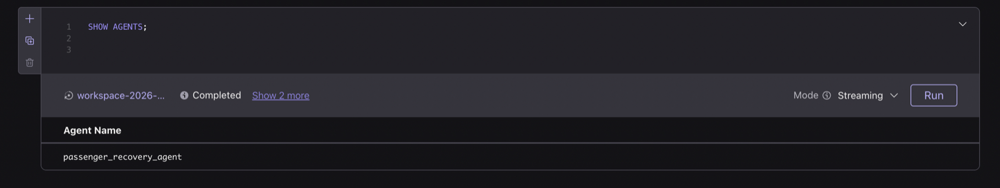

7. Start the `INSERT` statement. Keep the UTC `SET` line in the cell.

    ```sql
    SET 'sql.local-time-zone' = 'UTC';
    INSERT INTO passenger_recommendations
    WITH first_group AS (
      SELECT
        CONCAT(inbound_flight_id, '>', final_destination) AS group_key,
        inbound_flight_id,
        final_destination,
        MIN(impacted_at) AS impacted_at
      FROM impacted_passengers
      GROUP BY inbound_flight_id, final_destination
    ),
    new_groups AS (
      SELECT *
      FROM TO_CHANGELOG(
        input      => TABLE first_group PARTITION BY group_key,
        op_mapping => MAP['INSERT', 'FIRST_GROUP']
      )
    ),
    plans AS (
      SELECT g.inbound_flight_id, g.final_destination, r.response
      FROM new_groups g,
      LATERAL TABLE(AI_RUN_AGENT(
        'passenger_recovery_agent',
        CONCAT(
          'inbound_flight_id=', g.inbound_flight_id,
          '; final_destination=', g.final_destination,
          '; inbound_query=SELECT * FROM `flight_status` WHERE "key" = ''', g.inbound_flight_id, ''' ORDER BY estimated_arrival DESC LIMIT 1',
          '; departures_query=SELECT * FROM `flight_status` WHERE origin = ''SFO'' AND destination = ''',
          g.final_destination, ''' AND scheduled_departure >= TIMESTAMP ''',
          DATE_FORMAT(g.impacted_at - INTERVAL '1' HOUR, 'yyyy-MM-dd HH:mm:ss'),
          ''' ORDER BY scheduled_departure ASC LIMIT 12',
          '; hotel_query=SELECT * FROM `hotel_inventory` ORDER BY as_of DESC LIMIT 30'
        ),
        g.group_key
      )) AS r(agent_status, response)
    ),
    offers AS (
      SELECT
        h.`key` AS passenger_id,
        h.inbound_flight_id,
        h.final_destination,
        h.impacted_at,
        o.n,
        NULLIF(REGEXP_EXTRACT(p.response, CONCAT('O', o.n, '_FLIGHT=([^;\s]+)'), 1), 'NONE') AS recommended_flight_id,
        NULLIF(TRIM(REGEXP_EXTRACT(p.response, CONCAT('O', o.n, '_HOTEL=([^;\n]+)'), 1)), 'NONE') AS hotel_name,
        TRY_CAST(REGEXP_EXTRACT(p.response, CONCAT('O', o.n, '_COST=([0-9.]+)'), 1) AS DECIMAL(10, 2)) AS hotel_cost
      FROM impacted_passengers h
      JOIN plans p
        ON h.inbound_flight_id = p.inbound_flight_id AND h.final_destination = p.final_destination
      CROSS JOIN UNNEST(ARRAY['1', '2']) AS o(n)
    )
    SELECT
      CONCAT(passenger_id, '-O', n) AS `key`,
      passenger_id,
      recommended_flight_id,
      hotel_name,
      'OFFERED' AS status,
      hotel_cost,
      impacted_at,
      CAST(CURRENT_TIMESTAMP AS TIMESTAMP(3)) AS recommended_at
    FROM offers AS o
    JOIN LATERAL SNAPSHOT(
      input => TABLE flight_status,
      on_time => DESCRIPTOR($rowtime),
      load_completed_idle_timeout => INTERVAL '10' SECOND
    ) AS inbound ON o.inbound_flight_id = inbound.`key`
    JOIN LATERAL SNAPSHOT(
      input => TABLE flight_status,
      on_time => DESCRIPTOR($rowtime),
      load_completed_idle_timeout => INTERVAL '10' SECOND
    ) AS onward ON o.recommended_flight_id = onward.`key`
    WHERE onward.origin = 'SFO'
      AND onward.destination = o.final_destination
      AND onward.status NOT IN ('CANCELLED', 'DEPARTED')
      AND onward.estimated_departure >= inbound.estimated_arrival + INTERVAL '45' MINUTE;
    ```

    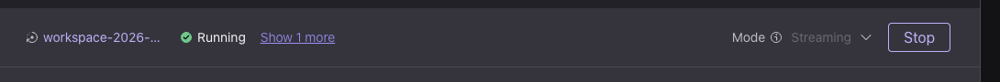

> [!NOTE]
>
> This statement runs continuously. Don't stop or delete it.

8. Query `passenger_recommendations` for RA417.

    ```sql
    SELECT `key`, recommended_flight_id, hotel_name, hotel_cost, status
    FROM passenger_recommendations
    WHERE passenger_id LIKE 'P-____-417-%';
    ```

    Offers arrive in waves as passengers reach `HIGH` risk and the agent finishes its live lookups. Some offers have no hotel for shorter layovers, and the agent can filter out unsafe flights with delays, cancellations, or tight connections.

    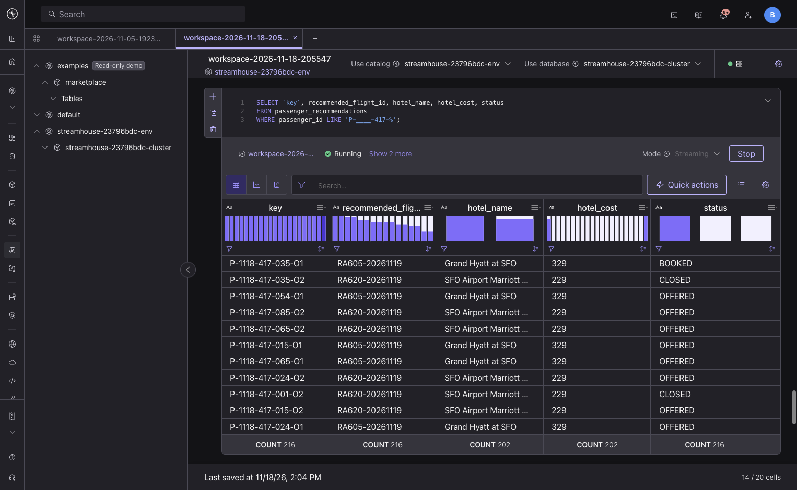

## Lab 5 — Recover a passenger

Now you see the recovery from the passenger's side. Some of the agent's offers include a room at the Grand Hyatt, which is selling out fast. An app working from stale data would book a room that's already gone.

With a Streamhouse architecture, that's not an issue: River Air's app always has the current state of hotel availability. It checks the rooms left with a Lightning Query when a passenger selects an offer, swaps in another hotel if the room is gone, and checks again at booking.

1. Open RA417 in the [dashboard app](http://127.0.0.1:8000) and click a HIGH-risk seat. Its two offers show under **Passenger recovery**.

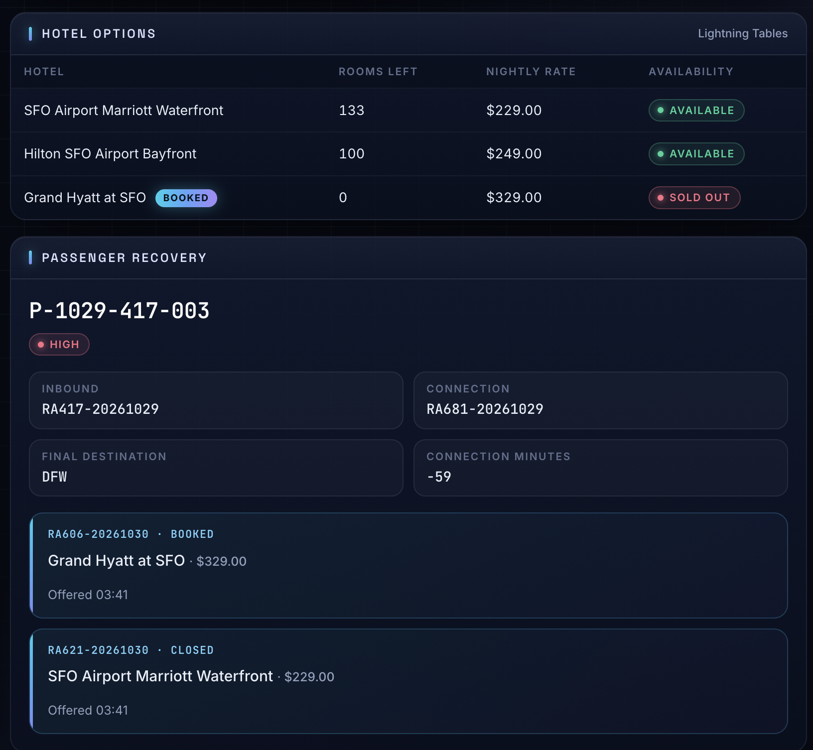

2. Watch the Grand Hyatt in **Hotel options** for a minute or so. The hotel partner's feed updates each hotel's rooms left every 15 seconds, and the dashboard shows them in real time using **Lightning Queries** on `hotel_inventory`. Lightning keeps every update, so the app shows each hotel's latest. You don't need to wait for it to sell out.

3. Click **Select** on either offer, then click **Book**. The **Book** button appears once Lightning shows your selection, usually within a minute.

    The app checks the hotel's live room count at each click, books that offer, and closes the other one. **Booked** goes up by one. It also climbs on its own as passengers on other flights book.

    If the Grand Hyatt has already sold out when you select it, the app swaps in another hotel:

    - The status bar at the bottom reads **Grand Hyatt at SFO is sold out. Now offering Hilton SFO Airport Bayfront.**
    - The offer now shows the Hilton at $249.
    - Click **Select** on it again, then **Book**.

    The passenger's two choices are then the Marriott and the Hilton.

4. Back in your SQL workspace, see what changed:

    ```sql
    SELECT `key`, recommended_flight_id, hotel_name, status
    FROM passenger_recommendations
    WHERE passenger_id LIKE 'P-____-417-%' AND status IN ('BOOKED', 'CLOSED');
    ```

    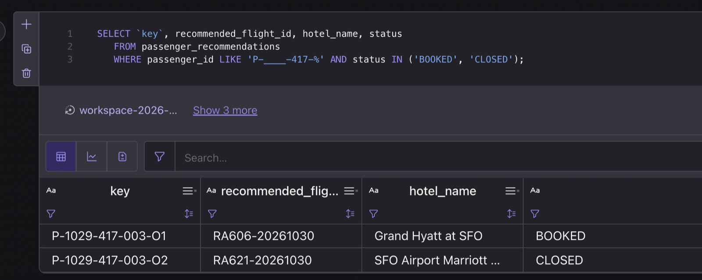

## 🧩 (Optional) Challenge — Ask your coding agent about the live operation

Any MCP client can query the topics you turned on in Lab 3. This bonus challenge requires Claude Code or Codex; do it before you clean up.

<details>
<summary>Install Claude Code</summary>

On Mac:

```bash
brew install --cask claude-code
```

On Windows:

```powershell
winget install --id Anthropic.ClaudeCode -e --source winget
```

Then open a new PowerShell window in the `quickstart-streamhouse` folder.

</details>

1. Back in your terminal, register RTCE with your coding agent:

    ```bash
    uv run setup-rtce
    ```

    Enter `1` for Claude Code or `2` for Codex. Already have it open? Restart it.

    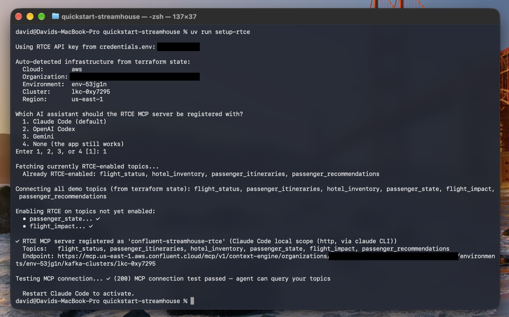

> [!NOTE]
>
> The connection can take a minute or two. In Claude Code, run `/mcp` and check that `confluent-streamhouse-rtce` shows as connected.

2. Start your coding agent in the `quickstart-streamhouse` folder (for example, `claude`) and ask:

    ```text
    What topics do I have access to in the Real-Time Context Engine?
    ```
    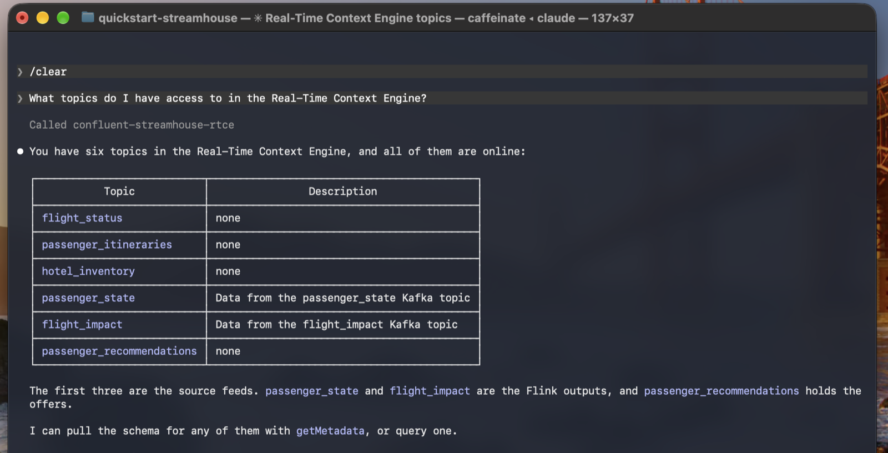

    ```text
    Which flight today puts the most passengers at risk of missing a connection, and where are they headed?
    ```
    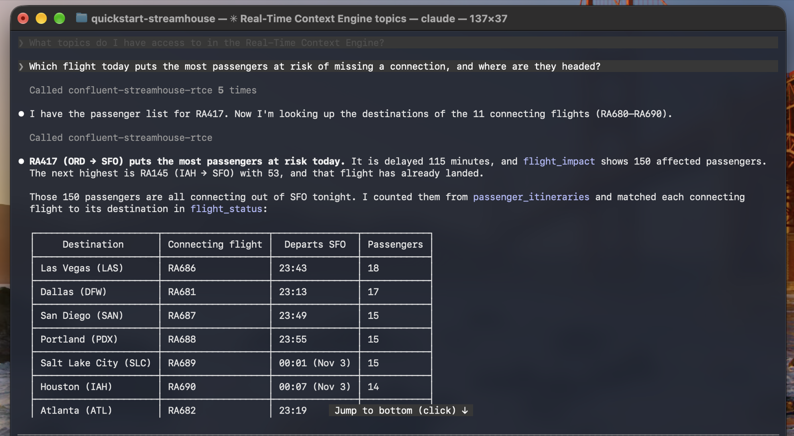

    ```text
    How many rooms does each SFO hotel have left right now?
    ```
    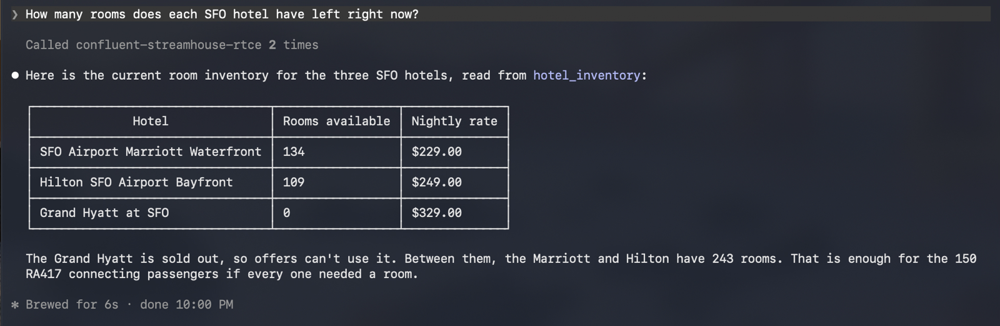

RTCE gives your agent three tools, `listTopics`, `getMetadata`, and `queryData`, and exposes only topics whose context engine is on. Watch the tool calls query your live topics directly.

## Skipped a step?

The labs build on each other, and Flink can't tell you which earlier step is missing. To find the gap, run this in the `quickstart-streamhouse` folder:

```bash
uv run workshop-status
```

## Conclusion

Congratulations! You built a Streamhouse. It turns raw flight and itinerary feeds into live connection risk with Flink, serves that state to an app through Lightning Tables, and gives a streaming agent the same live context through RTCE so it can rebook stranded passengers on its own. Every consumer works from one current view of the operation.

## Clean up

1. Stop the app and the generator: press **Ctrl-C** in their terminals.

2. Tear everything down. Enter `y` to confirm:

    ```bash
    uv run destroy
    ```

    It deletes everything deploy created: the cluster, the topics, the tables and agent you created, and the environment (with its Flink connection) if deploy made it.

    <details>
    <summary>Remove only this lab</summary>

    Keeps the environment, cluster, and the Agentic Pit Decisions lab:

    ```bash
    uv run destroy --lab flight-disruptions
    ```

    </details>

---

**← Back to Overview**: [README](../../README.md)
