# River Air Flight Recovery Workshop

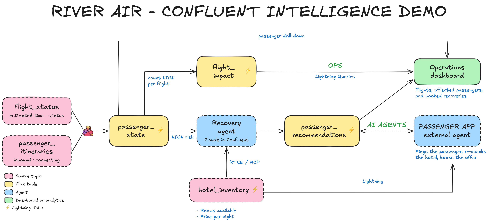

River Air runs 180 flights a day through its SFO hub, and like every airline, its data is spread across systems that weren't built to work together. Passenger itineraries come from ticketing. Flight status and gate times come from the airports' operational systems. Hotel rooms come from a partner. The airline owns part of the picture, the airport owns another, and partners own the rest.

That leaves River Air with two challenges:

1. **One live view of every flight.** A simple question like *"How many flights are delayed right now?"* turns into a data integration project.
2. **Recovering passengers when a flight is disrupted.** Flight RA417 from Chicago is about to run almost two hours late, and 150 of its passengers will miss their connections. Each one needs a new flight, and some need a hotel, before the rooms sell out.

In this workshop, you deploy a **Streamhouse** architecture on Confluent Cloud that tackles both. You compute every passenger's connection risk with Flink and serve it through Lightning Tables to an always-on, always-current operations dashboard. Then you build a streaming agent that reads live flights and hotel rooms through the Real-Time Context Engine (RTCE) and offers every stranded passenger a new flight and, when needed, a hotel.

> [!NOTE]
>
> **This workshop takes about 60 minutes to complete.**

| Part | Minutes | What you do |
|---|---|---|
| [Prerequisites](#0-prerequisites) | 5 | Install the tools (skip it on a workstation the host provides) |
| [Set up Confluent Cloud](#set-up-confluent-cloud) | 5 | Create your account and add a payment method |
| [Deploy to Confluent Cloud](#deploy-to-confluent-cloud) | 10 | Clone the repo, deploy your environment, and start the data |
| [Lab 1](#lab-1--explore-the-live-feeds) | 5 | Explore the live feeds |
| [Lab 2](#lab-2--compute-connection-risk-with-flink) | 10 | Compute every passenger's connection risk with Flink |
| [Lab 3](#lab-3--power-a-live-operations-dashboard-with-lightning-tables) | 10 | Turn on Lightning Tables, then open the operations dashboard |
| [Lab 4](#lab-4--build-the-recovery-agent) | 10 | Build the recovery agent |
| [Lab 5](#lab-5--recover-a-passenger) | 5 | Watch hotel rooms change live, then rebook a passenger |
| [Challenge](#-optional-challenge--ask-your-coding-agent-about-the-live-operation) | optional | Ask Claude Code or Codex about the live operation over MCP |
| [Clean up](#clean-up) | 5 | Tear everything down |

## 0. Prerequisites

> [!TIP]
>
> **Provided a workstation by the workshop host?** Skip this section — it's already set up for you. Continue to [Set up Confluent Cloud](#set-up-confluent-cloud).

<details>
<summary><strong>Prerequisites for your own machine</strong> (click to expand)</summary>

<details>
<summary>for Mac</summary>

No Homebrew yet? Install it from [brew.sh](https://brew.sh) first.

```bash
brew install git uv
brew tap hashicorp/tap
brew install hashicorp/tap/terraform
brew install --cask confluent-cli
```

</details>

<details>
<summary>for Windows</summary>

In PowerShell:

```powershell
winget install --id Git.Git -e
winget install --id astral-sh.uv -e
winget install --id Hashicorp.Terraform -e
```

Download the latest `confluent_*_windows_amd64.zip` from the [Confluent CLI releases](https://github.com/confluentinc/cli/releases/latest), unzip it, and add the folder that contains `confluent.exe` to your `PATH`.

Close and reopen the terminal so every tool is on your `PATH`.

</details>

Check that each tool prints a version:

```bash
git --version
uv --version
terraform -version
confluent version
```

</details>

## Set up Confluent Cloud

#### Step 1 — Create your Confluent Cloud account

1. Go to the **[Confluent Cloud sign-up page](https://cnfl.io/learnwithcflt)**.
2. Enter your **name**, **work email**, **company**, and a **password**, then accept the terms
   and click **Start Free**.
3. On first sign-in, an **onboarding wizard** asks a few questions, then offers to create your
   first cluster.

> [!WARNING]
> **Do NOT create a cluster.** Skip the **Add cluster** / **Create cluster** step — Terraform
> creates its own environment *and* cluster for you. Click the Confluent logo (top-left) to
> exit the wizard.

#### Step 2 — Add a payment method (credit card)

A payment method is required for Terraform to create a **Standard** cluster. Free
credit is used first, so you typically won't be charged during the workshop.

> [!TIP]
> All new sign-ups get **$400 in free credit** to use within the first 30 days — deploying this
> workshop will not get you charged.

1. Go directly to **[Billing & payment](https://confluent.cloud/settings/billing/payment)**.
2. Open the **Payment details and contacts** tab.
3. Click **Add credit card / bank account**, enter your **card details**, then **Save**.

   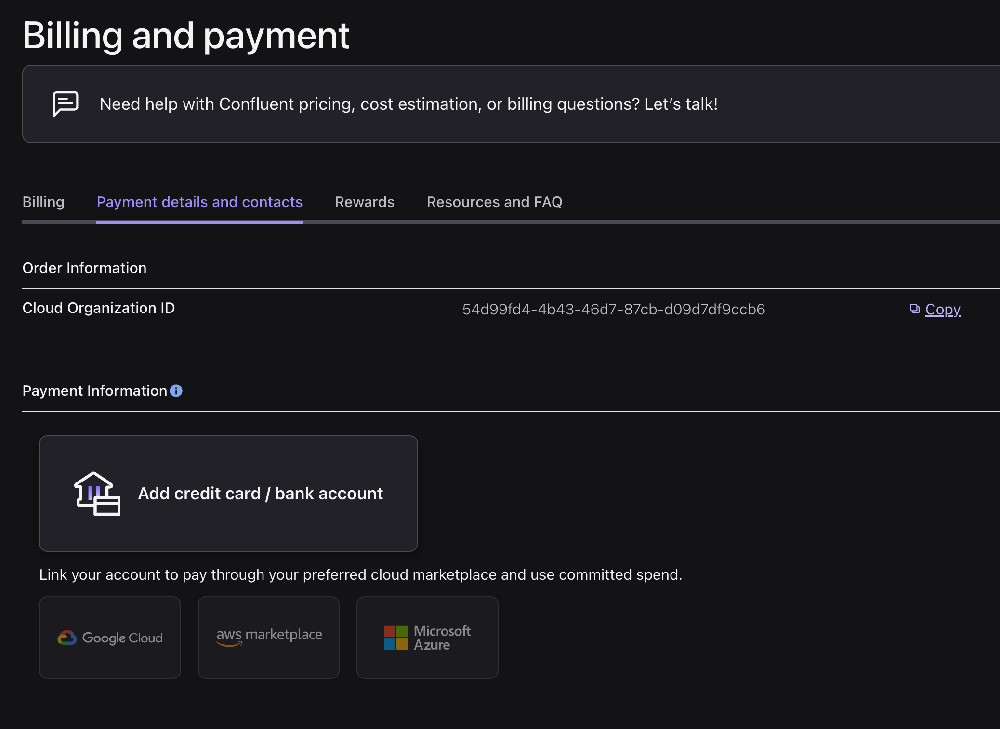

## Deploy to Confluent Cloud

1. Clone the repo and go into it:

    ```bash
    git clone https://github.com/confluentinc/quickstart-streamhouse.git
    cd quickstart-streamhouse
    ```

2. **Only if you signed up to Confluent Cloud with SSO:** sign in to the Confluent CLI first. Skip this if you signed up with email and password.

    ```bash
    confluent login
    ```

3. Deploy your environment:

    ```bash
    uv run deploy
    ```

    Deploy asks for the following, in this order:

    | Prompt | Answer |
    |---|---|
    | `Which lab do you want to deploy?` | Enter `1` for **Flight Disruptions**. Deploy builds the workshop's starting point, and you build the rest in the labs. |
    | `Email (Enter to skip)` and `Password` | The **email and password you used to sign up**. Deploy checks them with a real login and saves them to `credentials.env`, so later commands log in automatically. **Signed in with SSO in step 2?** Press **Enter** to skip. |
    | `Generate new Confluent Cloud API keys? (y/N)` | Enter `y`. Deploy creates the key and uses it, so it doesn't ask for a key or secret. |
    | `Ready to deploy? (y/n)` | Enter `y`. |

    **Deploy takes about 10 minutes to create all of the workshop infrastructure and source topics.** When finished, you'll see your environment and cluster names, which you need in Lab 2:

    ```text
    Environment name: streamhouse-1a2b3c4d-env
    Cluster name: streamhouse-1a2b3c4d-cluster
    ```

4. Start the datagen:

    Open a **second terminal** in the `quickstart-streamhouse` folder and start the generator:

    ```bash
    uv run airport-datagen --skip-history
    ```

    It publishes today's 180 flights, about 13,000 passenger itineraries, tomorrow's schedule, and three hotels, then streams live updates for 90 minutes.

> [!WARNING]
>
> **Leave this terminal running for the whole workshop.** If you stop it, the flights stop updating. If it stops by accident, run `uv run airport-datagen --resume` to pick the stream back up on the same clock.

## Lab 1 — Explore the live feeds

River Air's data comes from different systems: itineraries from ticketing, flight status from the airports' operational databases, and hotel rooms from a partner. Let's look at them as they arrive.

1. Open **[Topics](https://confluent.cloud/go/topics)** and select your **environment** (`streamhouse-…-env`) and **cluster** (`streamhouse-…-cluster`). You see the four topics deploy created: `flight_status`, `passenger_itineraries`, `hotel_inventory`, and `passenger_recommendations`.

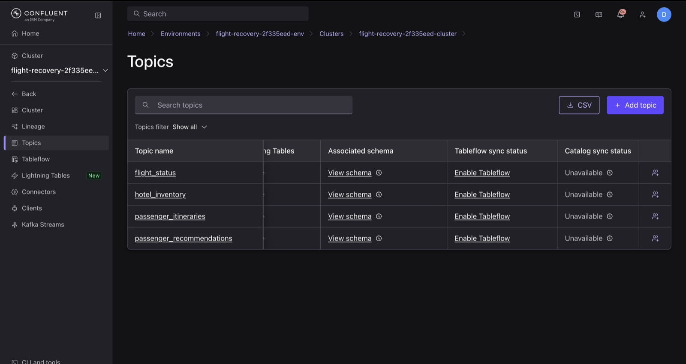

2. Explore the topics by clicking a topic name, then selecting **Messages** to view some of the incoming messages, their keys, and values. 

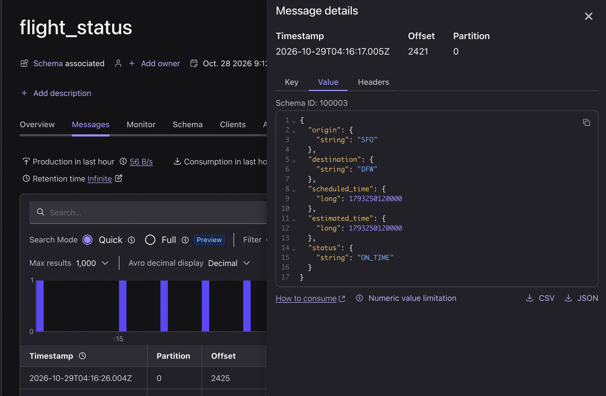

## Lab 2 — Compute connection risk with Flink

Now we'll use Flink to join every itinerary to the live status of both of its flights and keep the result current as flights change. Connection risk updates the moment a flight's delay changes, not on the next batch refresh.

1. Open the Flink SQL workspace:

    1. Go to the [Flink UI](https://confluent.cloud/go/flink) and select the **environment** deploy created (`streamhouse-…-env`).

        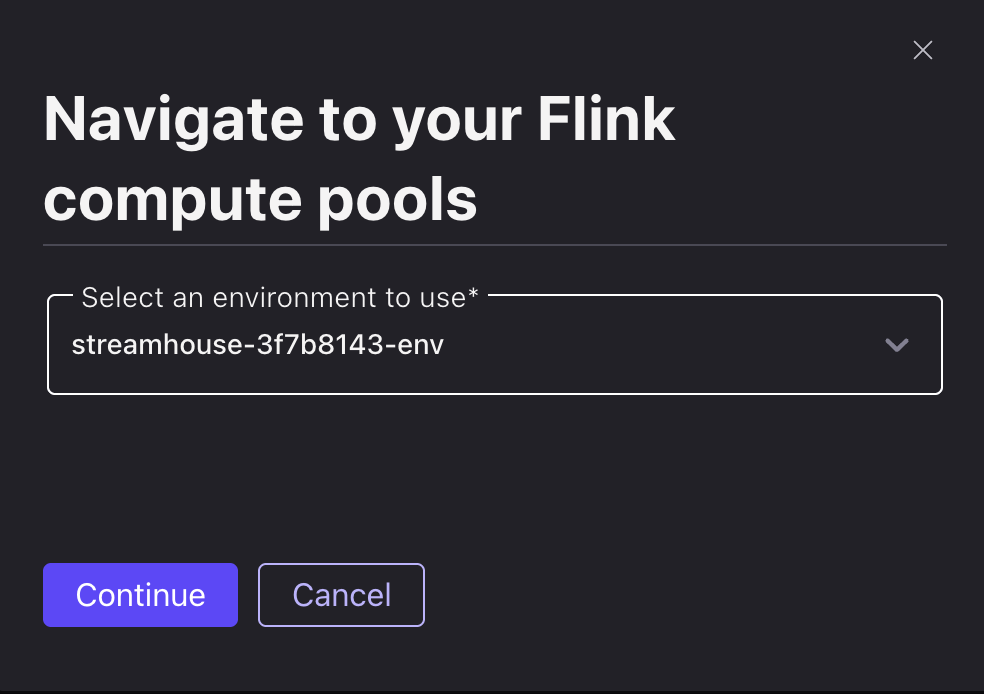

    2. Open a **SQL workspace**.

        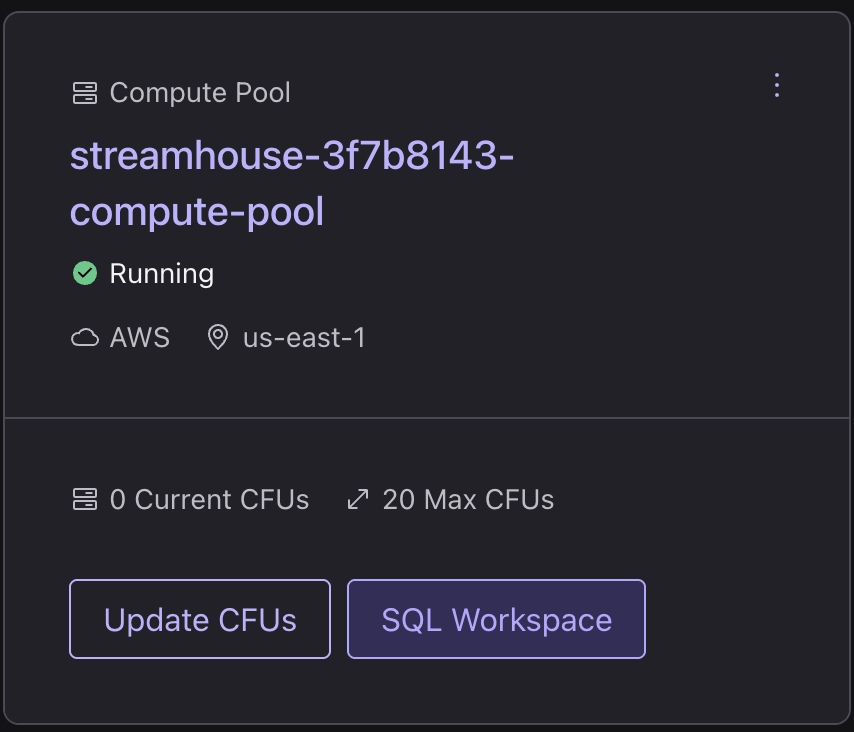

    3. Set the **Catalog** to your environment and the **Database** to your cluster: the names printed at the end of `uv run deploy` (`streamhouse-…-env` and `streamhouse-…-cluster`).

        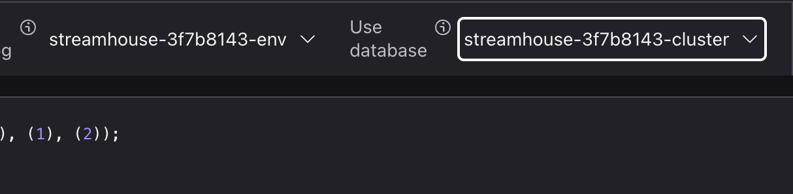

2. Check the source tables:

    ```sql
    SHOW TABLES;
    ```

    | Table | What it holds |
    |---|---|
    | `flight_status` | One row per flight: route, scheduled and estimated time, status |
    | `passenger_itineraries` | One row per passenger: inbound flight and seat, connecting flight and seat (null when the trip ends at SFO) |
    | `hotel_inventory` | One row per hotel: rooms left and nightly rate |
    | `passenger_recommendations` | The rebooking offers. The generator writes most flights', and in Lab 4 we'll create the agent that writes them for RA417 and two later delayed flights, RA183 and RA185 |

    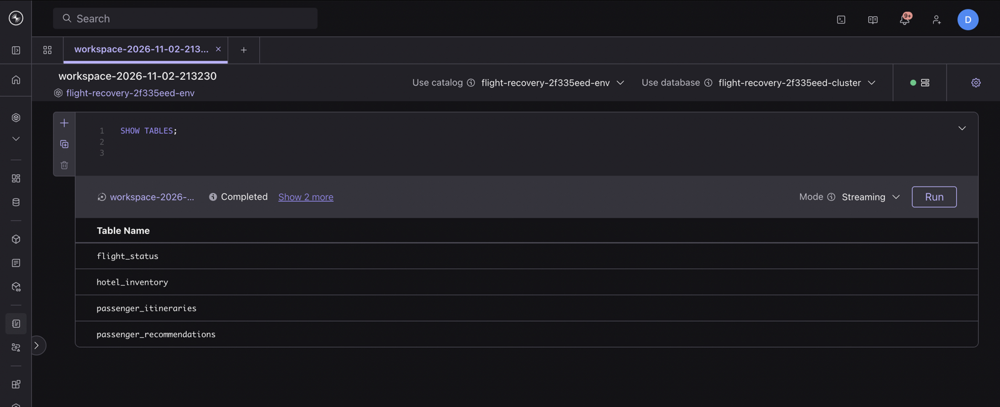

3. Create `passenger_state`, which keeps every passenger's connection current and flags it `HIGH` risk when a delay leaves less than 45 minutes to make it. Paste this whole statement into one cell and run it:

    ```sql
    CREATE OR ALTER MATERIALIZED TABLE passenger_state (
      `key` STRING NOT NULL,
      inbound_flight_id STRING,
      inbound_seat STRING,
      connecting_flight_id STRING,
      connecting_seat STRING,
      final_destination STRING,
      connection_minutes INT,
      risk STRING,
      inbound_estimated_time TIMESTAMP(3),
      PRIMARY KEY (`key`) NOT ENFORCED
    ) DISTRIBUTED BY (`key`) INTO 1 BUCKETS
    WITH (
      'changelog.mode' = 'upsert',
      'key.format' = 'raw',
      'kafka.cleanup-policy' = 'compact',
      'value.format' = 'avro-registry'
    )
    START_MODE = FROM_BEGINNING
    AS SELECT
      p.`key`,
      p.inbound_flight_id,
      p.inbound_seat,
      p.connecting_flight_id,
      p.connecting_seat,
      COALESCE(onward.destination, inbound.destination) AS final_destination,
      TIMESTAMPDIFF(MINUTE, inbound.estimated_time, onward.estimated_time) AS connection_minutes,
      CASE
        WHEN p.connecting_flight_id IS NULL THEN 'NO_CONNECTION'
        WHEN TIMESTAMPDIFF(MINUTE, inbound.estimated_time, onward.estimated_time) < 45 THEN 'HIGH'
        ELSE 'OK'
      END AS risk,
      inbound.estimated_time AS inbound_estimated_time
    FROM passenger_itineraries p
    JOIN flight_status inbound ON p.inbound_flight_id = inbound.`key`
    LEFT JOIN flight_status onward ON p.connecting_flight_id = onward.`key`;
    ```

    It joins each itinerary to its inbound flight and, when there is one, its connecting flight.

    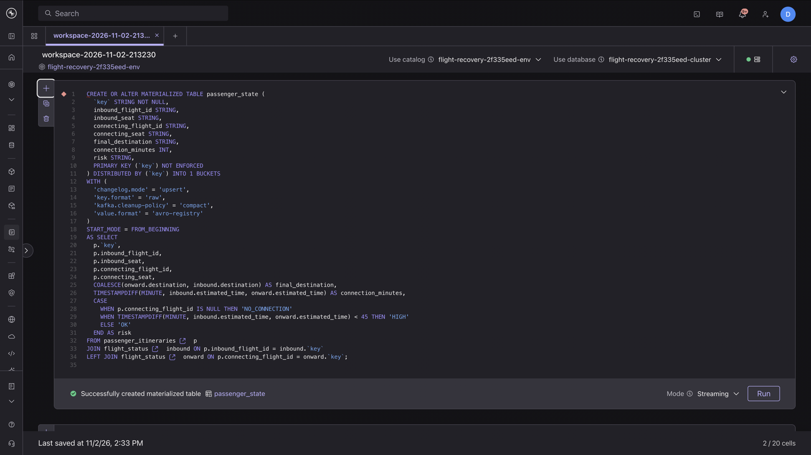

> [!NOTE]
> **Why a materialized table?**
>
> A materialized table is a single object that owns both the schema and the query logic that keeps filling it — Flink creates a backing Kafka topic, registers the schema, and runs the query continuously, so passenger risk updates as flights change.
>
> Because schema and query live together, you can **evolve** them in place: `CREATE OR ALTER MATERIALIZED TABLE` lets you change the query or add a column and Flink migrates the table for you, instead of dropping the table, recreating it, and juggling offsets and downstream consumers.
>
> *Reference*: [Materialized Tables in Confluent Cloud for Apache Flink](https://docs.confluent.io/cloud/current/flink/concepts/materialized-tables.html)

4. In a new cell, create `flight_impact`, which keeps each flight's delay and counts its HIGH-risk passengers:

    ```sql
    CREATE OR ALTER MATERIALIZED TABLE flight_impact (
      `key` STRING NOT NULL,
      origin STRING,
      destination STRING,
      scheduled_time TIMESTAMP(3),
      status STRING,
      delay_minutes INT,
      affected_passengers INT,
      PRIMARY KEY (`key`) NOT ENFORCED
    ) DISTRIBUTED BY (`key`) INTO 1 BUCKETS
    WITH (
      'changelog.mode' = 'upsert',
      'key.format' = 'raw',
      'kafka.cleanup-policy' = 'compact',
      'value.format' = 'avro-registry'
    )
    START_MODE = FROM_BEGINNING
    AS SELECT
      f.`key`,
      f.origin,
      f.destination,
      f.scheduled_time,
      f.status,
      TIMESTAMPDIFF(MINUTE, f.scheduled_time, f.estimated_time) AS delay_minutes,
      COALESCE(impact.affected_passengers, 0) AS affected_passengers
    FROM flight_status f
    LEFT JOIN (
      SELECT inbound_flight_id, CAST(COUNT(*) FILTER (WHERE risk = 'HIGH') AS INT) AS affected_passengers
      FROM passenger_state /*+ OPTIONS('kafka.consumer.isolation-level' = 'read-uncommitted') */
      GROUP BY inbound_flight_id
    ) impact ON f.`key` = impact.inbound_flight_id;
    ```

    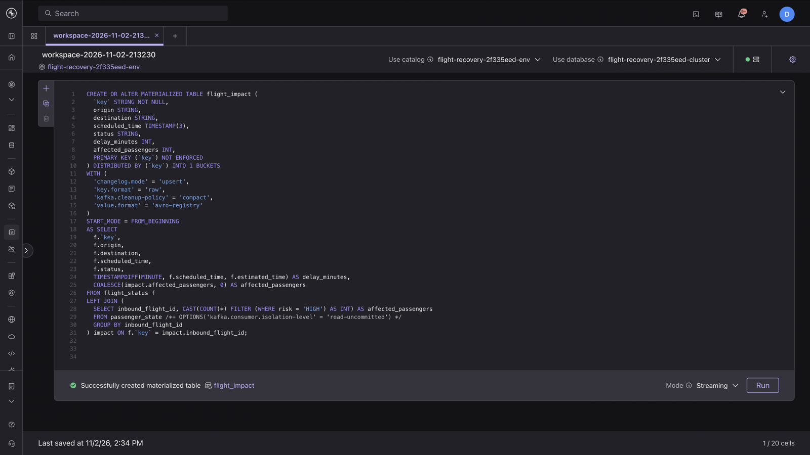

5. Watch RA417's passengers in a new cell:

    ```sql
    SELECT `key`, inbound_seat, final_destination, connection_minutes, risk
    FROM passenger_state
    WHERE inbound_flight_id LIKE 'RA417-%';
    ```

    As the flight is further delayed, you'll continue to see passengers delay risk change from "OK" to "HIGH".

    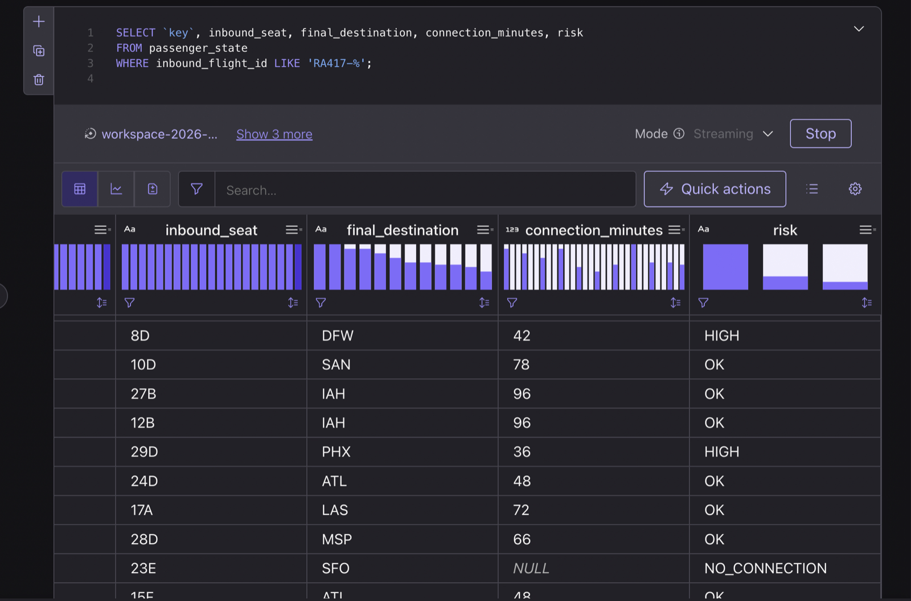

6. Check the flight itself:

    ```sql
    SELECT `key`, status, delay_minutes, affected_passengers
    FROM flight_impact
    WHERE `key` LIKE 'RA417-%';
    ```

    As today's flight RA417 becomes further delayed, the number of impacted passengers increases. 

    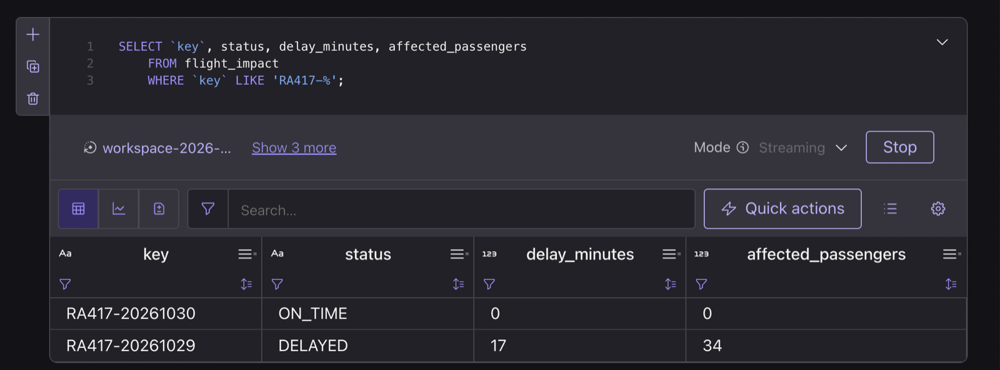

> [!NOTE]
>
> Stop each `SELECT` statement when you're done with it, so your compute pool has room for Lab 4.

## Lab 3 — Power a live operations dashboard with Lightning Tables

This is where River Air finally gets its answer to *"How many flights are delayed right now?"* In Lab 2, you turned raw feeds into live connection risk. Now you put that state in front of the people and agents who act on it: an operations dashboard that's always on and always current, answering in milliseconds, with no extra database, cache, or sync pipeline to build.

One click per topic does it. Enabling a topic's **Lightning Table** keeps a low-latency table of its latest rows that apps query directly, and the Real-Time Context Engine (RTCE) exposes the same table to AI agents over MCP. The dashboard you open in this lab and the recovery agent you build in Lab 4 read the same live state, each in the form it needs.

1. Back in the Console, open **[Topics](https://confluent.cloud/go/topics)** and select your **environment** (`streamhouse-…-env`) and **cluster** (`streamhouse-…-cluster`). `passenger_state` and `flight_impact` are there now; we created them with Flink in Lab 2.

2. Find the **Lightning Table** column (scroll right if you need to) and click **+ Enable** for `flight_status`.

    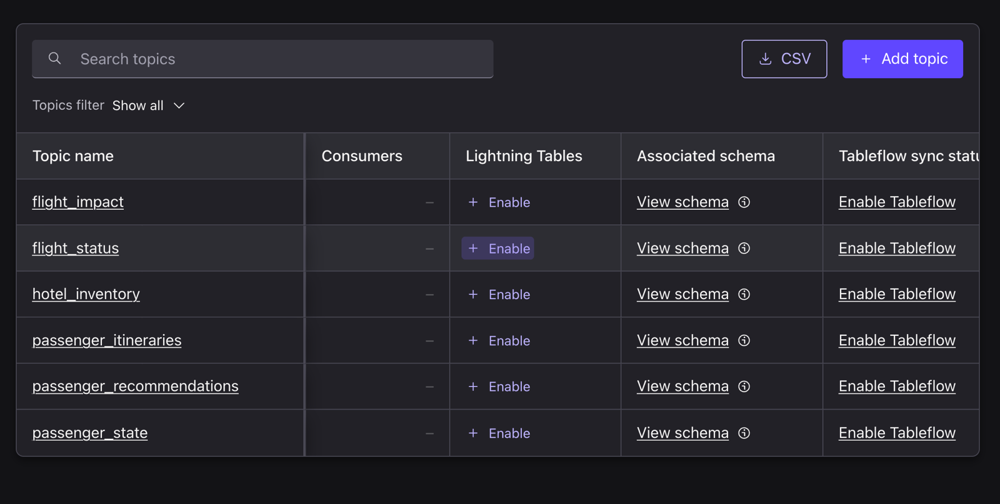

3. In the **Enable Lightning Table** panel, click **Enable**. It may take a minute for the query engine and infrastructure to be finalized, but you can go ahead and **close the panel and enable the next topics**.

    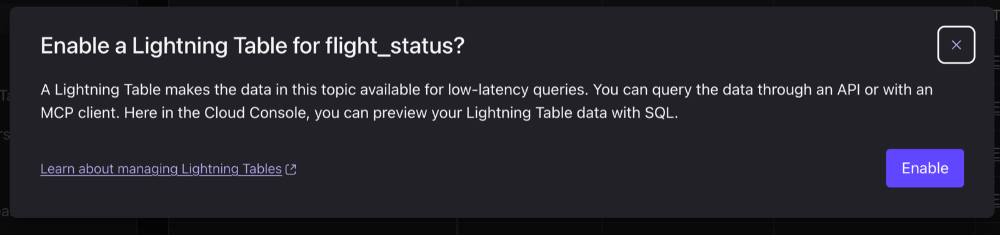

4. Repeat for `passenger_itineraries`, `passenger_state`, `flight_impact`, `passenger_recommendations`, and `hotel_inventory`.

    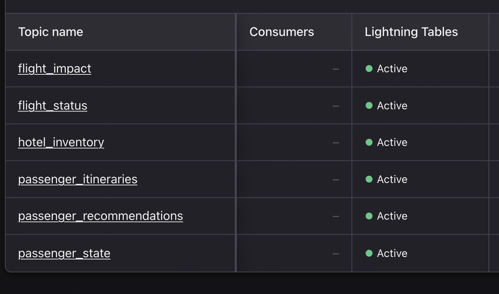

> [!NOTE]
>
> Each topic shows **Provisioning** while Confluent loads its rows, then **Active**. Wait until all six show **Active** before you continue.

5. Run your first Lightning Query. **In a terminal window, run**:

    ```bash
    uv run setup-rtce --lightning hotel_inventory --run
    ```

    It prints the three hotels' current rows and the round-trip time. Wait one minute, then run the command again and you'll see that the Grand Hyatt has fewer rooms.

    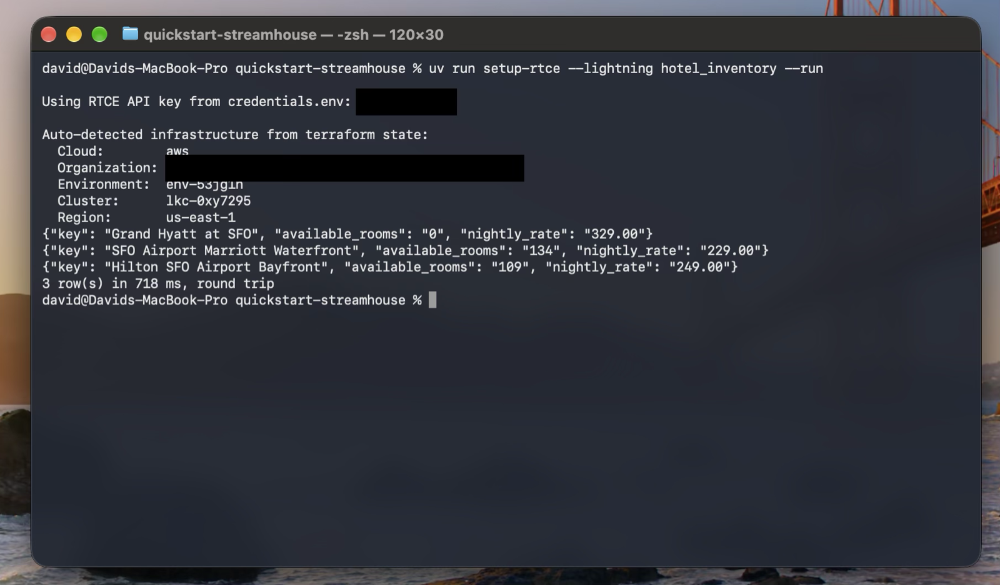

6. Open a **new terminal window** in the `quickstart-streamhouse` folder and start the dashboard app:

    ```bash
    uv run airport-app
    ```

    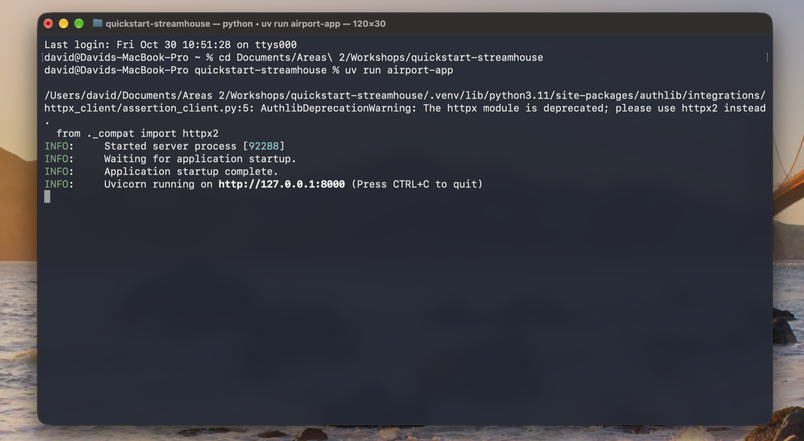

    Open [http://127.0.0.1:8000](http://127.0.0.1:8000). **Leave this terminal running too.**

    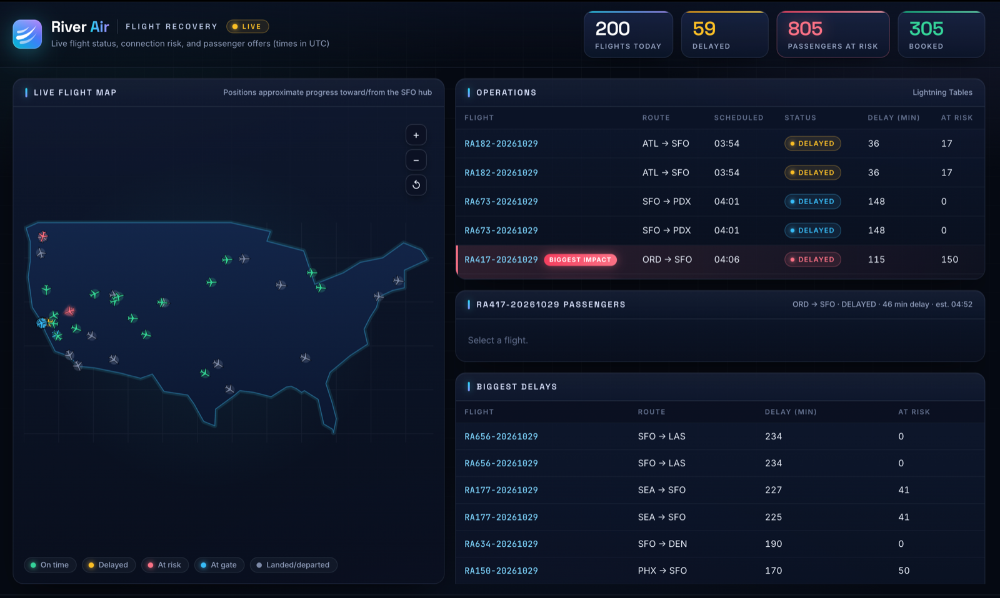

7. Explore the operations view:

    - **The counts bar** answers "what's our on-time performance today?" with **Flights today**, **Delayed**, **Passengers at risk**, and **Booked**.
    - **Operations** lists today's flights. Status and delay come straight from `flight_status`, so they change within seconds; **At risk** comes from Flink's `flight_impact`.
    - **Biggest delays** lists the ten latest flights. RA417 (ORD → SFO, up to 115 minutes late) is the one tagged **Biggest impact**.
    - Click **RA417-…**. The seat map colors every seat red (at risk), green (not at risk), or grey (open). Hover a seat to see that passenger's itinerary. The table below lists RA417's passengers, `HIGH` first.
    - The flight's box on the map also shows **Live telemetry** that updates every second: altitude, speed, heading, position, and time to arrival.

    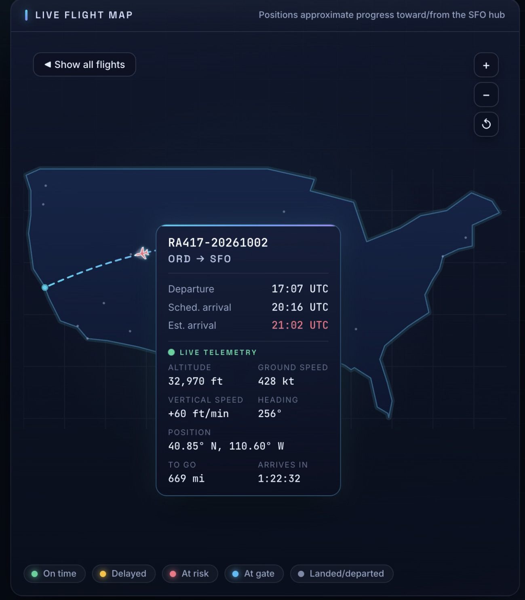

    RA417's seat map is in the top-right corner. Hover a seat to see that passenger's itinerary:

    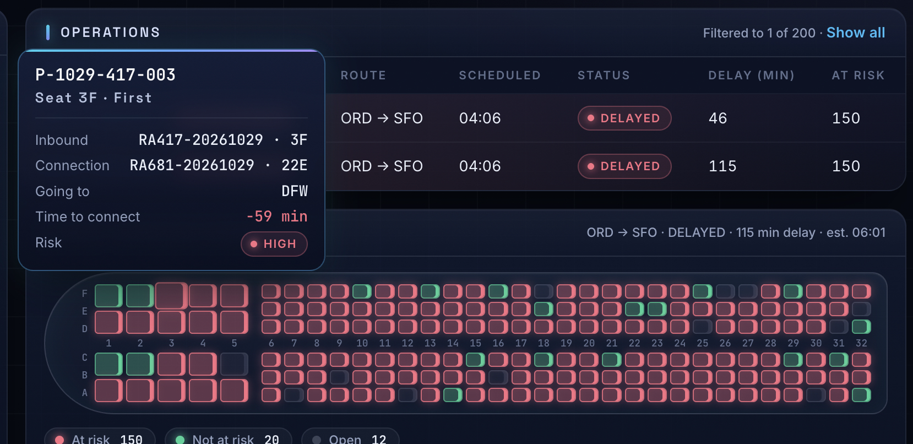

## Lab 4 — Build the recovery agent

Now for River Air's second challenge. RA417 is running almost two hours late, 150 passengers are about to miss their connections, and the Grand Hyatt's rooms are going fast. A team working through them one call at a time won't rebook everyone before the hotels sell out. **An agent can!**

In this lab, you build a streaming agent that runs inside Flink, on Claude hosted in Confluent Cloud. The moment a passenger turns HIGH risk, it checks live flights and hotel rooms through the Real-Time Context Engine (RTCE) and writes two rebooking offers: the next two flights to their final destination, with a hotel when the wait is overnight. No batch job, no polling, and no model keys to manage: the agent itself is a few SQL statements.

1. Connect Flink to RTCE, so the agent can look up live flights and hotel rooms. In a terminal, from the repo's root folder (`quickstart-streamhouse`), run:

    ```bash
    uv run setup-rtce --agent-connection
    ```

    It creates `rtce-connection`, which the agent's tool uses in step 3. The API key stays in the connection, so your SQL holds no secrets.

    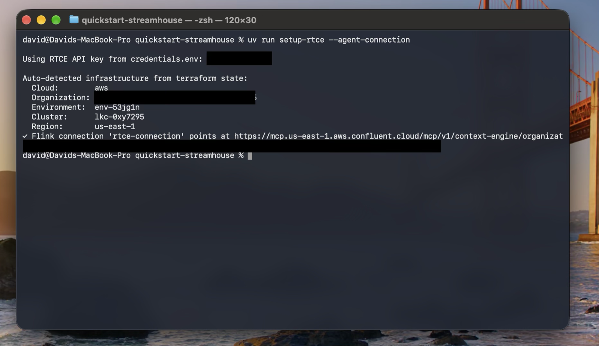

2. Give the agent a feed of impacted passengers. `AI_RUN_AGENT` reads only append-only input, and `passenger_state` is an upsert table, so two staging tables turn its changes into new rows. 

    Back in your [Flink SQL workspace](https://confluent.cloud/go/flink), run each statement in its own cell:

    `passenger_state_changes` records every change to a passenger's connection risk as a new row:

    ```sql
    CREATE OR ALTER MATERIALIZED TABLE passenger_state_changes (
      `key` STRING NOT NULL,
      inbound_flight_id STRING,
      connecting_flight_id STRING,
      final_destination STRING,
      risk STRING,
      inbound_estimated_time TIMESTAMP(3)
    ) DISTRIBUTED BY (`key`) INTO 4 BUCKETS
    WITH (
      'changelog.mode' = 'append',
      'key.format' = 'raw',
      'value.format' = 'avro-registry'
    )
    START_MODE = FROM_BEGINNING
    AS SELECT
      `key`,
      inbound_flight_id,
      connecting_flight_id,
      final_destination,
      risk,
      inbound_estimated_time
    FROM TO_CHANGELOG(
      input      => TABLE passenger_state PARTITION BY `key`,
      op_mapping => MAP['INSERT, UPDATE_AFTER', 'UPSERT']
    );
    ```
    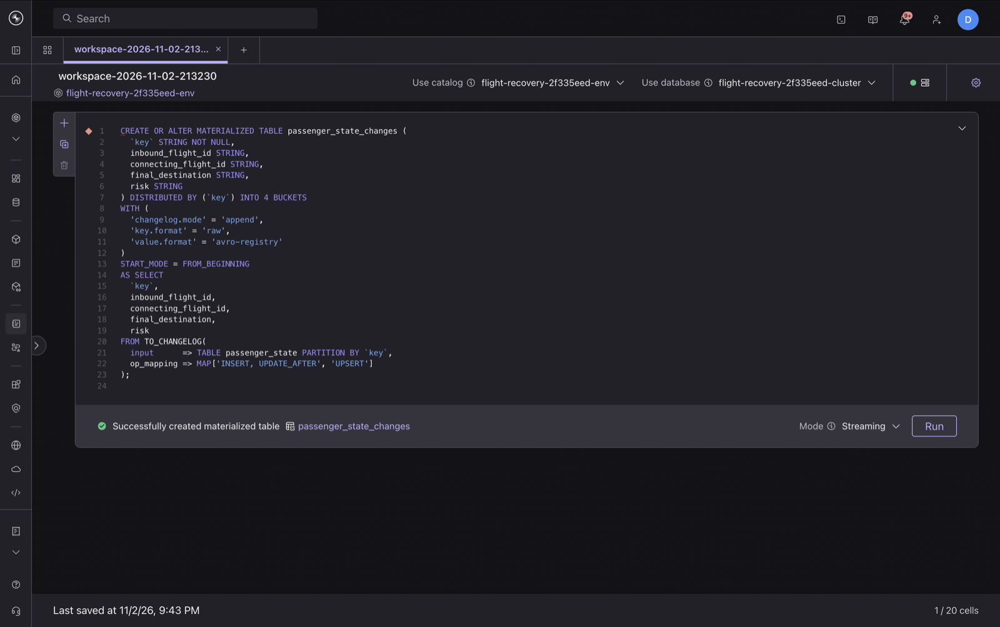

    `impacted_passengers` keeps one row per passenger on RA417, RA183, and RA185, from the moment they first turn `HIGH` while their inbound flight is still due to land. This is the agent's to-do list:

    ```sql
    SET 'sql.local-time-zone' = 'UTC';
    CREATE OR ALTER MATERIALIZED TABLE impacted_passengers (
      `key` STRING NOT NULL,
      inbound_flight_id STRING,
      connecting_flight_id STRING,
      final_destination STRING,
      impacted_at TIMESTAMP(3)
    ) DISTRIBUTED BY (`key`) INTO 4 BUCKETS
    WITH (
      'changelog.mode' = 'append',
      'key.format' = 'raw',
      'value.format' = 'avro-registry'
    )
    START_MODE = FROM_BEGINNING
    AS WITH first_high AS (
      SELECT
        `key`,
        inbound_flight_id,
        connecting_flight_id,
        final_destination,
        CAST(MIN($rowtime) AS TIMESTAMP(3)) AS impacted_at
      FROM passenger_state_changes
      WHERE risk = 'HIGH'
        AND SPLIT_INDEX(inbound_flight_id, '-', 0) IN ('RA417', 'RA183', 'RA185')
        AND CAST($rowtime AS TIMESTAMP(3)) < inbound_estimated_time
      GROUP BY `key`, inbound_flight_id, connecting_flight_id, final_destination
    )
    SELECT `key`, inbound_flight_id, connecting_flight_id, final_destination, impacted_at
    FROM TO_CHANGELOG(
      input      => TABLE first_high PARTITION BY `key`,
      op_mapping => MAP['INSERT', 'FIRST_HIGH']
    );
    ```
    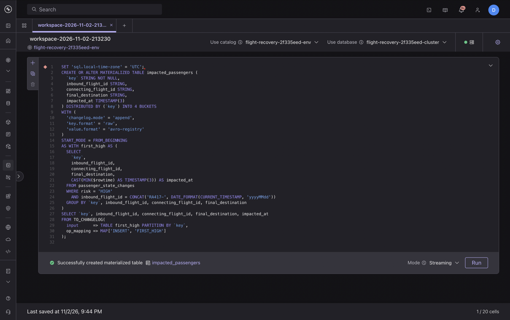

    > [!NOTE]
    >
    > For this workshop only, the filter keeps the agent to three flights to reduce LLM requests. In production, you would open it up to all flights.

3. Create the tool that gives the agent live context. It exposes RTCE's `getMetadata` and `queryData` tools through `rtce-connection`:

    ```sql
    CREATE TOOL IF NOT EXISTS hotel_inventory_live_context
    USING CONNECTION `rtce-connection`
    WITH (
      'type' = 'mcp',
      'allowed_tools' = 'getMetadata,queryData',
      'request_timeout' = '30'
    );
    ```
    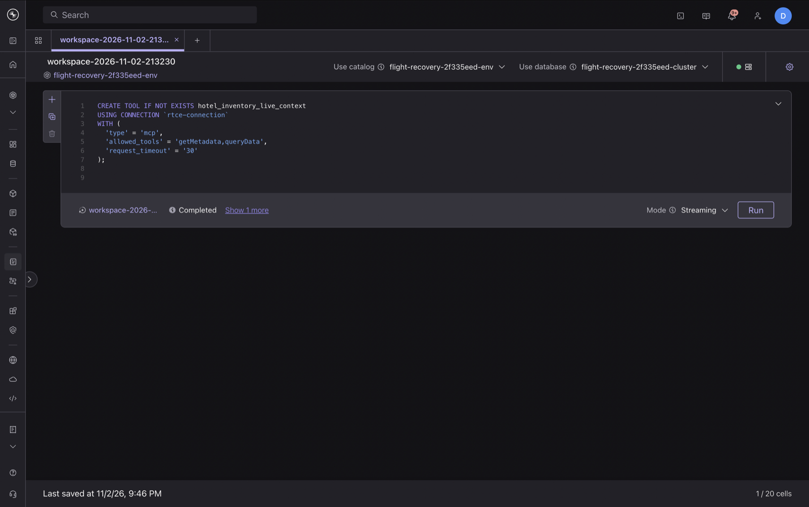

4. Create the agent. Its model, `passenger_recovery_model`, is a Claude model hosted in Confluent Cloud. It's already deployed for you.

    Its prompt tells it to:
    - Offer the first two flights that leave 45+ minutes after the passenger lands.
    - Add a hotel if the flight leaves 6+ hours later.
    - Pick hotels in order, skipping sold-out ones.

    ```sql
    CREATE AGENT IF NOT EXISTS passenger_recovery_agent
    USING MODEL passenger_recovery_model
    USING PROMPT 'You are the River Air recovery agent. The passengers on the inbound flight in the task
    will miss their connections to the final destination, and they all get the same two offers.
    Use the queryData tool (arguments: topic_name, query, max_result_rows) to run the three queries in the task.
    The queries already use the right column names, so run them as given without calling getMetadata first.

    1. inbound_query returns the inbound flight. Its estimated_time is when the passenger lands at SFO.
    2. departures_query returns flights from SFO to the final destination. Offer the first two flights whose
       estimated_time is at least 45 minutes after the inbound estimated_time. Skip CANCELLED flights.
    3. An offered flight that leaves 6 hours or more after the inbound estimated_time needs a hotel.
       Run hotel_query. List the hotels that have available_rooms above 0 in this order: Grand Hyatt at SFO,
       SFO Airport Marriott Waterfront, Hilton SFO Airport Bayfront. The first offer uses the
       first hotel in that list and the second offer uses the second. The hotel cost is that hotel nightly_rate.
       A flight that leaves sooner needs no hotel: write NONE for its hotel and cost.

    Reply with exactly one line and nothing else:
    O1_FLIGHT=<flight key>;O1_HOTEL=<hotel name or NONE>;O1_COST=<nightly_rate or NONE>;O2_FLIGHT=<flight key or NONE>;O2_HOTEL=<hotel name or NONE>;O2_COST=<nightly_rate or NONE>'
    USING TOOLS hotel_inventory_live_context
    WITH (
      'max_iterations' = '15',
      'handle_exception' = 'continue'
    );
    ```

5. Confirm the agent exists:

    ```sql
    SHOW AGENTS;
    ```
    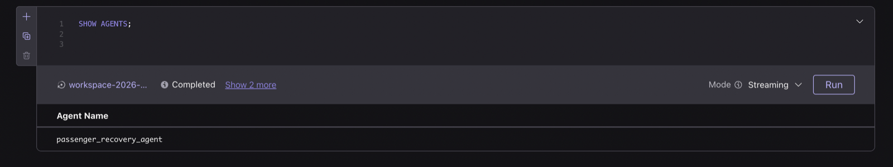

> [!NOTE]
>
> You could set up this agent for passengers connecting in any city. This workshop sets it up for SFO, River Air's hub, to keep the scope small.

6. Start the agent:

    ```sql
    SET 'sql.local-time-zone' = 'UTC';
    INSERT INTO passenger_recommendations
    WITH first_group AS (
      SELECT
        CONCAT(inbound_flight_id, '>', final_destination) AS group_key,
        inbound_flight_id,
        final_destination,
        MIN(impacted_at) AS impacted_at
      FROM impacted_passengers
      GROUP BY inbound_flight_id, final_destination
    ),
    new_groups AS (
      SELECT *
      FROM TO_CHANGELOG(
        input      => TABLE first_group PARTITION BY group_key,
        op_mapping => MAP['INSERT', 'FIRST_GROUP']
      )
    ),
    plans AS (
      SELECT g.inbound_flight_id, g.final_destination, r.response
      FROM new_groups g,
      LATERAL TABLE(AI_RUN_AGENT(
        'passenger_recovery_agent',
        CONCAT(
          'inbound_flight_id=', g.inbound_flight_id,
          '; final_destination=', g.final_destination,
          '; inbound_query=SELECT * FROM `flight_status` WHERE "KEY" = ''', g.inbound_flight_id, ''' LIMIT 1',
          '; departures_query=SELECT * FROM `flight_status` WHERE origin = ''SFO'' AND destination = ''',
          g.final_destination, ''' AND scheduled_time >= TIMESTAMP ''',
          DATE_FORMAT(g.impacted_at - INTERVAL '1' HOUR, 'yyyy-MM-dd HH:mm:ss'),
          ''' ORDER BY scheduled_time ASC LIMIT 12',
          '; hotel_query=SELECT * FROM `hotel_inventory` LIMIT 10'
        ),
        g.group_key
      )) AS r(agent_status, response)
    ),
    offers AS (
      SELECT
        h.`key` AS passenger_id,
        h.impacted_at,
        o.n,
        NULLIF(REGEXP_EXTRACT(p.response, CONCAT('O', o.n, '_FLIGHT=([^;\s]+)'), 1), 'NONE') AS recommended_flight_id,
        NULLIF(TRIM(REGEXP_EXTRACT(p.response, CONCAT('O', o.n, '_HOTEL=([^;\n]+)'), 1)), 'NONE') AS hotel_name,
        TRY_CAST(REGEXP_EXTRACT(p.response, CONCAT('O', o.n, '_COST=([0-9.]+)'), 1) AS DECIMAL(10, 2)) AS hotel_cost
      FROM impacted_passengers h
      JOIN plans p
        ON h.inbound_flight_id = p.inbound_flight_id AND h.final_destination = p.final_destination
      CROSS JOIN UNNEST(ARRAY['1', '2']) AS o(n)
    )
    SELECT
      CONCAT(passenger_id, '-O', n) AS `key`,
      passenger_id,
      recommended_flight_id,
      hotel_name,
      'OFFERED' AS status,
      hotel_cost,
      impacted_at,
      CAST(CURRENT_TIMESTAMP AS TIMESTAMP(3)) AS recommended_at
    FROM offers
    WHERE recommended_flight_id IS NOT NULL;
    ```

> [!WARNING]
>
> This statement must keep running for the rest of the workshop. Don't stop it.

7. Watch the offers arrive:

    ```sql
    SELECT `key`, recommended_flight_id, hotel_name, hotel_cost, status
    FROM passenger_recommendations
    WHERE passenger_id LIKE 'P-____-417-%';
    ```

    Within a few minutes, each of RA417's 150 at-risk passengers has two offers for tomorrow morning: the first with the Grand Hyatt at SFO ($329), the second with the SFO Airport Marriott Waterfront ($229). If the Grand Hyatt had already sold out when your agent ran, it offers the Marriott and the Hilton instead. The agent also writes offers for RA183 from Boston (40 passengers, who turn HIGH 26 to 32 minutes into the stream) and RA185 from Las Vegas (30 passengers, 52 to 55 minutes in, after the Grand Hyatt sells out, so they get the Marriott and the Hilton). To see them, change `417` in the query to `183` or `185`.

    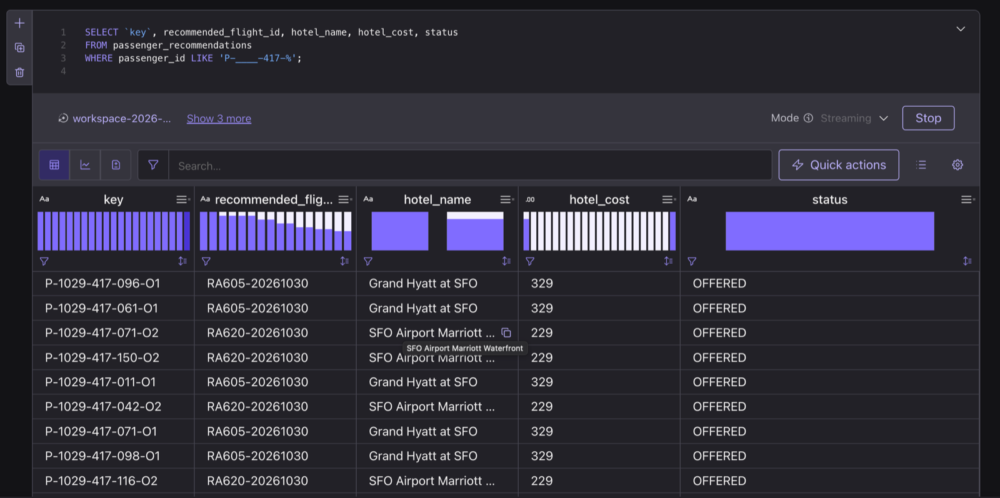

## Lab 5 — Recover a passenger

Now you see the recovery from the passenger's side. Some of the agent's offers include a room at the Grand Hyatt, which is selling out fast. An app working from stale data would book a room that's already gone.

With a Streamhouse architecture, that's not an issue: River Air's app always has the current state of hotel availability. It checks the rooms left with a Lightning Query when a passenger selects an offer, swaps in another hotel if the room is gone, and checks again at booking.

1. In the [dashboard app](http://127.0.0.1:8000), click the **RA417-…** flight, then click a delayed passenger's seat. **Scroll to Passenger recovery**, which shows their two offers. **These offers come from the agent you built!**

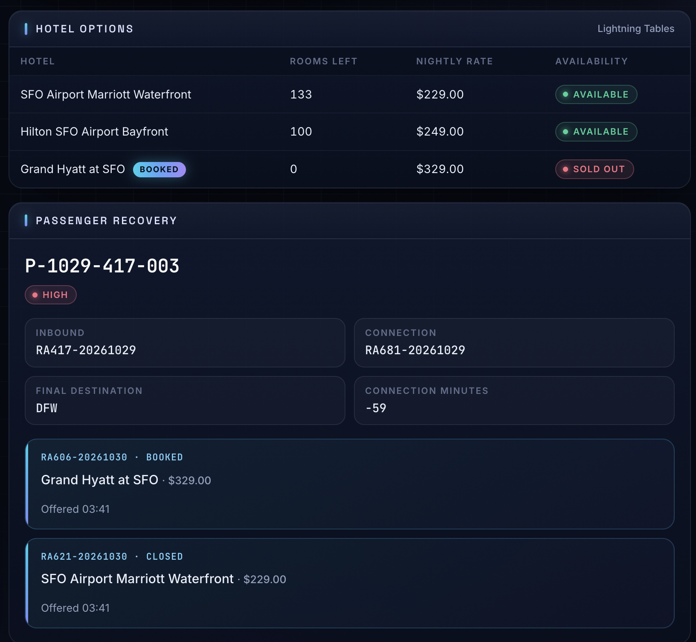

2. Watch the Grand Hyatt in **Hotel options** for a minute or so. The hotel partner's feed updates each hotel's rooms left every 15 seconds, and the dashboard shows them in real time using **Lightning Queries** on `hotel_inventory`. You don't need to wait for it to sell out.

3. Click **Select** on either offer, then click **Book**.

    The app checks the hotel's live room count at each click, books that offer, and closes the other one. **Booked** goes up by one. It also climbs on its own as passengers on other flights book.

    If the Grand Hyatt has already sold out when you select it, the app swaps in another hotel:

    - The status bar at the bottom reads **Grand Hyatt at SFO is sold out. Now offering Hilton SFO Airport Bayfront.**
    - The offer now shows the Hilton at $249.

    The passenger's two choices are then the Marriott and the Hilton.

4. Back in your SQL workspace, see what changed:

    ```sql
    SELECT `key`, recommended_flight_id, hotel_name, status
    FROM passenger_recommendations
    WHERE passenger_id LIKE 'P-____-417-%' AND status IN ('BOOKED', 'CLOSED');
    ```

    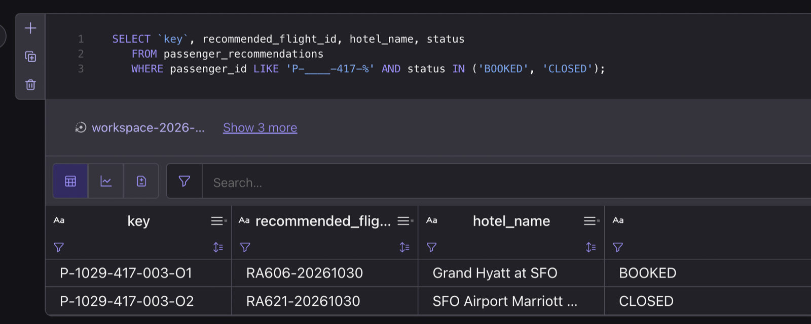

## 🧩 (Optional) Challenge — Ask your coding agent about the live operation

Any MCP client can query the topics you turned on in Lab 3. This bonus challenge requires Claude Code or Codex; do it before you clean up.

<details>
<summary>Install Claude Code</summary>

On Mac:

```bash
brew install --cask claude-code
```

On Windows:

```powershell
winget install --id Anthropic.ClaudeCode -e
```

</details>

1. Register RTCE with your coding agent. In your first terminal:

    ```bash
    uv run setup-rtce
    ```

    Choose Claude Code or Codex. It reuses your API key, connects every demo topic (and turns on any you skipped in Lab 3), and checks the connection. Restart your coding agent afterward.

    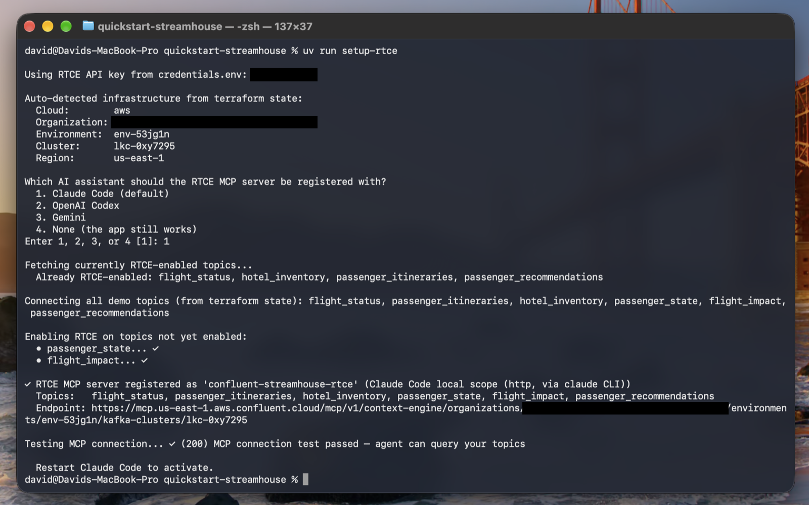

> [!NOTE]
>
> The connection can take a minute or two. In Claude Code, run `/mcp` and check that `confluent-streamhouse-rtce` shows as connected.

2. Start your coding agent in the `quickstart-streamhouse` folder (for example, `claude`) and ask:

    ```text
    What topics do I have access to in the Real-Time Context Engine?
    ```
    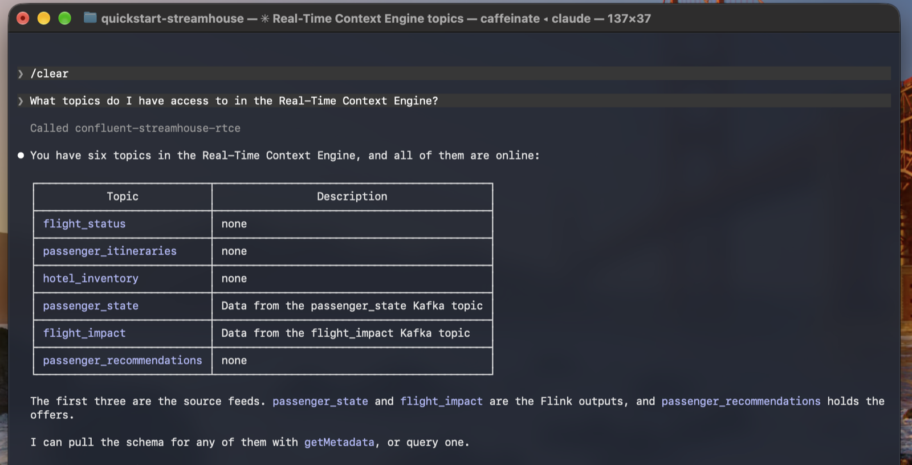

    ```text
    Which flight today puts the most passengers at risk of missing a connection, and where are they headed?
    ```
    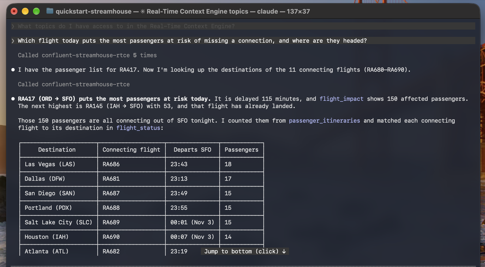

    ```text
    How many rooms does each SFO hotel have left right now?
    ```
    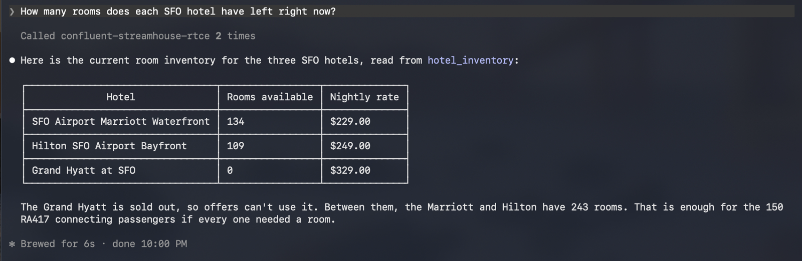

RTCE gives your agent three tools, `listTopics`, `getMetadata`, and `queryData`, and exposes only topics whose context engine is on. Watch the tool calls: the answers come from your live data, not from the model's memory.

## Conclusion

Congratulations! You built a Streamhouse. It turns raw flight and itinerary feeds into live connection risk with Flink, serves that state to an app through Lightning Tables, and gives a streaming agent the same live context through RTCE so it can rebook stranded passengers on its own. Every consumer works from one current view of the operation.

## Clean up

1. Stop the app and the generator: press **Ctrl-C** in their terminal windows.

2. In your first terminal window, tear everything down and answer `y`:

    ```bash
    uv run destroy
    ```

    It deletes your environment and everything in it: the cluster, the topics, the tables and agent you created, and the Flink connection.

    <details>
    <summary>Remove only this lab</summary>

    This keeps the shared environment, cluster, and Flink pool, and Agentic Pit Decisions if you deployed it:

    ```bash
    uv run destroy --lab flight-disruptions
    ```

    </details>

---

**← Back to Overview**: [README](../../README.md)
