# River Air Flight Recovery Workshop


In this workshop, you run operations for River Air, an airline with 180 flights a day through its SFO hub. Flight RA417 from Chicago is about to run almost two hours late, and 150 of its passengers will miss their connections. Starting from three raw feeds (flight status, passenger itineraries, and hotel rooms), you'll compute every passenger's connection risk with Flink, serve the live state to an operations app through Lightning Tables, and build a streaming agent that reads live flights and hotel rooms through the Real-Time Context Engine (RTCE) to offer each stranded passenger a new flight and a hotel. 

By the end, you'll know how the Streamhouse on Confluent Cloud keeps one live view of the business for apps, analytics, and AI agents alike.

> [!NOTE]
>
> **This workshop takes about 60 minutes to complete.**

| Part | Minutes | What you do |
|---|---|---|
| [Setup](#setup) | 15 | Create your account, install the tools, deploy, and start the data |
| [Lab 1](#lab-1--explore-the-live-feeds) | 5 | Explore the live feeds |
| [Lab 2](#lab-2--compute-connection-risk-with-flink) | 10 | Compute every passenger's connection risk with Flink |
| [Lab 3](#lab-3--serve-the-live-view-with-lightning-tables-and-rtce) | 10 | Turn on Lightning Tables and RTCE, then open the operations app |
| [Lab 4](#lab-4--build-the-recovery-agent) | 10 | Build the recovery agent |
| [Lab 5](#lab-5--recover-a-passenger) | 5 | Rebook a passenger when their hotel sells out |
| [Bonus](#bonus--ask-your-coding-agent-about-the-live-operation) | optional | Ask Claude Code or Codex about the live operation over MCP |
| [Clean up](#clean-up) | 5 | Tear everything down |

## Setup

### 1. Create your Confluent Cloud account

1. [Sign up for Confluent Cloud](https://www.confluent.io/confluent-cloud/tryfree/), or log in if you already have an account.

2. Add a payment method. **Terraform can't create your cluster without one.**

    1. Go to **[Billing & payment](https://confluent.cloud/settings/billing/payment)**.
    2. Open the **Payment details and contacts** tab.
    3. Click **Add credit card / bank account**, enter your card details, and click **Save**.

### 2. Install the tools

<details>
<summary>for Mac</summary>

No Homebrew yet? Install it from [brew.sh](https://brew.sh) first.

```bash
brew install git uv
brew tap hashicorp/tap
brew install hashicorp/tap/terraform
brew install --cask confluent-cli
```

</details>

<details>
<summary>for Windows</summary>

In PowerShell:

```powershell
winget install --id Git.Git -e
winget install --id astral-sh.uv -e
winget install --id Hashicorp.Terraform -e
```

Download the latest `confluent_*_windows_amd64.zip` from the [Confluent CLI releases](https://github.com/confluentinc/cli/releases/latest), unzip it, and add the folder that contains `confluent.exe` to your `PATH`.

Close and reopen the terminal so every tool is on your `PATH`.

</details>

Check that each tool prints a version:

```bash
git --version
uv --version
terraform -version
confluent version
```

### 3. Get the code

```bash
git clone https://github.com/confluentinc/quickstart-streamhouse.git
cd quickstart-streamhouse
uv sync
```

### 4. Deploy your environment

```bash
uv run deploy --workshop
```

Deploy asks for the following:

| Prompt | Answer |
|---|---|
| `Email (Enter to skip)` and `Password` | The email and password you use for Confluent Cloud. **Single sign-on?** Press **Ctrl-C**, run `confluent login --sso`, then run deploy again and press **Enter** at the email prompt. |
| `Generate new Confluent Cloud API keys? (y/n)` | Enter `y` the first time running the workshop. |
| `Confluent Cloud API Key` and `Confluent Cloud API Secret` | Press **Enter** twice to keep the key that deploy just created. |
| `Ready to deploy? (y/n)` | Enter `y` |

**Deploy takes about 10 minutes to create all of the workshop infrastructure and source topics.** When finished, you'll see your environment and cluster names, which you need in Lab 2:

```text
Environment name: flight-recovery-1a2b3c4d-env
Cluster name: flight-recovery-1a2b3c4d-cluster
```

### 5. Start the datagen

Open a **second terminal** in the `quickstart-streamhouse` folder and start the generator:

```bash
uv run airport-datagen --skip-history
```

It publishes today's 180 flights, about 13,000 passenger itineraries, tomorrow's schedule, and three hotels, then streams live updates for 90 minutes.

> [!WARNING]
>
> **Leave this terminal running for the whole workshop.** If you stop it, the flights stop updating. If it stops by accident, run `uv run airport-datagen --resume` to pick the stream back up on the same clock.

## Lab 1 — Explore the live feeds

River Air's data comes from different systems: itineraries from ticketing, flight status from the airports' operational databases, and hotel rooms from a partner. Let's look at them as they arrive.

1. Open [Confluent Cloud](https://confluent.cloud). Select **Environments**, then your environment (`flight-recovery-…-env`), then **Clusters** and your cluster.

2. Select **Topics**. You see the four topics deploy created, each tagged with the kind of data it holds: `flight_status`, `passenger_itineraries`, `hotel_inventory`, and `passenger_recommendations`.

3. Explore the topics by clicking a topic name, then selecting **Messages** to view some of the incoming messages, their keys, and values. 

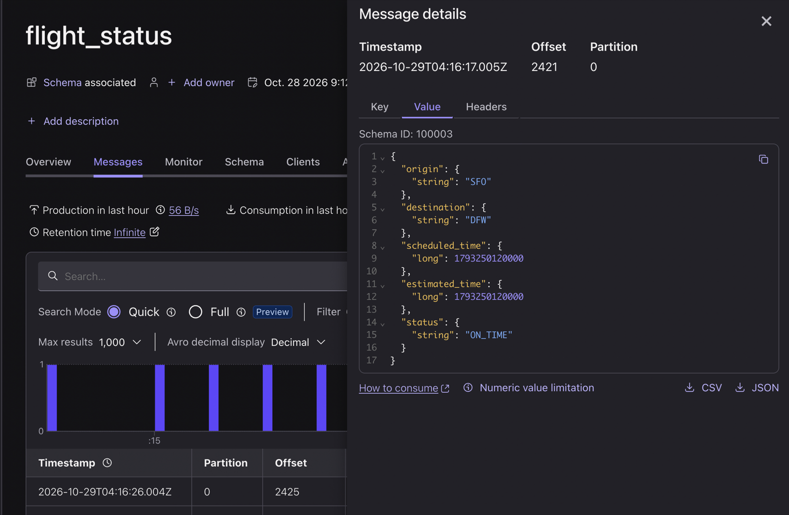

## Lab 2 — Compute connection risk with Flink

Now we'll use Flink to join every itinerary to the live status of both of its flights and keep the result current as flights change.

1. In your Confluent Cloud environment, open **Flink** from the left menu, go to the **Compute pools** tab, select  **SQL Workspace** on the `flight-recovery-…-compute-pool` pool, then click **Open SQL workspace**. Above the editor, set the **catalog** to your environment and the **database** to your cluster.

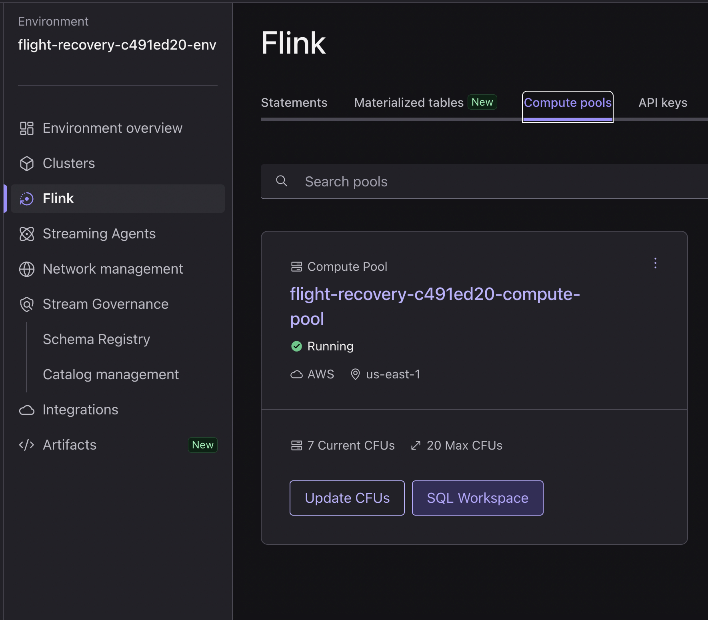

2. Check the source tables:

    ```sql
    SHOW TABLES;
    ```

    | Table | What it holds |
    |---|---|
    | `flight_status` | One row per flight: route, scheduled and estimated time, status |
    | `passenger_itineraries` | One row per passenger: inbound flight and seat, connecting flight and seat (null when the trip ends at SFO) |
    | `hotel_inventory` | One row per hotel: rooms left and nightly rate |
    | `passenger_recommendations` | The rebooking offers. The generator writes every other flight's, and we'll create the agent for flight RA417's recommendations in Lab 4 |

3. Create `passenger_state`. Paste this whole statement into one cell and run it:

    ```sql
    CREATE OR ALTER MATERIALIZED TABLE passenger_state (
      `key` STRING NOT NULL,
      inbound_flight_id STRING,
      inbound_seat STRING,
      connecting_flight_id STRING,
      connecting_seat STRING,
      final_destination STRING,
      connection_minutes INT,
      risk STRING,
      PRIMARY KEY (`key`) NOT ENFORCED
    ) DISTRIBUTED BY (`key`) INTO 1 BUCKETS
    WITH (
      'changelog.mode' = 'upsert',
      'key.format' = 'raw',
      'kafka.cleanup-policy' = 'compact',
      'value.format' = 'avro-registry'
    )
    START_MODE = FROM_BEGINNING
    AS SELECT
      p.`key`,
      p.inbound_flight_id,
      p.inbound_seat,
      p.connecting_flight_id,
      p.connecting_seat,
      COALESCE(onward.destination, inbound.destination) AS final_destination,
      TIMESTAMPDIFF(MINUTE, inbound.estimated_time, onward.estimated_time) AS connection_minutes,
      CASE
        WHEN p.connecting_flight_id IS NULL THEN 'NO_CONNECTION'
        WHEN TIMESTAMPDIFF(MINUTE, inbound.estimated_time, onward.estimated_time) < 45 THEN 'HIGH'
        ELSE 'OK'
      END AS risk
    FROM passenger_itineraries p
    JOIN flight_status inbound ON p.inbound_flight_id = inbound.`key`
    LEFT JOIN flight_status onward ON p.connecting_flight_id = onward.`key`;
    ```

    This is a **materialized table**: one object that owns both the table and the continuous query that keeps it current. It joins each itinerary to its inbound flight and, when there is one, its connecting flight.

4. In a new cell, create `flight_impact`, which keeps each flight's delay and counts its HIGH-risk passengers:

    ```sql
    CREATE OR ALTER MATERIALIZED TABLE flight_impact (
      `key` STRING NOT NULL,
      origin STRING,
      destination STRING,
      scheduled_time TIMESTAMP(3),
      status STRING,
      delay_minutes INT,
      affected_passengers INT,
      PRIMARY KEY (`key`) NOT ENFORCED
    ) DISTRIBUTED BY (`key`) INTO 1 BUCKETS
    WITH (
      'changelog.mode' = 'upsert',
      'key.format' = 'raw',
      'kafka.cleanup-policy' = 'compact',
      'value.format' = 'avro-registry'
    )
    START_MODE = FROM_BEGINNING
    AS SELECT
      f.`key`,
      f.origin,
      f.destination,
      f.scheduled_time,
      f.status,
      TIMESTAMPDIFF(MINUTE, f.scheduled_time, f.estimated_time) AS delay_minutes,
      COALESCE(impact.affected_passengers, 0) AS affected_passengers
    FROM flight_status f
    LEFT JOIN (
      SELECT inbound_flight_id, CAST(COUNT(*) FILTER (WHERE risk = 'HIGH') AS INT) AS affected_passengers
      FROM passenger_state /*+ OPTIONS('kafka.consumer.isolation-level' = 'read-uncommitted') */
      GROUP BY inbound_flight_id
    ) impact ON f.`key` = impact.inbound_flight_id;
    ```

> [!WARNING]
>
> Both tables keep running in the background for the rest of the workshop. Don't stop or delete their statements.

5. Watch RA417's passengers in a new cell:

    ```sql
    SELECT `key`, inbound_seat, final_destination, connection_minutes, risk
    FROM passenger_state
    WHERE inbound_flight_id LIKE 'RA417-%';
    ```

    As the flight is further delayed, you'll continue to see passengers delay risk change from "OK" to "HIGH".

    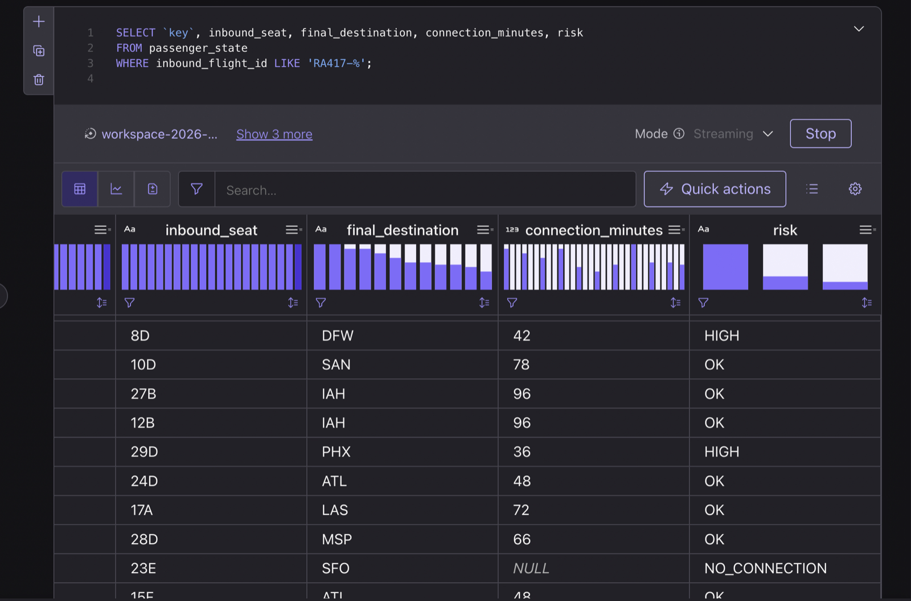

6. Check the flight itself:

    ```sql
    SELECT `key`, status, delay_minutes, affected_passengers
    FROM flight_impact
    WHERE `key` LIKE 'RA417-%';
    ```

    As today's flight RA417 becomes further delayed, the number of impacted passengers increases. 

    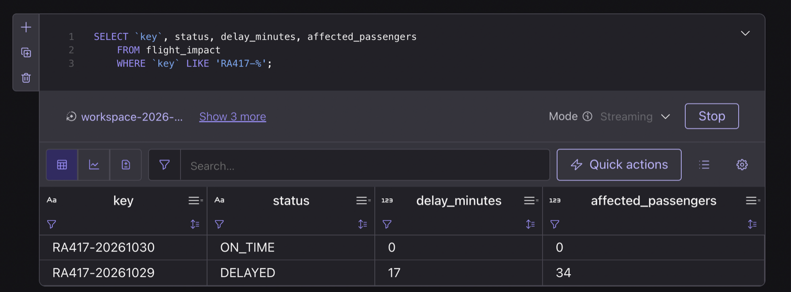

> [!NOTE]
>
> Stop each `SELECT` statement when you're done with it, so your compute pool has room for Lab 4.

## Lab 3 — Serve the live view with Lightning Tables and RTCE

Enabling Lightning Tables for a topic does two things. Confluent keeps a low-latency table of the topic's latest rows, which apps query as **Lightning Tables**, and it exposes the topic to AI agents over MCP.

1. Back in the Console, open your cluster's **Topics**. `passenger_state` and `flight_impact` are there now; we created them with Flink in Lab 2.

2. Find the **Lightning Table** column (scroll right if you need to) and click **+ Enable** for `flight_status`.

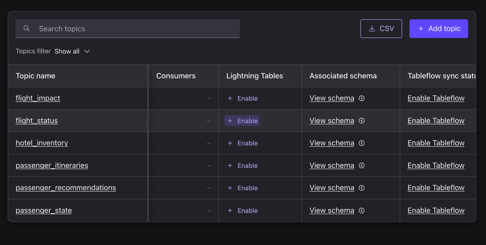

3. In the **Enable Lightning Table** panel, click **Enable**. It may take a minute for the query engine and infrastructure to be finalized, but you can go ahead and **close the panel and enable the next topics**.

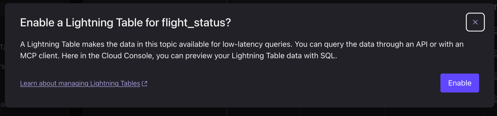

4. Repeat for `passenger_itineraries`, `passenger_state`, `flight_impact`, `passenger_recommendations`, and `hotel_inventory`.

> [!NOTE]
>
> Each topic shows **Provisioning** while Confluent loads its rows, then **Active**. Wait until all six show **Active** before you continue.

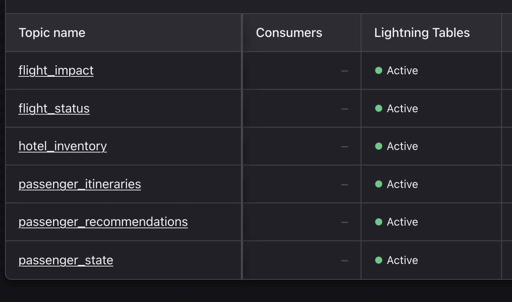

5. Run your first Lightning Query. **In a terminal window, run**:

    ```bash
    uv run setup-rtce --lightning hotel_inventory --run
    ```

    It prints the three hotels' current rows and the round-trip time. Wait one minute, then run the command again and you'll see that the Grand Hyatt has fewer rooms.

6. Open a **new terminal window** in the `quickstart-streamhouse` folder and start the dashboard app:

    ```bash
    uv run airport-app
    ```

    Open [http://127.0.0.1:8000](http://127.0.0.1:8000). **Leave this terminal running too.**

    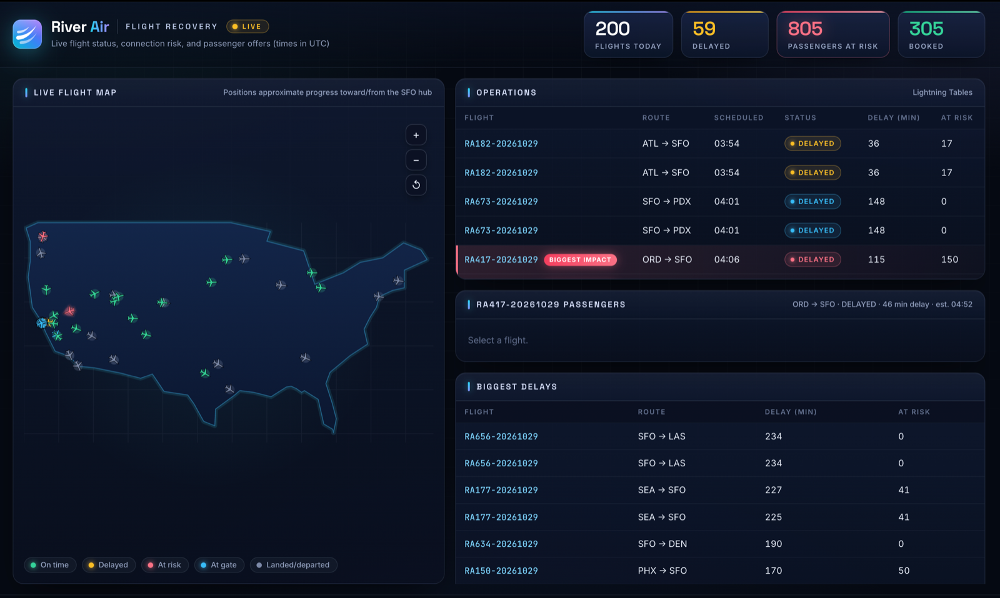

7. Explore the operations view:

    - **The counts bar** answers "what's our on-time performance today?" with **Flights today**, **Delayed**, **Passengers at risk**, and **Booked**.
    - **Operations** lists today's flights. Status and delay come straight from `flight_status`, so they change within seconds; **At risk** comes from Flink's `flight_impact`.
    - **Biggest delays** lists the ten latest flights. RA417 (ORD → SFO, up to 115 minutes late) is the one tagged **Biggest impact**, with **At risk 150**: other flights are later, but none strands as many passengers.
    - Click **RA417-…**. The seat map colors every seat red (at risk), green (not at risk), or grey (open). Hover a seat to see that passenger's itinerary. The table below lists RA417's passengers, `HIGH` first.

    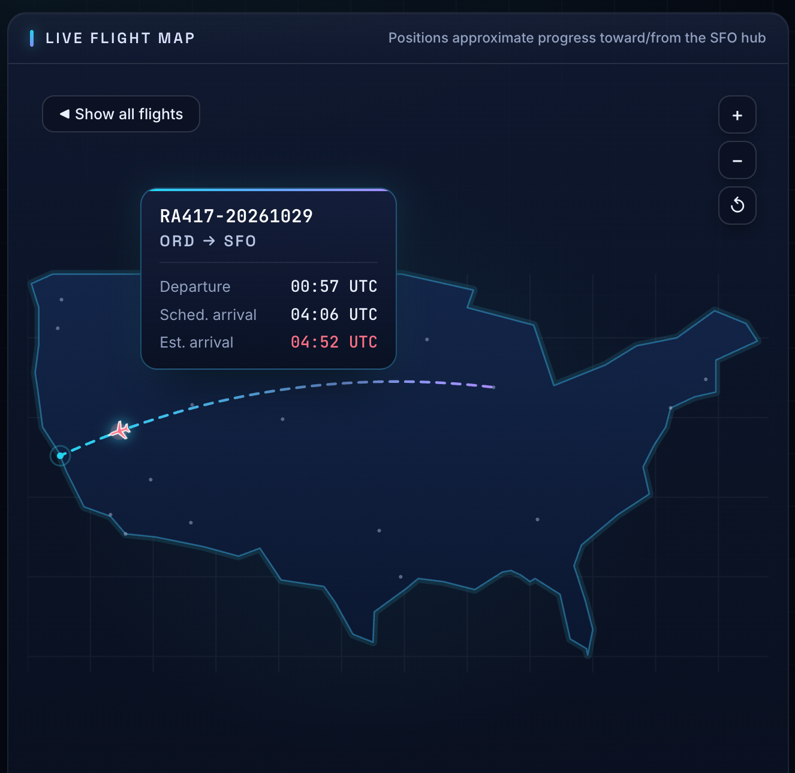
    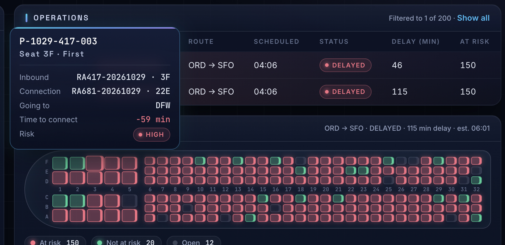


## Lab 4 — Build the recovery agent

Every HIGH-risk passenger gets two offers: the next two flights to their final destination, with a hotel when the wait is overnight. The agent runs on Claude, hosted in Confluent Cloud, and reads live flights and hotel rooms through RTCE.

1. Connect Flink to RTCE. **In your terminal window in the `quickstart-streamhouse` folder**, run:

    ```bash
    uv run setup-rtce --agent-connection
    ```

    It creates a Flink connection named `rtce-connection` that points at your cluster's RTCE endpoint and signs in with the API key in `credentials.env`, so no secret appears in your SQL.

2. Give the agent a feed of impacted passengers. `AI_RUN_AGENT` reads only append-only input, and `passenger_state` is an upsert table, so two staging tables turn its changes into new rows. 

    **In your SQL Workspace**, run each statement in its own cell:

    ```sql
    CREATE OR ALTER MATERIALIZED TABLE passenger_state_changes (
      `key` STRING NOT NULL,
      inbound_flight_id STRING,
      connecting_flight_id STRING,
      final_destination STRING,
      risk STRING
    ) DISTRIBUTED BY (`key`) INTO 4 BUCKETS
    WITH (
      'changelog.mode' = 'append',
      'key.format' = 'raw',
      'value.format' = 'avro-registry'
    )
    START_MODE = FROM_BEGINNING
    AS SELECT
      `key`,
      inbound_flight_id,
      connecting_flight_id,
      final_destination,
      risk
    FROM TO_CHANGELOG(
      input      => TABLE passenger_state PARTITION BY `key`,
      op_mapping => MAP['INSERT, UPDATE_AFTER', 'UPSERT']
    );
    ```

    ```sql
    SET 'sql.local-time-zone' = 'UTC';
    CREATE OR ALTER MATERIALIZED TABLE impacted_passengers (
      `key` STRING NOT NULL,
      inbound_flight_id STRING,
      connecting_flight_id STRING,
      final_destination STRING,
      impacted_at TIMESTAMP(3)
    ) DISTRIBUTED BY (`key`) INTO 4 BUCKETS
    WITH (
      'changelog.mode' = 'append',
      'key.format' = 'raw',
      'value.format' = 'avro-registry'
    )
    START_MODE = FROM_BEGINNING
    AS WITH first_high AS (
      SELECT
        `key`,
        inbound_flight_id,
        connecting_flight_id,
        final_destination,
        CAST(MIN($rowtime) AS TIMESTAMP(3)) AS impacted_at
      FROM passenger_state_changes
      WHERE risk = 'HIGH'
        AND inbound_flight_id = CONCAT('RA417-', DATE_FORMAT(CURRENT_TIMESTAMP, 'yyyyMMdd'))
      GROUP BY `key`, inbound_flight_id, connecting_flight_id, final_destination
    )
    SELECT `key`, inbound_flight_id, connecting_flight_id, final_destination, impacted_at
    FROM TO_CHANGELOG(
      input      => TABLE first_high PARTITION BY `key`,
      op_mapping => MAP['INSERT', 'FIRST_HIGH']
    );
    ```


3. Create the model, Claude Sonnet hosted in Confluent Cloud. There's no connection or key to manage, and your data stays in Confluent:

    ```sql
    CREATE MODEL IF NOT EXISTS passenger_recovery_model
    INPUT (prompt STRING)
    OUTPUT (response STRING)
    WITH (
      'provider' = 'confluent',
      'task' = 'text_generation',
      'confluent.model' = 'anthropic.claude-sonnet-4-6',
      'confluent.input_format' = 'confluent-chat',
      'confluent.params.max_tokens' = '1024'
    );
    ```

4. Create the tool that gives the agent live context. It exposes RTCE's `getMetadata` and `queryData` tools through `rtce-connection`:

    ```sql
    CREATE TOOL IF NOT EXISTS hotel_inventory_live_context
    USING CONNECTION `rtce-connection`
    WITH (
      'type' = 'mcp',
      'allowed_tools' = 'getMetadata,queryData',
      'request_timeout' = '30'
    );
    ```

5. Create the agent:

    ```sql
    CREATE AGENT IF NOT EXISTS passenger_recovery_agent
    USING MODEL passenger_recovery_model
    USING PROMPT 'You are the River Air recovery agent. The passengers on the inbound flight in the task
    will miss their connections to the final destination, and they all get the same two offers.
    Use the queryData tool (arguments: topic_name, query, max_result_rows) to run the three queries in the task.
    The queries already use the right column names, so run them as given without calling getMetadata first.

    1. inbound_query returns the inbound flight. Its estimated_time is when the passenger lands at SFO.
    2. departures_query returns flights from SFO to the final destination. Offer the first two flights whose
       estimated_time is at least 45 minutes after the inbound estimated_time. Skip CANCELLED flights.
    3. An offered flight that leaves 6 hours or more after the inbound estimated_time needs a hotel.
       Run hotel_query. List the hotels that have available_rooms above 0 in this order: Grand Hyatt at SFO,
       SFO Airport Marriott Waterfront, Hilton SFO Airport Bayfront. The first offer uses the
       first hotel in that list and the second offer uses the second. The hotel cost is that hotel nightly_rate.
       A flight that leaves sooner needs no hotel: write NONE for its hotel and cost.

    Reply with exactly one line and nothing else:
    O1_FLIGHT=<flight key>;O1_HOTEL=<hotel name or NONE>;O1_COST=<nightly_rate or NONE>;O2_FLIGHT=<flight key or NONE>;O2_HOTEL=<hotel name or NONE>;O2_COST=<nightly_rate or NONE>'
    USING TOOLS hotel_inventory_live_context
    WITH (
      'max_iterations' = '15',
      'handle_exception' = 'continue'
    );
    ```

    Its prompt has three rules: 1. Offer the first two departures to the passenger's destination at least 45 minutes after they land 2. Add a hotel when the flight leaves six or more hours later, and 3. Take hotels in order of preference, skipping any with no rooms left.

6. Confirm the agent exists:

    ```sql
    SHOW AGENTS;
    ```

7. Start the agent:

    ```sql
    SET 'sql.local-time-zone' = 'UTC';
    INSERT INTO passenger_recommendations
    WITH first_group AS (
      SELECT
        CONCAT(inbound_flight_id, '>', final_destination) AS group_key,
        inbound_flight_id,
        final_destination,
        MIN(impacted_at) AS impacted_at
      FROM impacted_passengers
      GROUP BY inbound_flight_id, final_destination
    ),
    new_groups AS (
      SELECT *
      FROM TO_CHANGELOG(
        input      => TABLE first_group PARTITION BY group_key,
        op_mapping => MAP['INSERT', 'FIRST_GROUP']
      )
    ),
    plans AS (
      SELECT g.inbound_flight_id, g.final_destination, r.response
      FROM new_groups g,
      LATERAL TABLE(AI_RUN_AGENT(
        'passenger_recovery_agent',
        CONCAT(
          'inbound_flight_id=', g.inbound_flight_id,
          '; final_destination=', g.final_destination,
          '; inbound_query=SELECT * FROM `flight_status` WHERE "KEY" = ''', g.inbound_flight_id, ''' LIMIT 1',
          '; departures_query=SELECT * FROM `flight_status` WHERE origin = ''SFO'' AND destination = ''',
          g.final_destination, ''' AND scheduled_time >= TIMESTAMP ''',
          DATE_FORMAT(g.impacted_at - INTERVAL '1' HOUR, 'yyyy-MM-dd HH:mm:ss'),
          ''' ORDER BY scheduled_time ASC LIMIT 12',
          '; hotel_query=SELECT * FROM `hotel_inventory` LIMIT 10'
        ),
        g.group_key
      )) AS r(agent_status, response)
    ),
    offers AS (
      SELECT
        h.`key` AS passenger_id,
        h.impacted_at,
        o.n,
        NULLIF(REGEXP_EXTRACT(p.response, CONCAT('O', o.n, '_FLIGHT=([^;\s]+)'), 1), 'NONE') AS recommended_flight_id,
        NULLIF(TRIM(REGEXP_EXTRACT(p.response, CONCAT('O', o.n, '_HOTEL=([^;\n]+)'), 1)), 'NONE') AS hotel_name,
        TRY_CAST(REGEXP_EXTRACT(p.response, CONCAT('O', o.n, '_COST=([0-9.]+)'), 1) AS DECIMAL(10, 2)) AS hotel_cost
      FROM impacted_passengers h
      JOIN plans p
        ON h.inbound_flight_id = p.inbound_flight_id AND h.final_destination = p.final_destination
      CROSS JOIN UNNEST(ARRAY['1', '2']) AS o(n)
    )
    SELECT
      CONCAT(passenger_id, '-O', n) AS `key`,
      passenger_id,
      recommended_flight_id,
      hotel_name,
      'OFFERED' AS status,
      hotel_cost,
      impacted_at,
      CAST(CURRENT_TIMESTAMP AS TIMESTAMP(3)) AS recommended_at
    FROM offers
    WHERE recommended_flight_id IS NOT NULL;
    ```

> [!WARNING]
>
> This statement must keep running for the rest of the workshop. Don't stop it.

8. Watch the offers arrive:

    ```sql
    SELECT `key`, recommended_flight_id, hotel_name, hotel_cost, status
    FROM passenger_recommendations
    WHERE passenger_id LIKE 'P-____-417-%';
    ```

    Within a few minutes, each of RA417's 150 at-risk passengers has two offers for tomorrow morning: the first with the Grand Hyatt at SFO ($329), the second with the SFO Airport Marriott Waterfront ($229). If the Grand Hyatt had already sold out when your agent ran, it offers the Marriott and the Hilton instead.

    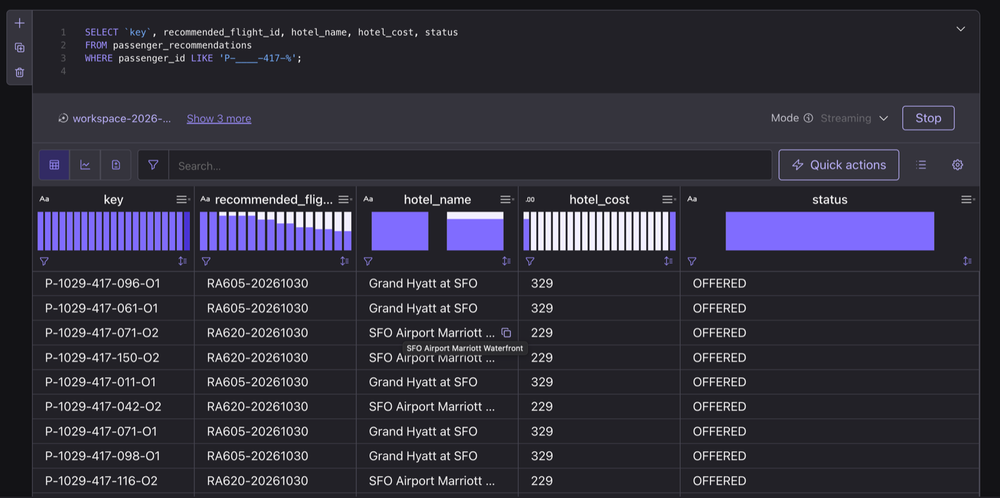

## Lab 5 — Recover a passenger

1. In the dashboard app, click **RA417-…**, then click a delayed passenger's seat. **Scroll to Passenger recovery**, which shows their two offers.

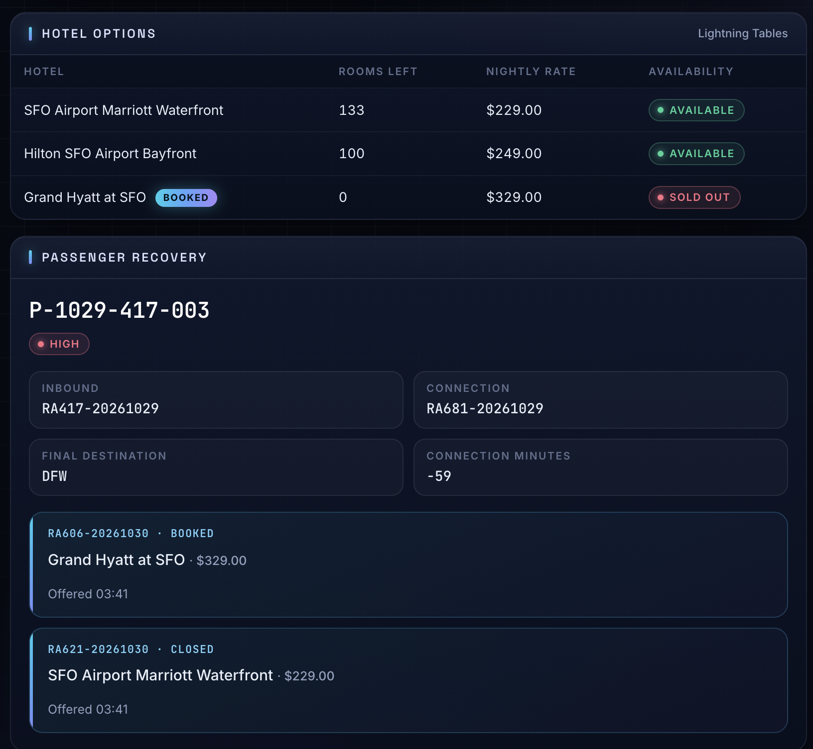

2. Watch the Grand Hyatt count down in **Hotel options**.

3. After the sellout, click **Select** on the Grand Hyatt offer. The app checks the hotel's rooms first, so the status bar at the bottom reads **Grand Hyatt at SFO is sold out. Now offering Hilton SFO Airport Bayfront.** That offer now has the Hilton ($249), and the passenger chooses between the Marriott and the Hilton.

4. Click **Select** on either offer, then **Book**. 

    The app re-checks the rooms, books the offer, and closes the other one. Your booking joins the count in **Booked**, which also climbs as other flights' passengers book.

5. Back in your SQL workspace, see what changed:

    ```sql
    SELECT `key`, recommended_flight_id, hotel_name, status
    FROM passenger_recommendations
    WHERE passenger_id LIKE 'P-____-417-%' AND status IN ('BOOKED', 'CLOSED');
    ```

    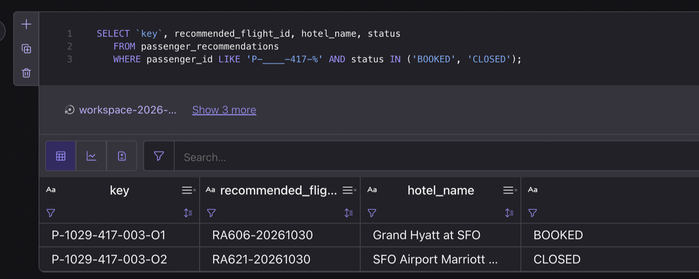

> [!NOTE]
>
> - **Ahead of the sellout?** Book another passenger in the meantime, or watch the Grand Hyatt's rooms run out in **Hotel options**.

## 🧩 Challenge — Ask your coding agent about the live operation

Any MCP client can query the topics you turned on in Lab 3. This bonus challenge requires Claude Code or Codex; do it before you clean up.

<details>
<summary>Install Claude Code</summary>

On Mac:

```bash
brew install --cask claude-code
```

On Windows:

```powershell
winget install --id Anthropic.ClaudeCode -e
```

</details>

1. Register RTCE with your coding agent. In your first terminal:

    ```bash
    uv run setup-rtce
    ```

    Choose Claude Code or Codex. It reuses your API key, connects every demo topic (and turns on any you skipped in Lab 3), and checks the connection. Restart your coding agent afterward.

> [!NOTE]
>
> The connection can take a minute or two. In Claude Code, run `/mcp` and check that `confluent-streamhouse-rtce` shows as connected.

2. Start your coding agent in the `quickstart-streamhouse` folder (for example, `claude`) and ask:

    ```text
    What topics do I have access to in the Real-Time Context Engine?
    ```

    ```text
    Which flight today puts the most passengers at risk of missing a connection, and where are they headed?
    ```

    ```text
    How many rooms does each SFO hotel have left right now?
    ```

    ```text
    Which RA417 passengers have booked a hotel, and which hotel did they pick?
    ```

RTCE gives your agent three tools, `listTopics`, `getMetadata`, and `queryData`, and exposes only topics whose context engine is on. Watch the tool calls: the answers come from your live data, not from the model's memory.

## Clean up

Congratulations! You built a pipeline that turns raw flight and itinerary feeds into live connection risk with Flink, served it to an app through Lightning Tables, and gave a streaming agent live context through RTCE so it could rebook stranded passengers on its own.

1. Stop the app and the generator: press **Ctrl-C** in their terminal windows.

2. In your first terminal window, tear everything down and answer `y`:

    ```bash
    uv run destroy
    ```

    It deletes your environment and everything in it: the cluster, the topics, the tables and agent you created, and the Flink connection.

3. Delete the setup service account. In Confluent Cloud, open the **Administration** menu (top right), select **Accounts & access**, open **Service accounts**, and delete each `flight-recovery-setup-sa-…` (one for every time you answered `y` to new keys).

4. Delete `credentials.env`, which holds your password:

    ```bash
    rm credentials.env
    ```

    On Windows PowerShell, run `Remove-Item credentials.env` instead.

---

**← Back to Overview**: [README](../README.md)
